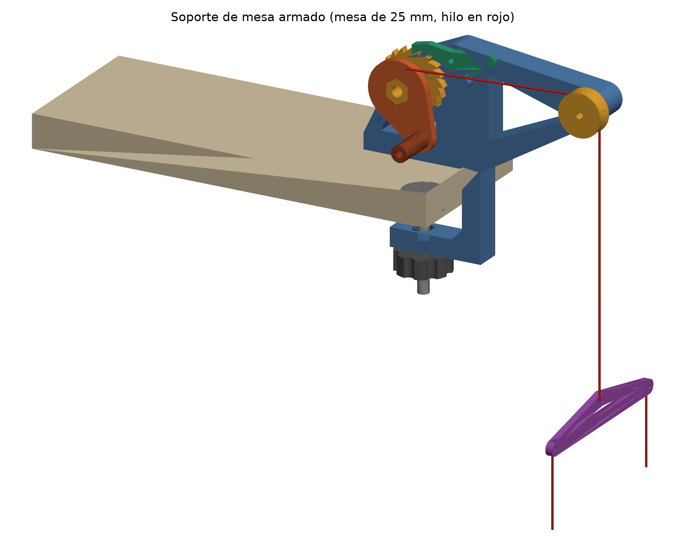

# Soporte de mesa con malacate de trinquete

Sostiene al robot, que está en el piso, con un hilo que baja del borde de la mesa. La
altura se regula con una manivela. Un trinquete con uñeta (el mismo principio que el
piñón libre de la bicicleta) deja enrollar libremente e impide que el peso desenrolle.
Para bajar se aprieta la palanquita.

Diseño del 26/10/2026 a partir del dibujo de Francisco. Es la **versión 1, todavía sin imprimir
ni probar** (BAN-001 y BAN-002 del backlog).



| Vista | Qué muestra |
|---|---|
| [conjunto_iso.png](vistas/conjunto_iso.png) | El conjunto montado en una mesa de 25 mm, con el hilo en rojo |
| [conjunto_frente.png](vistas/conjunto_frente.png) | Desde el lado de la manivela: sargento, brazo de 100 mm y polea |
| [trinquete_frente.png](vistas/trinquete_frente.png) | Sin la manivela: cómo engrana la uñeta y dónde apoya su resorte |
| [conjunto_costado.png](vistas/conjunto_costado.png) | Desde afuera de la mesa: el hilo, la polea y el carrete en el mismo plano; el balancín |

## Cómo funciona

Recorrido del hilo: carrete → polea de la punta (100 mm afuera del borde) → balancín → dos hilos al robot.

- **Subir:** girar la manivela en sentido **antihorario** (mirándola de frente). La uñeta
  hace clic diente por diente.
- **Bajar:** sostener la manivela, apretar hacia abajo la **cola de la uñeta** (la palanquita
  verde) y dejar que la manivela vuelva despacio. Si se suelta la cola, la uñeta vuelve
  sola por su resorte y traba en el diente siguiente (18° de giro, unos 4 mm de hilo).
- El **balancín** reparte un solo hilo en dos, separados 130 mm, así el robot queda colgado
  derecho sin tener que igualar dos carretes.

Las cargas son muy chicas: el robot pesa 962 g. Eso da 0,12 N·m en el carrete, 5 N en el
diente y 1 N·m de vuelco sobre el sargento. El dimensionado lo define la impresión, no la
resistencia.

## Archivos

| Archivo | Qué es |
|---|---|
| [`modelo.py`](modelo.py) | Modelo paramétrico (build123d). Todas las medidas son variables al principio del archivo |
| [`vistas.py`](vistas.py) | Regenera las cuatro vistas PNG |
| `step/*.step` | Una pieza por archivo, en coordenadas del conjunto o de la pieza, para SolidWorks. `conjunto.step` es el armado |
| `stl/*.stl` | Las nueve piezas ya apoyadas en la cama como se imprimen |

Para regenerar todo (probado con Python 3.14 y build123d 0.13.0):

```bash
pip install build123d matplotlib
```

```bash
python modelo.py
```

```bash
python vistas.py
```

## Piezas a imprimir (PETG)

| Pieza | Medidas (mm) | Cómo va en la cama | Notas |
|---|---|---|---|
| `cuerpo` | 186 × 154 × 27 | Plana, con los alojamientos hexagonales abajo | 4 perímetros, 30–40 % de relleno. Entra en una cama de 220 mm |
| `carrete` | Ø48 × 26 | Trinquete abajo | Lleva un agujero de Ø2,2 para atar el hilo |
| `manivela` | 67 × 44 × 6 | Plana | Hace de ala exterior del carrete; la arrastra el hexágono |
| `manija` | Ø12 × 30 | Parada | Gira sobre el tornillo M5 |
| `uneta` | 63 × 21 × 6 | Plana | **100 % de relleno**: la lámina del resorte mide 1,2 mm |
| `polea` | Ø32 × 19 | El STL ya viene con el ala exterior abajo | Así la garganta queda a 45° y el cubo sin voladizo |
| `zapata` | Ø30 × 12 | Hexágono abajo | Apoya debajo de la mesa; conviene pegarle goma |
| `perilla` | Ø39 × 14 | Hexágono arriba | |
| `balancin` | 140 × 23 × 5 | Plano | |

## Tornillería

| Cantidad | Elemento | Dónde |
|---:|---|---|
| 1 | Bulón M8 × 55, **cabeza hexagonal** | Eje del carrete. La cabeza queda trabada en el hexágono del cuerpo, del lado de la cama |
| 1 | Tuerca M8 autofrenante + arandela ancha M8 × 24 | Del lado de la manivela, **apretada solo hasta que el carrete gire sin juego** |
| 1 | Varilla roscada M8 × 80 | Tornillo del sargento |
| 3 | Tuercas M8 | Una alojada en la mordaza inferior, una en la zapata y una en la perilla (más una contratuerca opcional) |
| 1 | Bulón M5 × 45, cabeza hexagonal, + autofrenante y arandela | Eje de la polea |
| 1 | Tornillo M5 × 40 + tuerca | Manija: la tuerca va en el alojamiento de la placa |
| 1 | Bulón M4 × 30, cabeza hexagonal, + autofrenante y arandela | Pivote de la uñeta |
| ~1,5 m | Línea de pesca **trenzada** de 0,4–0,8 mm | El monofilamento de nylon se estira y resbala en los nudos |

## Medidas que se pueden cambiar en `modelo.py`

| Variable | Valor | Para qué |
|---|---|---|
| `T_MESA_MIN`, `T_MESA_MAX` | 12, 40 mm | Rango del sargento |
| `T` | (100, 64) | Punta del brazo: 100 mm afuera del borde de la mesa |
| `W` | 20 mm | Espesor del cuerpo |
| `N_DIENTES`, `R_PUNTA`, `R_FONDO` | 20, 24, 20 mm | Trinquete: paso de 18°, dientes de 4 mm |
| `R_CARRETE`, `L_CARRETE` | 12, 14 mm | Carrete: unos 75 mm de hilo por vuelta y lugar de sobra |
| `R_MANIJA` | 36 mm | Radio de la manivela |
| `SEP_BALANCIN` | 130 mm | Separación de los dos hilos que van al robot |
| `PRECARGA` | 1,2 mm | Cuánto se flexiona la lámina con la uñeta trabada |

## Qué se verificó y qué no

Verificado en el modelo (comprobaciones hechas con `modelo.conjunto()`):

- Las nueve piezas son un único sólido válido, y los STL son cerrados y están apoyados en z = 0.
- En el armado ninguna pieza se toca con otra. La única excepción es la lámina del resorte con
  su perno, 12,6 mm³, que es la precarga buscada.
- Si la uñeta gira hasta levantar la punta 4,5, 6 u 8 mm, no toca el trinquete. Lo único que se
  mete en el cuerpo es la punta de la lámina, que se flexiona contra su perno.
- La manivela da la vuelta completa, en pasos de 15°, sin tocar el cuerpo, la mesa, la uñeta ni
  la polea.
- El hilo pasa por el mismo plano en el carrete y en la polea (z = 33,6 mm).

**No verificado:**

- No se imprimió nada.
- No se probó si la lámina de 1,2 mm empuja lo suficiente ni si aguanta la fatiga. Por cálculo,
  se deforma alrededor de 1,5 % con la uñeta del todo levantada. Si falla, se reemplaza por una
  gomita entre la cola y el perno.
- No se probaron las tolerancias de los hexágonos (+0,4 mm) en la impresora real.
- El espesor de la mesa es un supuesto (rango de 12 a 40 mm).
