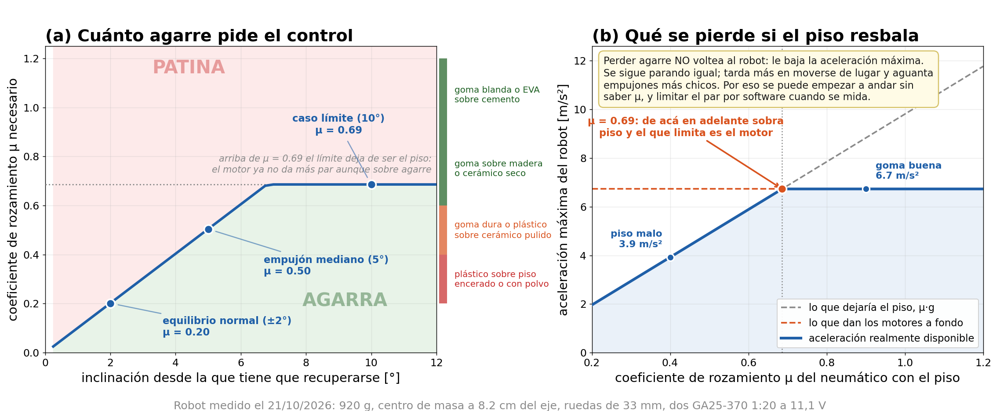
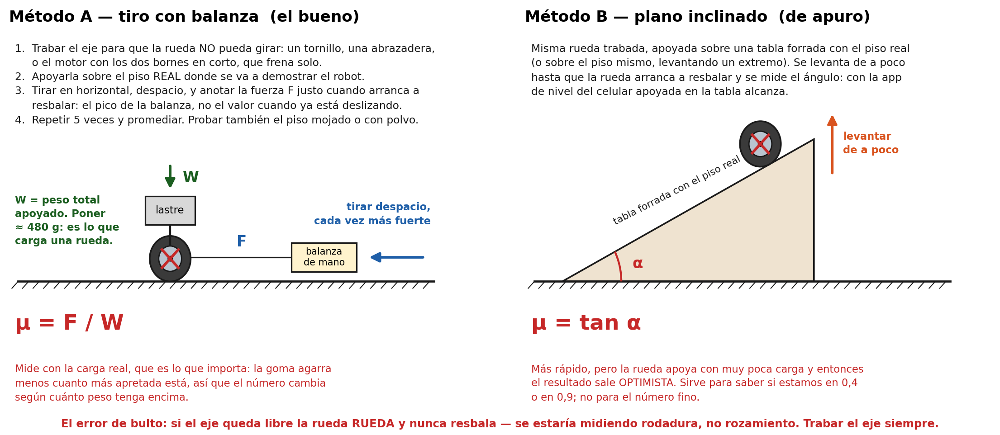
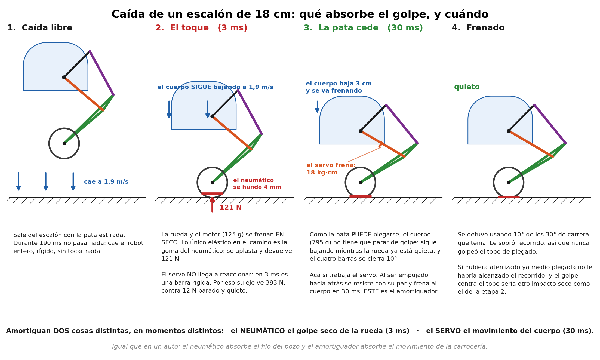

# Plan de ensayos del modelo — qué falta medir y cómo

**21/10/2026.** Complementa el [plan de ensayos de electrónica de Matías](../../electronica/ensayos/plan_de_ensayos.md)
(E-01 a E-10, que cubre alimentación, drivers, IMU, encoders y servos). Acá van los ensayos
**mecánicos y de modelo**, numerados M-… para que no choquen con los E-…

El modelo del péndulo invertido está cerrado y verificado (6/6 grupos, suite 24/24), pero descansa
sobre un puñado de números que todavía no están medidos. Este documento dice cuáles son, cuánto
cambia la conclusión si están mal, y cómo medir cada uno.

---

## 1. Dónde está parado el modelo hoy

Pesos **medidos el 21/10/2026**: las tres barras una por una (AD 30 g, BC 23 g, CDP 11 g) y el robot
entero sin ruedas ni motores de rueda (670 g), de donde la caja sale por diferencia en 542 g.
Con eso el robot queda en **920 g** (contra los 1006 g estimados) y el brazo del centro de masa en
**8,2 cm**. Dos sorpresas:

- el **BC pesa cuatro veces** lo que decía el modelo (23 g contra 5,6 g estimados);
- la **caja pesa 19 % menos** (542 g contra 667 g).

Que el modelo errara por cuatro en una pieza es la razón por la que conviene medir el resto en lugar
de confiar en las estimaciones. Lo bueno: el robot más liviano **mejora** los márgenes. El par que
pide el servo bajó de 9,06 a 7,98 kg·cm, así que el servo de 40 kg·cm pasó de un margen de 4,4 a 5,0.

## 2. Qué falta medir, ordenado por cuánto importa

| # | Parámetro | Valor hoy | De dónde sale | Si está mal, cambia… |
|---|---|---|---|---|
| **M-1** | **μ del neumático** | 0,70 **supuesto** | nada: elegido | **Todo el margen de tracción.** Es el único parámetro sin ninguna cota |
| **M-6** | **rigidez del neumático** | 30 kN/m **supuesto** | nada: elegido | **Todo el pico del golpe al aterrizar.** La fuerza va con √k: un neumático tres veces más blando baja el pico un 43 % |
| M-2 | par real y rendimiento del reductor | η = 0,75 supuesto | la ficha se contradice | el par disponible ±25 %, y con él el ángulo máximo de recuperación |
| M-3 | resolución del encoder | 11 PPR **supuesto** | la ficha no la dice | el filtro de velocidad y el ruido que entra al control |
| M-4 | masa de rueda y motor de rueda | 30 + 95 g estimados | catálogo | el brazo `l`, el polo inestable (±5 %) y la masa no suspendida del golpe |
| M-5 | inercia del rotor | 6e-7 kg·m² típica | valor de libro | el coeficiente de avance hasta 43 % |

Los demás parámetros ya se movieron uno por uno en un barrido de sensibilidad: el polo inestable se
queda entre 7,38 y 7,83 1/s y la ganancia K_φ varía menos de ±5 % frente a **todas** las demás
suposiciones juntas. El diseño del control es robusto; **lo único que está realmente indeterminado
es si patina o no.**

---

## 3. M-1 — Coeficiente de rozamiento μ del neumático

### Por qué no se puede sacar de una foto ni del datasheet

μ no es una propiedad de la goma: es una propiedad del **par goma–piso**, y además depende de la
presión de contacto. Una foto alcanza para saber si la rueda es goma blanda, goma dura, silicona o
plástico duro con una banda de goma — y eso ya sirve, porque descarta el caso malo. Pero dentro de
"goma sobre piso de interior" el rango razonable va de 0,4 a 1,0, y **ese es exactamente el rango que
decide si el robot patina**. Así que: sí, conviene mandar las fotos, pero el número hay que medirlo.

### Cuánto importa en realidad

Esta es la parte que vale la pena entender antes de salir a medir:

| Maniobra | μ que necesita | ¿anda con un piso malo (μ = 0,4)? |
|---|---|---|
| **Mantenerse parado** (±2°, que es lo normal) | **0,20** | sí, con sobra de 2× |
| Recuperarse de un empujón mediano (5°) | 0,50 | no, patina un poco |
| Recuperarse de 10° (caso límite) | 0,69 | no |

El equilibrio normal pide **μ = 0,20**, que lo da hasta un piso encerado. Dicho de otra manera:
**el robot no se va a caer por falta de agarre; lo que pierde es aceleración máxima y tolerancia a
empujones.** Por eso se puede empezar a andar sin saber μ y medirlo después.

Arriba de μ = 0,69 el piso deja de ser el límite: ahí manda la batería, porque los motores ya no
dan más par aunque sobre agarre.

### Cómo se mide

Fuente editable del mismo diagrama en ASCII: [`docs/diagramas/ensayo_mu_neumatico.bob`](../diagramas/ensayo_mu_neumatico.bob).
*(El renderizador `svgbob` ya no está instalado en esta máquina — falta `cargo`. Para reinstalarlo:
`cargo install svgbob_cli --locked` y `cargo install resvg --version 0.45.1 --locked`.)*

**Método A, tiro con balanza (el bueno).** Trabar el eje de la rueda para que no pueda girar, cargarla
con ≈ 460 g (lo que carga una rueda del robot: 920 g repartidos en dos), apoyarla sobre el piso real y
tirar en horizontal con una balanza de mano hasta que arranque a resbalar. **μ = F / W**. Cinco
repeticiones y promedio. No hace falta el robot, ni los motores, ni la electrónica: alcanza con **una
rueda sola**, así que se puede hacer el día que lleguen.

**Método B, plano inclinado (de apuro).** La misma rueda trabada sobre una tabla, levantando un
extremo hasta que resbala. **μ = tan α**. Más rápido, pero apoya con muy poca carga y la goma agarra
más cuanto menos apretada está, así que sale optimista. Sirve para ubicarse, no para el número fino.

**El error que arruina el ensayo:** si el eje queda libre, la rueda *rueda* y nunca resbala. Se
estaría midiendo resistencia a la rodadura, no rozamiento. Trabar el eje siempre. Un truco cómodo:
con el motor ya montado, cortocircuitar sus dos bornes lo frena solo (frenado dinámico).

**Qué anotar:** el piso exacto (cerámico, flotante, cemento alisado), si estaba seco o recién
trapeado, la carga usada, las cinco lecturas y el promedio. Medir sobre **el piso donde se va a
presentar el proyecto**, que es el que decide.

### Mientras tanto: cómo dejar de depender de μ

Dos cosas que se programan ahora y hacen que el número deje de ser crítico:

1. **Tope de par por software.** Limitar el PWM al valor que el piso aguanta. Con μ = 0,5 el tope
   queda en 73 % del PWM; con μ = 0,4, en 58 %. Como el equilibrio normal usa menos del 30 %, el tope
   **no se nota** salvo en maniobras bruscas. Es una constante en el firmware: cuando se mida μ, se
   cambia un número.
2. **Detección de patinaje, gratis.** El encoder dice cuánto giró la rueda y la IMU dice cómo
   respondió el cuerpo. Si la rueda acelera y el cuerpo no reacciona como predice el modelo, está
   patinando: bajar el par. No hace falta hardware nuevo, sólo comparar dos señales que ya están.

---

## 4. M-2 — Par real y rendimiento del reductor del GA25-370

La ficha del motor **se contradice sola**: el punto de carga implica un rendimiento de reductor del
18 % y el punto de bloqueo implica 146 %, que es imposible. La columna eléctrica, en cambio, es
coherente consigo misma (da R_m = 10,28 Ω y predice 1,17 A de bloqueo contra los ≤1,1 A declarados).
Por eso el modelo **calcula** el par (3,1 kg·cm por motor) en lugar de leerlo (5,6 kg·cm declarados).

**Ensayo:** motor alimentado a tensión conocida, con un brazo rígido de largo conocido apoyado sobre
una balanza de cocina. Se mide el par de bloqueo real a dos o tres tensiones y la corriente que toma.
Con eso salen K_t y el rendimiento del reductor de verdad. Diez minutos por motor.

**Criterio:** si el par medido se acerca a los 3,1 kg·cm calculados, el modelo está bien y se cierra
el tema. Si se acerca a 5,6, sobra par y hay que revisar el límite de tracción hacia arriba.

## 5. M-3 — Resolución del encoder

El modelo supone 11 PPR en el rotor, que con la reducción 1:20 y el canal en cuadratura da 880 cuentas
por vuelta de rueda = 0,24 mm de resolución. La ficha de Matías
([ROB-011](../../electronica/componentes_comprados/datasheets/ROB-011_GA25-370_300RPM/)) dice que
**falta la etiqueta del fabricante y la resolución real no está confirmada**.

**Ensayo:** marcar la rueda, hacerla girar exactamente 10 vueltas a mano y contar los pulsos.
Dividir por 10. Es el ensayo E-04 de Matías; acá importa porque de ese número depende el filtro de
velocidad: a 0,1 m/s con 880 cuentas/vuelta entran sólo **2 cuentas por muestra de 5 ms**, y por eso
el control necesita el filtro de 20 Hz que ya está en el diseño del LQR.

## 6. M-4 — Pesar la rueda y el motor de rueda

Es lo único que falta para cerrar la masa del robot. Se pesa cada conjunto rueda+motor por separado
cuando lleguen y se carga en `modelado/parametros/parametros_fisicos.m`
(`o.m_rueda` y `o.m_motor`, en gramos). El test
[`test_dinamica_pata/test_fuente_comun_de_parametros`](../../modelado/dinamica/tests/test_dinamica_pata.m)
va a fallar a propósito: es la guarda que avisa que cambió una masa. Hay que actualizar el valor
esperado y volver a correr la suite.

**Referencia:** si el robot completo pesara los 850 g que se estimaron a ojo, quedarían 180 g para
las dos ruedas con sus motores, o sea 90 g cada conjunto. Un GA25-370 solo ya pesa cerca de 95 g,
así que los 850 g son optimistas: el rango realista está entre **850 y 950 g**.

## 6 bis. M-6 — Rigidez del neumático, y por qué importa tanto

Es el parámetro que decide **cuánta fuerza recibe el robot al aterrizar**, y hoy vale 30 kN/m
puesto a dedo. Al caer de un escalón hay dos golpes muy distintos y conviene no confundirlos:

| | Fase A: el toque | Fase B: el frenado |
|---|---|---|
| **Dura** | ~3 ms | 11 a 33 ms |
| **Qué se frena** | la rueda y el motor, 125 g, **en seco** | el resto del robot, 795 g |
| **Quién lo absorbe** | **sólo el neumático** | el servo plegando la pata |
| **El servo** | no llega a reaccionar: actúa como barra rígida | trabaja, 8 a 18 kg·cm |
| **Fuerza en el eje del servo** | 128 N (escalón de 2 cm) a 393 N (18 cm) | 71 N |

La fase A es la que preocupa, y el control no puede hacer nada: en 3 ms el servo ni se entera.
El pico sale de `F = √(2·E·k)`, con `E` la energía de la masa **no suspendida** (rueda + motor).
O sea que baja con la raíz de las dos cosas, y los dos se pueden tocar:

| Cambio (escalón de 10 cm) | Hundimiento | N en el neumático | Eje del servo |
|---|---|---|---|
| como está hoy (k = 30 kN/m) | 3,0 mm | 90 N | **292 N** |
| neumático 3× más blando | 5,2 mm | 52 N | **167 N** (−43 %) |
| neumático 10× más blando (gomaespuma) | 9,5 mm | 29 N | **89 N** (−70 %) |
| neumático 3× más duro | 1,7 mm | 157 N | **509 N** (+74 %) |
| rueda + motor de 125 a 80 g | 2,5 mm | 74 N | 241 N (−17 %) |
| rueda + motor de 125 a 180 g | 3,6 mm | 107 N | 344 N (+18 %) |

**Ensayo:** apoyar la rueda sobre una balanza de cocina, apretar hasta 4,5 N (la carga estática)
y hasta 45 N, y medir con un calibre cuánto se hunde en cada caso. `k = ΔF/Δd`. Dos minutos.
Hacerlo **antes de comprar la segunda rueda**, porque de acá sale si conviene goma blanda o dura.

**Lo que conviene hacer en el CAD, independientemente de lo que dé:** que el pasador `A` tenga su
**propio rodamiento** tomando la carga radial, y que el servo entregue sólo par. 393 N sobre el
estriado de un servo le arranca los dientes; 393 N sobre un rodamiento de 6 mm no es nada.
Si eso no se puede, la alternativa es un **acople elástico** entre el brazo del servo y la manivela
(un resorte de torsión con topes), que es lo que en robótica se llama actuación elástica en serie.

## 7. M-5 — Inercia del rotor

El valor usado (6e-7 kg·m²) es típico de un motor de este tamaño, no medido. Multiplicado por 20²
por la reducción, pesa bastante en la ecuación de avance.

**Ensayo:** no vale la pena medirlo por separado. Sale solo del ensayo de respuesta al escalón de
M-2: alimentar el motor con la rueda libre, registrar la velocidad con el encoder y ajustar la
constante de tiempo mecánica. El mismo registro da el rozamiento del eje.

---

## 8. Orden recomendado

| Cuándo | Qué | Depende de |
|---|---|---|
| **Ya, sin esperar nada** | programar el tope de par como constante configurable y la detección de patinaje; revisar en el CAD si `A` tiene rodamiento propio | nada |
| Al llegar las ruedas | **M-1** (μ), **M-6** (rigidez) y **M-4** (pesar) | tener una rueda |
| Con un motor en la mesa | **M-2** (par) y **M-5** (inercia), junto con E-04 de Matías | motor + driver + fuente |
| Con el encoder leyendo | **M-3** (resolución) | ESP32 andando |
| Después de M-1 a M-5 | recargar `parametros_fisicos.m`, correr la suite, regenerar PDFs y rediseñar el LQR | todo lo anterior |

Nada de esto bloquea armar el robot y probar el equilibrio: el control está diseñado para el caso
nominal y los márgenes alcanzan. Los ensayos sirven para **saber cuánto margen queda**, no para poder
empezar.
