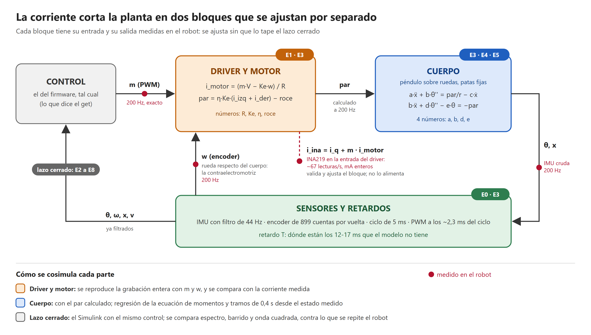

# Plan: cosimulación robot ↔ Simulink para dejar una planta simple y verdadera (9/11/2026)

Pedido de Francisco el 9/11. Ítem en [`BACKLOG.md`](../../BACKLOG.md): **VAL-303**. Por WiFi, **sin grabar firmware**
y **sin mandar `servo`** (las patas las mueve el equipo). Segunda versión, del mismo día: el diseño se auditó contra
el código del firmware (sección 4) y los ensayos quedaron como programas en [`ensayos/`](../../ensayos/README.md).

## 1. Por qué

Hoy conviven cinco plantas (Simulink completo, Simulink ajustado, `banco_lqr.c`, `banco_escalon`, el lineal de
MATLAB) y el control tiene más de doce perillas encendidas a la vez (tabla por pata × dos factores, dos notch, zona
muerta, referencia automática, filtro de velocidad, `tau`, margen...). El modelo ajustado reproduce lo estático y la
onda cuadrada, pero **no explica lo que importa para el control**
([plan del 7/11](2026-11-07-plan-retardo-modelo-lqr.md), [sección 9 del ajuste](../../modelado/ajuste/ajuste_del_modelo.md)):

| Medido en el robot | El modelo dice |
|---|---|
| Pico de sensibilidad **3,7 en 4,7 Hz** (patas en 30°) | 1,34 |
| La planta tiene **12-17 ms más de retardo** | — |
| Un pico en ~11 Hz y un antipico en ~12,5 Hz | Cuerpo rígido: no los tiene |
| Con `lqrfac` 1,0 oscila (4-6 Hz); anda con 0,6-0,87 | Aguantaría ×3,4 |

Con eso cada perilla nueva se ajusta a ciegas, y depurar el control es casi imposible: no se sabe si un cambio
mejora por lo que se cree o por otra cosa. **Menos es más**: primero una planta chica que se entienda y que
coincida con el robot; después, con esa planta, ver qué del control sobra.

## 2. La idea: la corriente corta la planta en dos



Fuente editable: [`cosim_planta_por_bloques.svg`](../diagramas/cosim_planta_por_bloques.svg) (SVG escrito a mano; el
PNG sale con Edge en modo headless).

Lo nuevo con las PCB es que se mide la **corriente de cada driver** (INA219). Con ella, el bloque del motor tiene
entrada y salida medidas y se ajusta solo, sin que lo tape el lazo cerrado; y una vez que ese bloque está bien, da
el **par** que entra al cuerpo:

| Bloque | Entrada medida | Salida medida | Cómo se cosimula |
|---|---|---|---|
| Driver y motor (eléctrico) | `m` (exacto, 200 Hz), tensión de la batería, `w` = giro de la rueda **respecto del cuerpo** (el encoder: justo lo que pide la contraelectromotriz) | corriente de entrada del driver, `i_ina = i_q + m·i_motor` (~67 lecturas por segundo, mA enteros) | Se reproduce **la grabación entera** con `m` y `w` y se compara con la corriente medida. Da `R`, `Ke`, el consumo del driver y el retardo de la medida |
| Cuerpo (péndulo sobre ruedas) | el par **calculado** por el bloque de arriba, a 200 Hz | `theta` y giróscopo (IMU), `x` (encoder + `theta`) | Inestable solo: **regresión de la ecuación de momentos** (lineal en los parámetros) y **tramos cortos de 0,4 s** desde el estado medido |
| Sensores y retardos | — | giróscopo, acelerómetro y encoder en la misma grabación | La fase del barrido de cada bloque dice **dónde** están los 12-17 ms que faltan |
| Lazo cerrado | `exc`, `ref`, `mov` (lo que se le pide) | todo | El Simulink con **el mismo control** del `get`: espectro, barrido y onda cuadrada, contra lo que se repite el robot entre ensayos iguales |

Hay además una ecuación que **no necesita la corriente**: sumando la de la rueda (×r) y la del cuerpo, el par del
motor se cancela y queda la de los momentos respecto del punto de apoyo. Con solo la IMU y el encoder da las
proporciones entre masa, acople e inercia: sirve para verificar el bloque eléctrico, no al revés.

## 3. La planta mínima (hipótesis a confirmar o descartar)

Para patas fijas, cuatro números del cuerpo, cuatro del motor y un retardo. Arranca **con los valores que hoy da
la variante `'ajustada'`** de [`parametros_fisicos.m`](../../modelado/parametros/parametros_fisicos.m) linealizada (así
coincide de entrada con el Simulink ajustado) y los ensayos los corrigen:

```text
cuerpo   a·ẍ + b·θ̈           = τ/r − c·ẋ         (rueda, con la masa de todo)
         b·ẍ + d·θ̈ − e·θ     = −τ                (cuerpo, respecto del eje)
motor    i = (m·V − Ke·w)/R  en cada rueda,   τ = η·Ke·(i_izq + i_der) − roce seco   (w: rueda respecto del cuerpo)
lazo     el control del firmware tal cual, con un retardo T desde la medida hasta el PWM
```

| Número | Qué es | De dónde sale hoy | Lo confirma |
|---|---|---|---|
| `a` | masa efectiva (robot + ruedas + rotores reflejados) | 1208 g pesados + inercias del modelo | E3, E4 |
| `b` | acople rueda-cuerpo (m·l, menos el rotor) | centro de masa de la curva de equilibrio | E3, E4 |
| `d` | inercia del cuerpo respecto del eje (más el rotor) | CAD + estimadas | E3 |
| `e` | par de gravedad por radián (m·g·l) | curva de equilibrio | E4 (baja frecuencia; fija la escala con `η`) |
| `R`, `Ke` | resistencia y constante del motor | 7,81 Ω y 0,359 (7/11, en el aire y frenada) | `Ke`: **E1**; `R`: **E3** (en el piso) |
| `η`, roce, `c` | rendimiento, roce seco y de rodadura | 0,75 **supuesto**, 42 mA, — | E3, **E5** |
| `T` | retardo total medida → PWM | ~10 ms en el modelo; el robot, 12-17 ms más | **E0**, **E3** |
| (solo si hace falta) | un modo flexible de ~11 Hz | — | E3: lo que la planta rígida no explique |

Criterio "menos es más": el modo flexible, el juego del reductor o la goma entran **solo si** con rígido + retardo
el barrido no cierra (sección 7).

## 4. Auditoría del diseño (9/11)

El primer diseño se revisó contra el código de `segway_v02` (cómo se lee el INA, cómo se graba y se manda el
registro, cómo se aplican los `set`) y contra lo que cada ensayo puede y no puede medir. Lo que cambió:

| # | Hallazgo | Consecuencia | Qué cambió |
|---|---|---|---|
| 1 | La corriente que se mide es la de **entrada** del driver: `\|m\| × i_motor` más ~3 mA del driver despierto, en **mA enteros**, una lectura cada 15 ms por motor (izquierda y derecha desfasadas 5 ms), promedio de 4,3 ms y retenida: llega con 10-15 ms de atraso | Quieto (PWM 0,03-0,07) la señal son **1 a 5 mA**: no sirve muestra a muestra. Dividirla por `m` multiplica el error por 15-30 | El par del cuerpo se **calcula** con el bloque eléctrico desde `m` y el encoder (200 Hz, exactos). La corriente **valida y ajusta** ese bloque donde hay señal (E1, E3, E5), siempre en unidades del INA y con su retardo como un parámetro más |
| 2 | La cuenta de apuro del primer día ("R aparente 10-11 Ω": el motor no cierra en el piso) usaba 60-90 lecturas por grabación, sin el consumo del driver ni el retardo | No prueba nada | Retirada como evidencia. Lo decide E1 y E3 |
| 3 | `set lqrpata 0` con las ganancias escritas a mano no hacía falta: `get` ya informa las ganancias que se están usando, y con las patas quietas la tabla no cambia | Un cambio de más con el robot equilibrando (y ganancias tipeadas) | **Eliminado.** La configuración de ensayo son solo dos cosas: `inacada 1` y `refauto 0` |
| 4 | El barrido de `set exc` va de 1 a 20 Hz en 7,5 s, logarítmico: 1,7 s por octava. De 1 a 2 Hz son 2 o 3 ciclos, y el polo inestable está en ~1,2 Hz | E3 no puede dar la gravedad ni el acople en baja frecuencia | E3 queda para 2-20 Hz. **E4 pasa a ser el ensayo de baja frecuencia** (0,25-2 Hz): cada grabación de 8 s tiene exactamente 2 períodos de la onda, después de un período de asentamiento |
| 5 | En lazo cerrado, comparar `m` con la salida da un resultado sesgado (el ruido vuelve por el control) | La planta saldría corrida hacia la inversa del control | Todo se estima **contra la señal de afuera** (`exc` o `ref`) y promediando barridos idénticos (el barrido es siempre igual): E3 pasa de 2+2 a **1 + 4 + 1** (0,04; cuatro de 0,06; 0,08) |
| 6 | La amplitud de 0,03 era igual al salto de la compensación de zona muerta (0,03) | El estímulo sería del tamaño de la alinealidad | 0,04 a 0,08 (el 7/11 se usó 0,05-0,08 en 30° sin problemas) |
| 7 | Mientras el robot manda un registro (~16 s) **no hay telemetría**: el programa queda ciego | No se puede estar excitando al robot en ese rato | Regla de los protocolos: entre `grabar` y la descarga, 8 s o menos, y al llegar la descarga todo en cero. E4 y E5 se rearmaron en bloques de 8 s |
| 8 | UDP pierde líneas (el registro del 8/11 llegó con 1590 de 1600) | Registros con huecos | `escalon datos` vuelve a mandar el último registro: se piden las que faltan y se juntan por tiempo. La pérdida de telemetría se mide con el reloj del robot |
| 9 | `motor` no tiene tiempo de espera: si se corta la red, la rueda sigue girando | Riesgo en E1 | E1 solo colgado, hasta 30 % y con alguien con la mano en el corte; `motor stop` dos veces al salir, pase lo que pase |
| 10 | El ciclo de control ya llega a 4,7-4,8 ms de 5; leer la corriente en todos los ciclos le suma ~1 ms a cada uno | Medir podría cambiar lo medido | E0 y E2 comparan `inacada 5` contra `1` (ciclo, ciclos excedidos y que la huella del robot no cambie). Si cambia, se usa 2 |
| 11 | Los criterios eran números puestos antes de medir (±25 %, ±2 dB, 10 mm) | Sin saber cuánto se repite el robot no dicen nada | Cada criterio se compara contra la **dispersión entre repeticiones** (4 barridos iguales, 3 ondas, 2 registros quieto) |
| 12 | El encoder da 0,28 mm por cuenta: por encima de ~8 Hz la rueda se mueve menos que una cuenta | "Giróscopo contra encoder" no puede decir de quién es el modo de 11 Hz | De 8 a 20 Hz, solo giróscopo y acelerómetro. De quién es el modo se ve con **E8** (si su frecuencia cambia con la pata) y con la vibración según la pata ya medida el 7/11 |
| 13 | E6 (cortar el control 0,10 s) son dos comandos por UDP: si el segundo se pierde, se cae. Y lo que daba (el polo inestable) sale de E4 | Riesgo sin ganancia | **Fuera de la campaña** |
| 14 | El joystick y la página mandan comandos por el mismo puente | Un `mov` del joystick pelea con E5 | No tocarlos durante un ensayo (el ◯ del joystick sigue siendo el desarme de emergencia) |
| 15 | E8 no necesita protocolo propio; E7 depende de lo que prediga el gemelo | — | E8 = E2, E3 y E4 con `--patas 0` o `--patas 30`. E7 se escribe después (un archivo más) |
| 16 | En el aire la rueda sigue al voltaje (25 ms) y casi no circula corriente: `m²·V` y `m·w` quedan casi iguales | E1 da bien `Ke`, el consumo del driver y el retardo, pero **no `R`**: con los escalones en el aire del 7/11 sale 12-14 Ω y cambia con el filtrado | `R` se saca del piso (E3), donde la rueda no sigue al comando. E1 queda para `Ke`, consumo, retardo, arranque y simetría |

**Primer número, con datos viejos** (cinco registros del 7/11 en el piso, 13 lecturas por segundo, nueve ajustes
rueda por rueda con [`revisar.py`](../../ensayos/revisar.py)): `Ke` da 0,36 de mediana (0,27-0,40; el modelo, 0,359), la
corriente llega con **10-15 ms de atraso** y `R` da **8,4 a 11,7 Ω** (mediana 9,4) contra 7,81 de la rueda frenada,
con R² de 0,86 a 0,98. Son 80-100 lecturas por registro, en pruebas con caídas y movimientos grandes, y el consumo
del driver sale disparejo (−3 a 18 mA): es un indicio de que en el piso el motor empuja ~15-20 % menos por voltio
que en el modelo, **no una conclusión**. Lo decide E3, con cinco veces más lecturas y un movimiento controlado.

Lo que se revisó y quedó como estaba: la separación en bloques, la ecuación sin par, E2 como "huella", la planta
mínima de la sección 3 y el orden de las sesiones.

## 5. Configuración de ensayo

Solo dos cambios sobre lo que el robot hace todos los días, y los dos se deshacen solos al terminar cada ensayo:

```text
set inacada 1      corriente de cada motor ~67 veces por segundo (13 con el 5 de siempre)
set refauto 0      sin el lazo lento que corre la referencia durante el ensayo
```

Las ganancias, los filtros y la zona muerta **no se tocan**: quedan los del `get`, que se guarda antes y después de
cada ensayo y es lo que copia el Simulink. Patas en **15°** (las pone el equipo). LiPo por encima de **11,6 V**.

Lo que se graba: la telemetría de 50 Hz todo el tiempo (39 columnas) y ventanas de **8 s a 200 Hz** con `grabar`
(29 columnas: `exc`, corrientes, `m`, encoders e IMU cruda; ~16 s de descarga, sin telemetría mientras tanto). Cada
corrida deja una carpeta con todo y un manifiesto ([formato](../../ensayos/FORMATO.md)).

## 6. Los ensayos

Cada uno es un archivo de [`ensayos/protocolos/`](../../ensayos/protocolos/) y se corre con una línea
([cómo](../../ensayos/README.md)). Ninguno es brusco. Duraciones con las descargas incluidas.

### Sesión 1 — colgado y desarmado (~4 min)

| | Qué | Pregunta | Cómo | Criterio |
|---|---|---|---|---|
| **E0** | [Reposo](../../ensayos/protocolos/E0_reposo.json) | Ruido y sesgo de giróscopo y acelerómetro; corriente en cero; ¿cuentan los encoders?; ¿cuánto tarda el ciclo con `inacada` 5 y con 1? | 30 s con cada uno y un registro de 200 Hz | El ruido medido para el bloque de sensores. Si con 1 suben los ciclos excedidos, el resto va con 2 |
| **E1** | [Motores en el aire](../../ensayos/protocolos/E1_motores_aire.json) | ¿El bloque eléctrico vale con el PWM bajo en que vive el equilibrio? ¿Cuánto consume el driver despierto? ¿Con qué retardo llega la corriente? ¿Dónde arranca y se para cada rueda? ¿Las dos, en los dos sentidos (FW-022)? | Escalera de 2 a 30 % subiendo y bajando, en los dos sentidos, y cuatro registros de 200 Hz: escalones (0, ±8, ±16 %), inversiones (±12, ±25 %), rampa lenta de −30 a +30 % y cada rueda sola | Reproduce la corriente con R² > 0,9 y da `Ke` a menos de 10 % de lo del 7/11, el consumo del driver y el retardo de la medida. `R` no: en el aire queda mal determinada (hallazgo 16) y sale de E3 |

### Sesión 2 — en el piso, patas en 15° (~9 min)

| | Qué | Pregunta | Cómo | Criterio |
|---|---|---|---|---|
| **E2** | [Quieto](../../ensayos/protocolos/E2_quieto.json) | La huella del robot: cuánto cabecea y se corre, a qué frecuencias vibra, cuánta corriente usa. ¿Cambia algo leer la corriente más seguido? | 30 s con `inacada 5`, 60 s con 1 y dos registros | Lo que el gemelo tiene que reproducir. Los dos tramos tienen que dar lo mismo |
| **E3** | [Barrido](../../ensayos/protocolos/E3_barrido.json) | **El central.** De 2 a 20 Hz: margen del lazo (`exc→u`), bloque eléctrico en carga, el cuerpo (`par→giróscopo`), cuánto retardo hay y dónde | Seis barridos: 0,04, cuatro de 0,06 y 0,08 | Rígido + retardo alcanza si sigue al robot de 2 a 8 Hz dentro de lo que se repite entre barridos iguales, y da el pico de sensibilidad. Si no, **un** modo más |
| **E4** | [Onda en la referencia](../../ensayos/protocolos/E4_onda_ref.json) | De 0,25 a 2 Hz, donde vive el polo inestable: gravedad y acople, y cuánto va y viene el robot | ±1° cada 2 s; tres veces: un período de asentamiento y dos grabados | El gemelo con el mismo control sigue `x` y `theta` dentro de lo que se repite entre las tres |
| **E5** | [Andar despacio](../../ensayos/protocolos/E5_andar.json) | A velocidad constante la corriente es el roce y el comando es el `ff`: ¿cuánto roce, cuánto comando por m/s? | 0,1 m/s 4 s ida y vuelta, 0,2 m/s 3 s ida y vuelta; un registro por tramo. ~0,8 m libres adelante | Roce seco y viscoso, y rendimiento (la corriente de crucero son ~7 mA: ±15 %); el gemelo da el comando de crucero a ±10 % |

### Sesión 3 — con el gemelo ya ajustado (otro rato)

| | Qué | Pregunta | Cómo |
|---|---|---|---|
| **E8** | E2, E3 y E4 con las patas en 0° y en 30° | Cómo cambian los números del cuerpo (y el modo de 11 Hz) con la pata | El equipo mueve las patas; los mismos protocolos con `--patas 0` y `--patas 30` |
| **E7** | Escalera de simplificación del control | ¿Qué de la complejidad del control sobra? | El gemelo **predice primero** cada paso; después se prueba quieto y con un barrido: `deadband 0` → sin `notch2` → `velf 10` → `tau 1` → sin `notch` (este solo si el gemelo le da margen ×1,5 o más). Protocolo a escribir con esas predicciones |

**Lo que se reutiliza sin repetir:** el ensayo de motores del 7/11 (R, Ke, J_r, zona muerta), la curva de equilibrio
según la pata, los barridos del 7/11 en 30° (`firmware/docs/barridos_lazo_2026-11-07/`), el barrido de `lqrfac`, las
perturbaciones y la vibración según la pata del 7/11, y las pruebas de manejo. Sirven para validar, no para ajustar.

## 7. Qué se concluye en cada paso (y qué se decide)

1. **Después de E0-E1.** ¿El bloque eléctrico cierra con PWM bajo? ¿Cuánto atrasa la medida de corriente? Con eso el
   par se calcula a 200 Hz y la corriente queda como verificación.
2. **Después de E3.** ¿Rígido + retardo alcanza? ¿Dónde está el retardo: antes del PWM (ciclo, filtros), en el
   driver, en la IMU o en una flexibilidad? Eso dice si se corrige en el firmware (más adelante, con permiso para
   grabar) o en el modelo.
3. **Después de E4-E5.** El gemelo de lazo cerrado queda ajustado: los números de la sección 3 con su
   incertidumbre, en `simulacion/cosim/conclusiones.md`.
4. **Después de E7.** La lista de lo que sobra del control, probada en el robot y predicha por el modelo. Con eso,
   un LQR rediseñado sobre la planta mínima (y sin factores a mano) es el paso siguiente, ya fuera de este plan.

Las vías de corrección, en orden de prioridad:

| Vía | Qué corrige | Ensayos |
|---|---|---|
| 1. Igualar la planta | los números del cuerpo y del motor, con la corriente | E1, E3, E4, E5 |
| 2. Los retardos | localizar los 12-17 ms (ciclo de 4,7 ms medido hoy con WiFi, IMU de 44 Hz, PWM a mitad del ciclo) | E0, E3 |
| 3. Lo que falta en la mecánica | modo de 11 Hz, juego del reductor, goma; solo si 1 y 2 no alcanzan | E3, E8 |
| 4. Simplificar el control | sacar perillas que no aportan, con el gemelo prediciendo antes | E7 |
| 5. Una sola planta | la planta mínima como fuente para el Simulink, el banco en C y el LQR | todos |

## 8. Dónde está cada cosa

- [`ensayos/`](../../ensayos/README.md): los experimentos como programas, para repetirlos y para hacer otros.
  `protocolos/` (un archivo por experimento), `correr.py` (lo ejecuta por el puente y deja una carpeta por corrida
  en `datos/`), `revisar.py` (controla lo grabado y saca los primeros números) y [`FORMATO.md`](../../ensayos/FORMATO.md).
- `simulacion/cosim/` (**falta**): `construir_planta_minima.m` → `planta_minima.slx` (solo bloques nativos),
  la reproducción del bloque eléctrico y de tramos del cuerpo, el gemelo de lazo cerrado con el control del `get`.
  Primero se verifica que la planta mínima con los valores de `'ajustada'` da lo mismo que `segway_ajustado` en 15°.

## 9. Qué necesito del equipo

| Cuándo | Qué |
|---|---|
| Sesión 1 | El robot **colgado** con las dos ruedas libres (como el 29/10 y el 7/11), desarmado, y alguien con la mano en el corte de los motores |
| Sesión 2 | Patas en 15°, armarlo y dejarlo quieto; alguien con las manos cerca, sin tocarlo; para E5, ~0,8 m libres adelante y 0,3 m atrás |
| Sesión 3 | Lo mismo, y mover las patas a 0° y a 30° |
| Siempre | LiPo cargada; no tocar el joystick (salvo ◯ para desarmar) ni la página mientras corre un ensayo; el corte confiable es la alimentación de los motores (UDP puede perder un `disarm`) |

No hace falta ninguna perturbación de afuera: el barrido (`exc`) y la onda en la referencia son perturbaciones
repetibles que manda el firmware.

## 10. Para cuando se pueda grabar firmware (no ahora)

Cuatro cambios chicos que harían estos ensayos mucho mejores; ninguno toca el control:

1. La corriente con décimas de mA (el INA219 da 0,1 mA y se imprime sin decimales) y una marca de "lectura nueva"
   en el registro: quieto se pasaría de 1-5 a 10-50 cuentas de señal.
2. El barrido desde 0,3 Hz y más largo (hoy `EXC_F0` 1 Hz y 7,5 s fijos en el código).
3. La tensión de cada driver en el registro de 200 Hz.
4. Telemetría (aunque sea a 5 Hz) mientras se descarga un registro.
