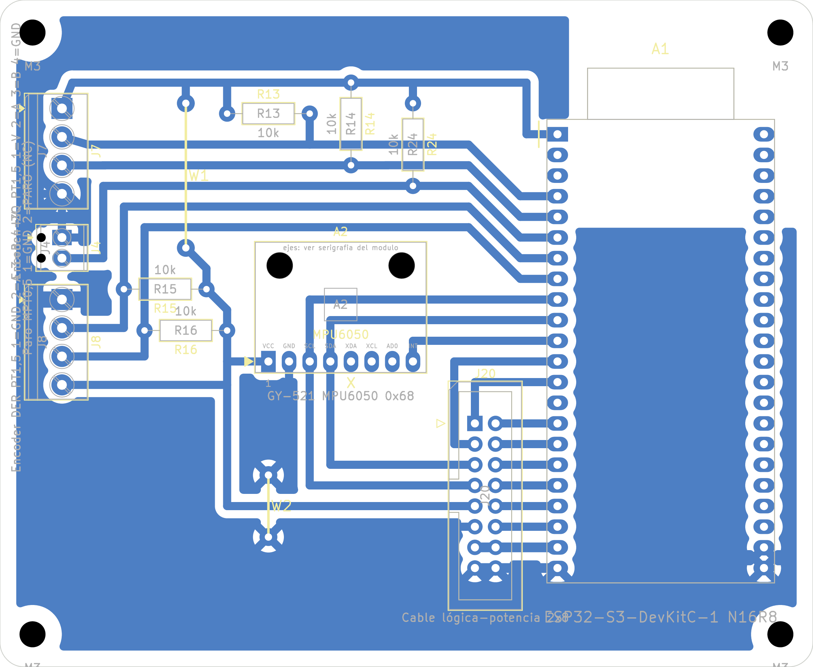

# Placa de lógica v0.1: PCB casera de una cara

Fecha: 20/10/2026. Decisión de origen: DEC-17 (dos placas unidas por cable plano). Reglas: [fabricación casera](../segway_base/reglas_fabricacion_casera.md). Supuestos: [lista](../segway_base/supuestos.md), en particular SUP-04, SUP-07, SUP-15, SUP-24, SUP-28 y SUP-72 a SUP-74.

## Resumen

| Dato | Valor |
|---|---|
| Contorno | 100 × 82 mm, esquinas de 3 mm, 4 agujeros M3 a 4 mm de cada esquina |
| Cobre | Una cara (B.Cu), pistas de 1,0 mm (5V_MCU y GND de J20: 1,2 mm), separación ≥ 0,7 mm, relleno GND |
| Componentes | 11 del esquema: A1 ESP32-S3-DevKitC-1, A2 MPU6050, J20 IDC 2×8, J4 paro, J7 y J8 encoders, R13–R16 y R24 (10 kΩ) |
| Puentes de alambre | 2, en la cara de componentes: **W1** 3V3 de 17,8 mm y **W2** GND de 7,6 mm ([lista](evidencia/puentes_pcb_v0.1.json)) |
| DRC (kicad-cli 10.0.7, con paridad de esquema) | **0 errores, 0 sin conectar, 0 de paridad** ([informe](evidencia/drc_pcb_v0.1.json)) |
| Avisos del DRC que quedan | 11 `lib_footprint_mismatch`: los pads caseros son más grandes que los de la biblioteca, a propósito. 2 `lib_footprint_issues`: los puentes W no están en una biblioteca. 54 `silk_over_copper`: serigrafía sobre pads, sin efecto en una placa sin máscara. |

## Cómo se diseñó

El ruteo se hizo a mano por topología: [`agente/placas/logica.py`](../../agente/placas/logica.py), construido con [`agente/construir_pcb.py --placa logica`](../../agente/construir_pcb.py). Freerouting daba entre 3 y 7 puentes según los costos, algunos de hasta 68 mm. El mapa de pines se eligió para que la placa cierre en una cara:

- **J20 junto a A1.** La columna par del IDC queda a la misma altura que los pines 15–22 de la ESP32-S3, así que van ocho pistas rectas. La columna impar rodea el conector por arriba hasta A1.9–13.
- **I2C a través del MPU.** SCL y SDA pasan por los pines 3 y 4 del MPU en su camino de J20 a A1. VCC y GND quedan de un lado, e INT del otro, hacia A1.11.
- **Banda superior.** A1.4–8 suben 6,35 mm para pasar sobre los agujeros de fijación del MPU y van a J7, J4 y J8, en el borde oeste. Las pull-ups R14, R24 y R15 pasan por encima de las pistas vecinas.
- **3V3 en dos mitades.** La mitad del riel superior viene de A1.1 y alimenta J7, R13, R14 y R24. La otra viene de J20.9 y alimenta el MPU, J8, R15 y R16. W1 las une.
- **GND por relleno.** W2 une la cara de cobre que queda encerrada bajo el MPU. No hay relleno alrededor de la antena (SUP-74).
- **J7 invertida (SUP-73):** 1 = 3V3, 4 = GND. **J8:** 1 = GND, 4 = 3V3.

Mapa de pines de A1 (SUP-28):

| Pin físico | GPIO | Net | Pin físico | GPIO | Net |
|---|---|---|---|---|---|
| 4 | GPIO4 | ENC_IZQ_A | 13 | GPIO3 | INA_ALERT |
| 5 | GPIO5 | ENC_IZQ_B | 15 | GPIO9 | IN1_DER_MCU |
| 6 | GPIO6 | PARO_CONT | 16 | GPIO10 | IN2_DER_MCU |
| 7 | GPIO7 | ENC_DER_A | 17 | GPIO11 | IN1_IZQ_MCU |
| 8 | GPIO15 | ENC_DER_B | 18 | GPIO12 | IN2_IZQ_MCU |
| 9 | GPIO16 | I2C_SCL | 19 | GPIO13 | SERVO_IZQ_MCU |
| 10 | GPIO17 | I2C_SDA | 20 | GPIO14 | SERVO_DER_MCU |
| 11 | GPIO18 | IMU_INT | 21 | 5V | 5V_MCU (por J20.13/14) |
| 12 | GPIO8 | VBAT_ADC (ADC1_CH7) | 1, 2 / 22 | 3V3 / GND | 3V3_MCU / GND |

Cable J20 (SUP-72): el pin n de una placa va al pin n de la otra. La tabla completa está en [`interconexion_v0.6.json`](../interconexion_v0.6.json).

## Archivos de fabricación (`fabricacion/rev-0.1/`)

| Archivo | Uso |
|---|---|
| `segway_logica_cobre_BCu_1a1.pdf` | Transferencia de tóner. B.Cu + contorno, escala 1, **sin espejar** (SUP-07). En el papel, «SEGWAY LOGICA v0.1» y «LADO COBRE» se leen al revés. |
| `segway_logica_montaje_cara_superior.pdf` | Guía de montaje: serigrafía y contornos de la cara de componentes |
| `segway_logica.drl`, `segway_logica-drl_map.pdf`, `segway_logica_taladros.rpt` | Taladros. 92 metalizados en la placa real, que en casa no se metalizan: 10 de 0,8 mm, 4 de 0,9, 68 de 1,0, 2 de 1,1 y 8 de 1,2. Los NPTH (M3, MPU y trabas de J4) figuran en el informe. |

## Pasos

1. **Imprimir** el PDF de cobre en láser, a tamaño real (100 %). Medir con calibre la escala de 50,00 mm del borde inferior: el error tiene que ser menor que 0,2 mm.
2. **Verificar la orientación.** En el papel, los rótulos se leen al revés.
3. **Planchar, atacar y limpiar.** Después de transferir, los rótulos se leen derechos mirando la cara de cobre.
4. **Taladrar** con mecha de 0,8, 0,9, 1,0, 1,1 o 1,2 mm según el mapa; los M3 con 3,2 mm.
5. **Montar** en este orden:
   1. Puentes W1 y W2 (alambre estañado de 0,6 mm, del lado de componentes).
   2. Resistencias.
   3. Zócalos hembra de A1 (2 × 22) y A2 (1 × 8, posición 5 tapada).
   4. IDC J20, con la muesca hacia afuera de la placa.
   5. Borneras J4, J7 y J8.
6. **Comprobar antes de enchufar los módulos:**
   - Continuidad de W1 (3V3 entre A1.1 y J20.9) y de W2 (GND entre A2.2 y J20.11).
   - Que no haya corto 3V3–GND ni 5V_MCU–GND.
   - J7.1 = 3V3 y J7.4 = GND; J8.1 = GND y J8.4 = 3V3.

## Pendiente

- Medir con calibre la separación de hileras de la DevKitC (SUP-22, 25,40 mm) y el MPU (SUP-HA-MPU) antes de taladrar.
- Confirmar con mecánica la posición de la placa y el largo del cable J20.
- Placa de potencia v0.1 (siguiente bloque).
