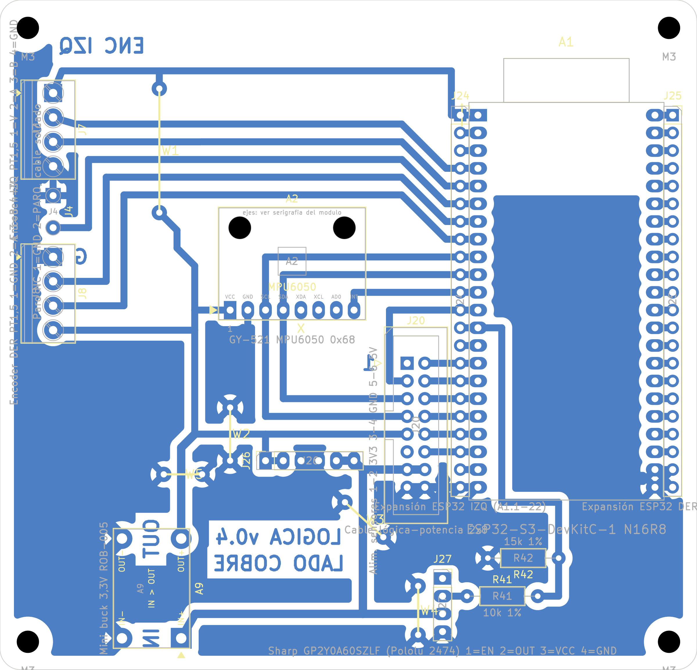

# Placa de lógica v0.4: PCB casera de una cara

Fecha: 31/10/2026. Reemplaza a la [v0.3](pcb_v0.3.md). Montaje: [DEC-20](../../planificacion/2026-10-26-decisiones-del-equipo.md). Reglas: [fabricación casera](../segway_base/reglas_fabricacion_casera.md). Supuestos: [lista](../segway_base/supuestos.md). Control eléctrico: [auditoria_electrica_v0.4.md](../auditoria_electrica_v0.4.md). Compras: [lista_compras_v0.4.md](../lista_compras_v0.4.md). Pines para el firmware: [pinout](../../interfaces/pinout_firmware_placas_v0.1.md).

## Qué cambió desde la v0.3

- **Buck de 3,3 V (A9) corregido:** la huella estaba **espejada**, según la serigrafía del módulo comprado, y era de otro tamaño: el módulo es tipo **Mini-360** (17 × 11 mm, pads a 14,3 × 8,5 mm, medidos con calibre por Matías el 31/10/2026; en las fotos se habían estimado 8,9). Ahora IN+ y OUT+ quedan al este (x 26) y GND al oeste (x 17,5). La salida de 3,3 V sube directo a la pista de 3V3 de J20.9.
- **Fuera las resistencias de pull-up** R13–R16 (encoders) y R24 (paro): se usan las pull-ups internas de la ESP32, que **hay que activar en el firmware**. Si un encoder de colector abierto necesita más, se agrega una de 10 kΩ en su bornera, entre V y la señal.
- **GPIO3 lee el sensor de distancia:** la batería la mide el INA226 de la potencia (J20.1 queda sin conexión) y GPIO3 (ADC1) pasó a leer el Sharp de J27.
- **Sharp en lugar del HC-SR04 (ELE-044):** J27 sigue el orden del carrier Pololu #2474: 1 EN (sin conexión, arriba), 2 OUT, 3 VCC (5 V), 4 GND. OUT pasa por el divisor R41 10k / R42 15k (3,6 V → 2,2 V) y sube a A1.13 (GPIO3) por debajo de la DevKitC. Sale R43; GPIO47 y GPIO21 quedan libres.
- **Puentes:** 5. W5 une el relleno del oeste con el centro, por encima de la salida de 3,3 V de A9.
- **Rótulos de A9:** «IN» y «OUT» entre los dos pads de cada borde (antes «IN+» y «3V3», que no decían a qué pad se referían).
- **Título acortado** a «LOGICA v0.4»: «SEGWAY LOGICA» tocaba el pad OUT+ de A9.
- **Sin C30** (pedido del equipo): el mini buck trae su capacitor de entrada. R43 se quitó y volvió, y salió con el HC-SR04 (ya no hay TRIG). Para qué está cada pieza que queda: [guía de montaje](../guia_montaje_v0.4.md).
- **J27 sin rótulos de cobre:** partían el relleno de masa. Su orden (EN, OUT, VCC, GND, con EN arriba) va en la guía de montaje.

## Resumen

| Dato | Valor |
|---|---|
| Contorno | 100 × 96 mm, esquinas de 3 mm, 4 agujeros M3 a 4 mm de cada esquina |
| Cobre | Una cara (B.Cu), pistas de 1,0 mm (5V_MCU y GND de J20: 1,2 mm), separación ≥ 0,7 mm, relleno GND |
| Componentes | 13 del esquema: A1 ESP32-S3-DevKitC-1, A2 MPU6050, A9 buck de 3,3 V, J20 IDC 2×8, J4 paro (pads para cable), J7 y J8 encoders, J27 sensor de distancia Sharp con R41/R42, y la expansión J24, J25 y J26 |
| Puentes de alambre | 5, en la cara de componentes: **W1** 3V3 de 17,8 mm y **W2**–**W5** de GND (7,6, 7,4, 7,0 y 5,5 mm) ([lista](evidencia/puentes_pcb_v0.4.json)) |
| DRC (kicad-cli 10.0.7, con paridad de esquema) | **0 errores, 0 sin conectar, 0 de paridad** ([informe](evidencia/drc_pcb_v0.4.json)) |
| Avisos del DRC que quedan | 12 `lib_footprint_mismatch`: los pads caseros son más grandes que los de la biblioteca, a propósito. 5 `lib_footprint_issues`: los puentes W no están en una biblioteca. El resto es serigrafía, que solo va en la guía impresa. |

## Cómo se diseñó

El ruteo se hizo a mano por topología: [`agente/placas/logica.py`](../../agente/placas/logica.py), construido con [`agente/construir_pcb.py --placa logica`](../../agente/construir_pcb.py). Freerouting daba entre 3 y 7 puentes según los costos, algunos de hasta 68 mm. El mapa de pines se eligió para que la placa cierre en una cara:

- **J20 junto a A1.** La columna par del IDC queda a la misma altura que los pines 15–22 de la ESP32-S3, así que van ocho pistas rectas. La columna impar rodea el conector por arriba hasta A1.9–13.
- **I2C a través del MPU.** SCL y SDA pasan por los pines 3 y 4 del MPU en su camino de J20 a A1. VCC y GND quedan de un lado, e INT del otro, hacia A1.11.
- **Banda superior.** A1.4–8 suben 6,35 mm para pasar sobre los agujeros de fijación del MPU y van a J7, J4 y J8, en el borde oeste.
- **3V3 en dos mitades, alimentadas por A9.** A9 entrega 3V3 por el borde oeste a la pista de J8.4. Esa mitad alimenta el MPU, J8, J26 y, por J20.9, los INA de la potencia. W1 la une con el riel superior, que llega a los pines 3V3 de la ESP32 (A1.1/A1.2) y a J7.
- **GND por relleno.** W2 une la cara de cobre que queda encerrada bajo el MPU; W3, W4 y W5 unen las islas que dejan las pistas de A9, J27 y la expansión. No hay relleno alrededor de la antena (SUP-74).
- **J7 invertida (SUP-73):** 1 = 3V3, 4 = GND. **J8:** 1 = GND, 4 = 3V3.
- **Rótulos de cobre (SUP-14):** ENC IZQ, G de J8 y el pin 1 de J20. Las V de J7/J8, PARO y J26 no entran sin partir el relleno GND: quedan en la guía de montaje.
- **Orientación de A1 (SUP-80):** la DevKitC entra girada 180° en sus zócalos y así sus 3V3 caen en GND. La antena va hacia el borde superior y los USB-C hacia el inferior, como en la guía.
- **Expansión.** Cada pin de J24 y J25 está unido por pista al pin de A1 que tiene al lado (detalle abajo).

Mapa de pines de A1 (SUP-28):

| Pin físico | GPIO | Net | Pin físico | GPIO | Net |
|---|---|---|---|---|---|
| 4 | GPIO4 | ENC_IZQ_A | 13 | GPIO3 | DIST_SUELO (Sharp de J27 por R41/R42) |
| 5 | GPIO5 | ENC_IZQ_B | 15 | GPIO9 | SERVO_IZQ_MCU |
| 6 | GPIO6 | PARO_CONT | 16 | GPIO10 | SERVO_DER_MCU |
| 7 | GPIO7 | ENC_DER_A | 17 | GPIO11 | IN2_DER_MCU |
| 8 | GPIO15 | ENC_DER_B | 18 | GPIO12 | IN1_DER_MCU |
| 9 | GPIO16 | I2C_SCL | 19 | GPIO13 | IN2_IZQ_MCU |
| 10 | GPIO17 | I2C_SDA | 20 | GPIO14 | IN1_IZQ_MCU |
| 11 | GPIO18 | IMU_INT | 21 | 5V | 5V_USB: sin conexión al cable (la ESP32 se alimenta por 3V3 desde A9) |
| 12 | GPIO8 | INA_ALERT | 1, 2 / 22 | 3V3 / GND | 3V3_MCU / GND |

Cable J20 (SUP-72): el pin n de una placa va al pin n de la otra. La tabla completa está en [`interconexion_v0.6.json`](../interconexion_v0.6.json) y en la [placa de potencia](../segway_potencia/pcb_v0.1.md). Los pines 1 y 11 quedan sin conexión en las dos placas: la batería la mide el INA226 y el GND vuelve por los pines 15 y 16.

## Expansión para sensores (ELE-037)

Pedido del equipo del 26/10/2026: pines hembra en paralelo a la controladora para sumar sensores más adelante, por ejemplo un ultrasonido o un infrarrojo.

- **J24 y J25** son tiras hembra de 1 × 22 a 2,54 mm, pegadas por fuera a cada hilera de la ESP32-S3. Cada pin está unido al pin de A1 que tiene al lado: J24.n = A1.n y J25.n = A1.(22 + n). Se enchufan cables Dupont macho.
- **J26** es una tira hembra de 1 × 6 para alimentar los sensores, junto al IDC: **1–2 3V3, 3–4 GND, 5–6 5V**. GND va en el medio: un sensor de 3,3 V enchufado un pin corrido no queda en 5 V.
- En lugar de J24 + el zócalo izquierdo de A1 se puede soldar una sola tira hembra de **2 × 22**, que ocupa las dos hileras. Lo mismo del lado derecho con J25.

### Pines libres para sensores (J25, hilera derecha)

La hilera izquierda (J24) repite pines que ya usa el robot: sirve para medir o espiar señales, no para conectar sensores. Sus únicos pines sin uso son J24.3 (RST: a GND reinicia la placa) y J24.14 (GPIO46, strapping).

| J25 | A1 | GPIO | Uso en la expansión |
|---|---|---|---|
| 1 | 23 | GND | GND |
| 2 | 24 | GPIO43 | **Sin conexión**: el pin 24 del módulo se corta para codificar el zócalo |
| 3 | 25 | GPIO44 | UART0 RX, ídem |
| 4 | 26 | **GPIO1** | **Libre**, entrada analógica ADC1_CH0 |
| 5 | 27 | **GPIO2** | **Libre**, entrada analógica ADC1_CH1 |
| 6 | 28 | **GPIO42** | **Libre** (JTAG MTMS si se usa JTAG externo) |
| 7 | 29 | **GPIO41** | **Libre** (JTAG MTDI) |
| 8 | 30 | **GPIO40** | **Libre** (JTAG MTDO) |
| 9 | 31 | **GPIO39** | **Libre** (JTAG MTCK) |
| 10 | 32 | **GPIO38** | **Libre** |
| 11–13 | 33–35 | GPIO37, 36, 35 | **No usar**: PSRAM octal del N16R8 |
| 14 | 36 | GPIO0 | Strapping (botón BOOT): no forzar en el arranque |
| 15 | 37 | GPIO45 | Strapping: no forzar en el arranque |
| 16 | 38 | GPIO48 | LED RGB de la placa |
| 17 | 39 | GPIO47 | Libre (era el TRIG del HC-SR04) |
| 18 | 40 | GPIO21 | Libre (era el ECHO del HC-SR04) |
| 19–20 | 41–42 | GPIO20, 19 | USB nativo D+ y D−: no usar |
| 21–22 | 43–44 | GND | GND |

Quedan **9 GPIO libres**: 1, 2, 21, 38, 39, 40, 41, 42 y 47 (GPIO3 lee el Sharp de J27). GPIO1 y GPIO2 son los únicos con ADC1, el que funciona junto con el Wi-Fi.

### Cuidados al conectar sensores

- **La ESP32-S3 no tolera 5 V en sus pines (SUP-25).** Un sensor alimentado con 5 V que devuelve 5 V necesita un divisor.
  - **Sharp GP2Y0A60SZLF (Pololu #2474):** va en **J27**, que ya trae los 5 V y el divisor. Cable Dupont de 4 hilos, pin n con pin n: EN, OUT, VCC, GND.
  - **Infrarrojo digital** (módulos tipo FC-51 o TCRT5000 con comparador): alimentarlo con 3V3 (J26.1), así su salida ya es de 3,3 V.
  - **Infrarrojo analógico** (Sharp GP2Y0A21): se alimenta con 5 V y su salida no pasa de unos 3,1 V. Va a GPIO1 o GPIO2 con atenuación de 11 dB.
- **Corriente disponible (SUP-79):** hasta unos 300 mA en 5V y 200 mA en 3V3 entre todos los sensores (J26 y J27). El 5V llega directo del buck A8 (5,0 V). El 3V3 sale de A9, que también alimenta la ESP32.
- Los cables enchufados en J25.1–5 quedan junto a la antena: conviene sacarlos hacia el costado y no por encima de la placa.
- Los conectores Dupont de J24 y J25 quedan a ras del borde de la DevKitC: su placa mide 28 mm de ancho y sus hileras están a 25,4 mm, así que sobra 1,3 mm por lado (SUP-78). Probar en seco que un Dupont entra con la ESP32 enchufada antes de soldar.

## Cuidados de alimentación

- **USB y batería:** hasta identificar el chip de A9, **no enchufar el USB con la batería conectada**. Programar con la batería desconectada, o con la batería y sin USB (por Wi-Fi).
  - **Con los dos a la vez:** quedan en paralelo el regulador de la DevKitC y A9. Si A9 es un buck síncrono, puede absorber corriente.
  - **Con solo USB:** el 3V3 de la DevKitC llega al revés a A9 y deja unos 2,7 V en 5V_MCU y unos 2 V en la potencia. No se espera daño, pero las lecturas de los INA y del voltímetro son falsas (SUP-26).
- **Antes de soldar A9**, comparar la serigrafía del módulo con la de la placa: IN+ y OUT+ del mismo lado (este), IN− y OUT− del otro. Los pads están a 14,3 × 8,5 mm (medidos con calibre). La huella de la v0.3 estaba espejada y habría puesto la salida en corto (SUP-37).
- **J24.21** es el 5V del USB de la DevKitC: no unirlo con el 5V de J26 o J27.

## Archivos de fabricación (`fabricacion/rev-0.4/`)

| Archivo | Uso |
|---|---|
| `segway_logica_cobre_BCu_1a1.pdf` | Transferencia de tóner. B.Cu + contorno, escala 1, **sin espejar** (SUP-07). En el papel, «LOGICA v0.4» y «LADO COBRE» se leen al revés. |
| `segway_logica_montaje_cara_superior.pdf` | Guía de montaje: serigrafía y contornos de la cara de componentes |
| `segway_logica.drl`, `segway_logica-drl_map.pdf`, `segway_logica_taladros.rpt` | Taladros: 0,8 mm (6), 0,9 (10), 1,0 (124), 1,2 (8) y 1,5 (4, los de A9: más grandes para absorber el error de medida de las fotos). Sin metalizar: 4 M3 y los 2 agujeros del MPU, de 3,2 mm. |

## Pasos

1. **Imprimir** el PDF de cobre en láser, a tamaño real (100 %). Medir con calibre el contorno impreso: **100,0 × 96,0 mm**.
2. **Verificar la orientación.** En el papel, los rótulos se leen al revés.
3. **Planchar, atacar y limpiar.** Después de transferir, los rótulos se leen derechos mirando la cara de cobre.
4. **Taladrar** con mecha de 0,8, 0,9, 1,0, 1,2 o 1,5 mm según el mapa; los M3 con 3,2 mm.
5. **Montar** en este orden:
   1. Puentes W1–W5 (alambre estañado de 0,6 mm, del lado de componentes).
   2. Resistencias R41 y R42.
   3. Zócalos hembra de A1 (2 × 22, posición 24 tapada) y A2 (1 × 8, posición 5 tapada), y las tiras de expansión J24, J25 (1 × 22) y J26 (1 × 6). Soldar J24 y J25 con la ESP32 enchufada, para que queden alineadas con su zócalo.
   4. IDC J20, con la muesca hacia afuera de la placa.
   5. Borneras J7 y J8, y J27 (tira hembra 1 × 4).
   6. A9 soldado sobre 4 pines macho con el espaciador: IN+ abajo y OUT+ arriba del lado este (rótulos IN y OUT en el cobre, entre los dos pads de cada borde; el pad cuadrado es IN+), GND del lado oeste. Los rótulos del módulo están en su cara de abajo: comprobarlos antes de presentarlo.
   7. Cable del paro soldado en J4 (1 = GND, 2 = PARO), o un puente entre sus dos pads si el hongo tiene un solo contacto.
6. **Comprobar antes de enchufar los módulos:**
   - Continuidad de W1 (3V3 entre A1.1 y J20.9) y de W2–W5 (GND contra J20.15).
   - Que no haya corto 3V3–GND ni 5V_MCU–GND, ni **continuidad entre el pad IN+ y el pad OUT+ de A9**: si la hay, A9 quedó girado o dado vuelta y pondría 5 V en la ESP32 (SUP-37).
   - J7.1 = 3V3 y J7.4 = GND; J8.1 = GND y J8.4 = 3V3.
   - J26: 1–2 = 3V3, 3–4 = GND, 5–6 = 5V_MCU. Cada pin de J24 y J25 tiene continuidad con el pin de A1 de al lado y no con sus vecinos.

## Antes de conectar el cable J20

Medir continuidad entre los dos conectores del cable armado: pin 1 con pin 1 y pin 13 con pin 13. Un conector IDC prensado al revés une el pin n con el 17−n y manda 5V_MCU a GPIO10 y GPIO8 (SUP-72).

## Pendiente

- Medir con calibre la separación de hileras de la DevKitC (SUP-22, 25,40 mm) y su ancho (SUP-78) antes de taladrar. Los pads del buck A9 ya se midieron (14,3 × 8,5 mm, SUP-37); el MPU quedó confirmado por Matías (SUP-36).
- Confirmar con mecánica la posición de la placa y el largo del cable J20.
