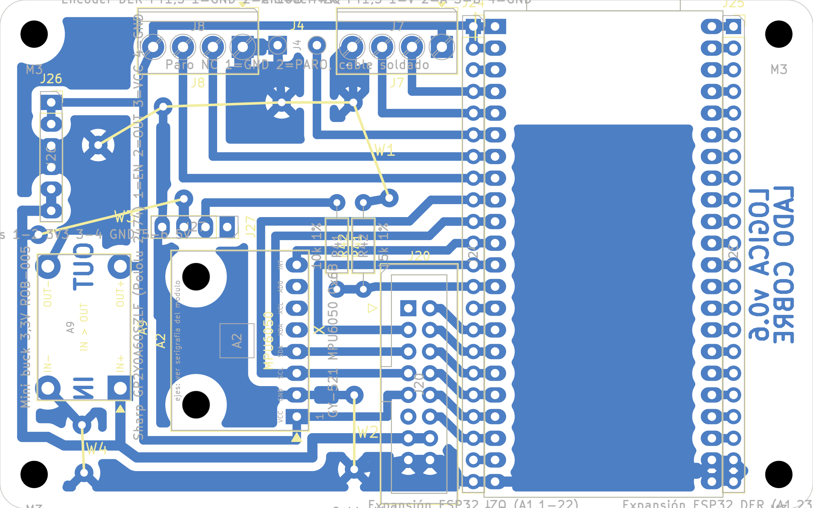

# Placa de lógica v0.6: PCB casera de una cara

Fecha: 31/10/2026. Reemplaza a la [v0.5](pcb_v0.5.md). Guía de montaje: [guia_montaje_v0.6.md](../guia_montaje_v0.6.md). Compras: [lista_compras_v0.6.md](../lista_compras_v0.6.md). Control eléctrico: [auditoria_electrica_v0.6.md](../auditoria_electrica_v0.6.md). Documentos para el equipo: [consolidado](../placas_v0.6_consolidado.pdf) y [completo](../placas_v0.6_completo.pdf).

## Qué cambió desde la v0.5

- **Compactada: 95,25 × 59,6 mm** (antes 100 × 96; 41 % menos de superficie), a pedido de Matías. Se mantienen las tiras de expansión J24/J25.
- **La DevKitC sobresale** del contorno: la antena unos 5 mm por el borde superior (sin cobre debajo, como recomienda Espressif) y los USB-C por el inferior. No puede haber nada pegado a esos dos bordes a la altura de la ESP32.
- **4 puentes de alambre** (antes 5); W1 es largo (43 mm en 4 tramos rectos) y une la masa del borde superior.
- El buck A9 queda a unos 5 mm de la MPU (antes más de 20 mm). La MPU6050 no tiene magnetómetro; se acepta.

## Resumen

| Dato | Valor |
|---|---|
| Contorno | 95,25 × 59,6 mm, esquinas de 3 mm, 4 agujeros M3 en (4; 4), (91,25; 4), (4; 55,6) y (91,25; 55,6) |
| Componentes | 13 del esquema: A1 ESP32-S3-DevKitC-1, A2 MPU6050, A9 buck de 3,3 V, J20, J4, J7, J8, J24, J25, J26, J27, R41 y R42 |
| Puentes ([lista](evidencia/puentes_pcb_v0.6.json)) | W1 GND 43,1 mm (4 tramos); W2 GND 8,7 mm; W3 5V_MCU 17,5 mm; W4 GND 5,6 mm |
| DRC (kicad-cli 10.0.7, con paridad de esquema) | **0 errores, 0 sin conectar, 0 de paridad** ([informe](evidencia/drc_pcb_v0.6.json)) |

## Disposición

- **A1 (ESP32-S3):** vertical al este, antena hacia el borde superior y USB-C hacia el inferior; J24 y J25 pegadas a cada hilera. Al este de J25, una franja con los rótulos «LOGICA v0.6» y «LADO COBRE».
- **Borde superior:** J8, J4 y J7 con la entrada del cable hacia afuera; sus pistas bajan rectas a A1.4–A1.8.
- **Centro:** J20 al oeste de J24; A2 (MPU) girada 90°, entre la columna oeste y J20; R41 y R42 verticales sobre J20; J27 (Sharp) horizontal sobre A2.
- **Columna oeste:** J26 arriba y A9 (buck de 3,3 V) abajo.

## Conexiones externas

| Conector | Qué va |
|---|---|
| J4 (pads) | Paro hacia la ESP32 (GPIO6): con botón de un solo contacto, puentear con alambre |
| J7 / J8 | Encoder IZQ (1 V, 2 A, 3 B, 4 GND) / DER (1 GND, 2 A, 3 B, 4 V), a 3,3 V |
| J27 | Sharp GP2Y0A60SZLF: 1 EN (sin conexión), 2 OUT, 3 VCC 5 V, 4 GND |
| J26 | Sensores nuevos: 1-2 3,3 V, 3-4 GND, 5-6 5 V |
| J24 / J25 | Expansión: cada pin repite el de la ESP32 que tiene al lado |
| J20 | Cable plano a la potencia, pin n con pin n |

## Archivos de fabricación (`fabricacion/rev-0.6/`)

Cobre a escala 1 sin espejar (`segway_logica_cobre_BCu_1a1.pdf`), guía de montaje impresa, taladros (`.drl`, mapa e informe) y modelo 3D (`segway_logica_3d.step`).
