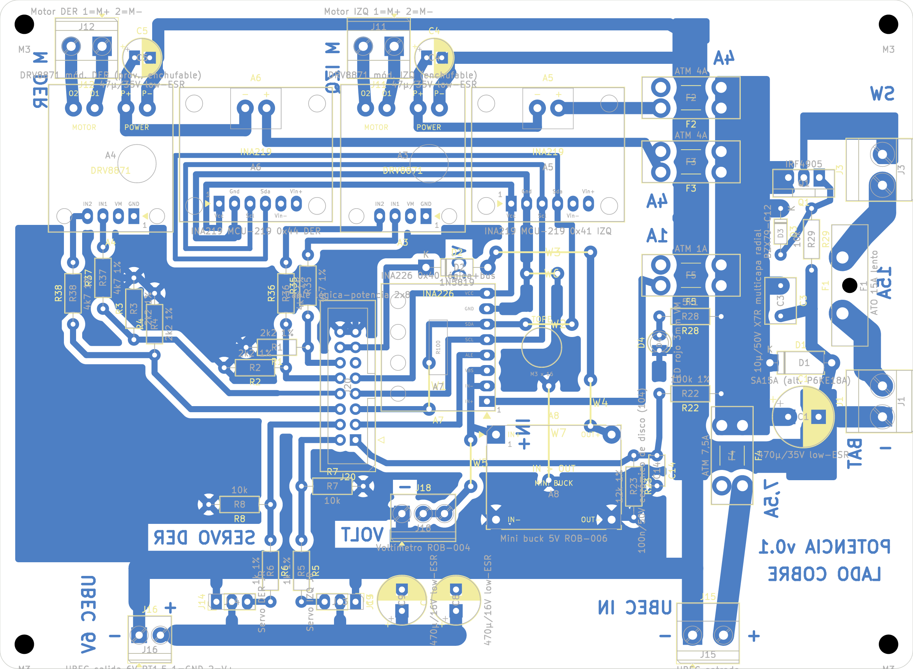

# Placa de potencia v0.1: PCB casera de una cara

Fecha: 20/10/2026. Origen: DEC-17 (dos placas unidas por cable plano). Reglas: [fabricación casera](../segway_base/reglas_fabricacion_casera.md). Supuestos: [lista](../segway_base/supuestos.md), en particular SUP-04, SUP-13, SUP-15, SUP-72 y SUP-75 a SUP-77.

## Resumen

| Dato | Valor |
|---|---|
| Contorno | 150 × 110 mm, esquinas de 3 mm, 4 agujeros M3 |
| Cobre | Una cara (B.Cu). Barra VM_BUS de 8,5 mm, batería 3,5–4,5 mm, motores 1,5–2,0 mm, servos 3,5 mm, señales 1,0 mm |
| Componentes | 49 del esquema y 7 puentes de alambre |
| Puentes | 7, todos en la cara de componentes ([lista](evidencia/puentes_pcb_v0.1.json)): W1 y W2 (SDA, 7,6 mm), W3 (5V, 15,5 mm), W4 (5V, 7,6 mm), W5 (VM_LOG, 7,6 mm), W6 (GND, 5,1 mm), W7 (GND, 15,5 mm) |
| DRC (kicad-cli 10.0.7, con paridad de esquema) | **0 errores, 0 sin conectar, 0 de paridad** ([informe](evidencia/drc_pcb_v0.1.json)) |
| Avisos | 5 `pth_inside_courtyard`: W1, W2, W4 y W7 pasan bajo A7 y A8, que van en zócalos (SUP-76). 48 `lib_footprint_mismatch`: pads caseros más grandes. 7 `lib_footprint_issues`: puentes sin biblioteca. Serigrafía sobre pads y en el borde de J1/J3. |

## Cómo está armada

Ubicación y esqueleto en [`agente/placas/potencia.py`](../../agente/placas/potencia.py); se construye con `construir_pcb.py --placa potencia --costo-via 50 --costo-fcu 60 --fabricar`.

- **Entrada (columna derecha).** J1 (batería) → F1 15 A → J3 (lazo del interruptor y el paro) → Q1 (polaridad) → barra VM_BUS de 8,5 mm.
  - El drenaje de Q1 está en el pin central del TO-220 y llega por una zona con un cuello de unos 1,2 mm. Hay que **estañarlo**, igual que la barra y las pistas de batería.
- **GND en estrella.**
  - El punto de referencia es C1−, junto a J1.
  - Un lomo de GND corre entre los pads de los portafusibles: cada fusible "salta" el lomo, así las salidas de VM y las ramas de GND no se cruzan.
  - Ramas propias van a cada DRV, por el borde superior (la del canal DER pasa bajo el cuerpo de J11).
  - El retorno de servos sube por J15 hasta el lomo.
  - El relleno lógico se une al bus de retorno de servos y al lomo, este último por D4.
- **Canales de motor (arriba).** F2/F3 → INA219 (shunt) → DRV8871 → borneras J11/J12.
  - El VM del INA al DRV y el VM del canal DER van por un corredor bajo el cuerpo de los módulos.
  - Los electrolíticos C4/C5 están junto a VM/GND de cada DRV.
- **Bus I2C.** J20 → A7 (INA226) → A5 → corredor bajo A3 y A5 → rodeo por el oeste de A6 → A6. SDA cruza SCL dos veces (W1 y W2).
  - El GND de los tres INA viaja con el bus y se une al relleno por W6 y W7.
- **Alimentación lógica.** F5 → A7 (shunt) → buck A8 → D2 → J20.13/14 (5V_MCU). El 5V del buck llega a D2 por W3 y W4. VM_LOG llega al voltímetro J18 por W5.
- **Servos (franja inferior).** UBEC por J15 (entrada) y J16 (salida).
  - Bus de GND (y 93,5) y bus de V_SERVO (y 104,5), con los headers J13 y J14 entre ambos.
  - Las resistencias serie R5/R6 pasan por encima del bus de GND.

### Orden del cable J20 (SUP-72)

Pin n a pin n con la placa de lógica:

| Pin | Net | Pin | Net |
|---|---|---|---|
| 1 | VBAT_ADC | 2 | SERVO_IZQ_MCU |
| 3 | INA_ALERT | 4 | SERVO_DER_MCU |
| 5 | I2C_SDA | 6 | IN2_DER_MCU |
| 7 | I2C_SCL | 8 | IN1_DER_MCU |
| 9 | 3V3_MCU | 10 | IN2_IZQ_MCU |
| 11 | sin conexión (en las dos placas) | 12 | IN1_IZQ_MCU |
| 13 | 5V_MCU | 14 | 5V_MCU |
| 15 | GND | 16 | GND |

## Archivos de fabricación (`fabricacion/rev-0.1/`)

| Archivo | Uso |
|---|---|
| `segway_potencia_cobre_BCu_1a1.pdf` | Transferencia de tóner. B.Cu + contorno, escala 1, **sin espejar** (SUP-07). En el papel, «POTENCIA v0.1» y «LADO COBRE» se leen al revés. |
| `segway_potencia_montaje_cara_superior.pdf` | Guía de montaje |
| `segway_potencia.drl`, `segway_potencia-drl_map.pdf`, `segway_potencia_taladros.rpt` | Taladros. 170 metalizados en el archivo: 0,8 mm (44), 0,9 (14), 1,0 (56), 1,1 (3), 1,2 (9), 1,3 (16), 1,5 (10), 1,8 (16) y 2,0 (2). Además 5 sin metalizar: 4 M3 de 3,2 mm y la traba del portafusible ATO, de 2,5 mm. |

## Pasos

1. **Imprimir** el PDF de cobre a tamaño real. Esta placa no tiene escala de 50 mm porque no hay lugar libre en el cobre: verificar con calibre que el contorno impreso mida **150,0 × 110,0 mm**.
2. **Planchar y atacar.** Después, **estañar** la barra VM_BUS, el lomo GND, las pistas de batería y motores y el cuello del drenaje de Q1.
3. **Taladrar** según el mapa.
4. **Montar** en este orden:
   1. Puentes W1–W7 (alambre estañado de 0,6 mm; W3 y W7 de 15,5 mm).
   2. Resistencias y diodos.
   3. Zócalos de los módulos.
   4. Portafusibles, Q1, electrolíticos.
   5. Borneras e IDC.
5. **Comprobar antes de enchufar los módulos:**
   - Que no haya corto VM_BUS–GND, 5V–GND ni 3V3–GND.
   - Continuidad de cada puente.
   - Que J20.13/14 lleguen al cátodo de D2.
   - Que los tres GND de los INA (A5.2, A6.2, A7.7) estén unidos al GND general.

## Pendiente y riesgos

- **Corriente:** con el cobre de 35 µm, las pistas de batería (3,5–4,5 mm) y el cuello de Q1 están por debajo de los 8,5 mm de SUP-46 para 15 A. Por eso se estañan, y en el primer ensayo de carga hay que medir la temperatura.
- **Mecánica:** medir con calibre los módulos (pinouts y separaciones de SUP-22 y SUP-HA) antes de taladrar.
- **Revisión eléctrica:** la revisión con el equipo queda pendiente (Matías, 20/10/2026).
