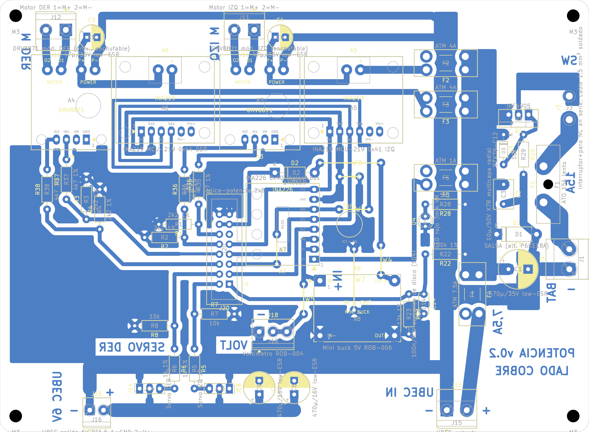

# Placa de potencia v0.2: PCB casera de una cara

Fecha: 26/10/2026. Reemplaza a la [v0.1](pcb_v0.1.md). Origen: DEC-17 (dos placas unidas por cable plano). Decisiones de montaje: [DEC-20](../../planificacion/2026-10-26-decisiones-del-equipo.md). Reglas: [fabricación casera](../segway_base/reglas_fabricacion_casera.md). Supuestos: [lista](../segway_base/supuestos.md). Control eléctrico: [auditoria_electrica_v0.2.md](../auditoria_electrica_v0.2.md). Compras: [lista_compras_v0.2.md](../lista_compras_v0.2.md).

## Qué cambió desde la v0.1

- **J3** pasó de bornera a **pads para soldar el cable** del lazo interruptor general + hongo de emergencia NC (1,5 mm², agujero de 1,8 mm). Lo pidió Matías para conectar cualquier interruptor (SUP-45).
- **Rótulos en el cobre** (SUP-14): BAT con su −, SW, M IZQ, M DER, UBEC IN y UBEC 6V con + y −, SERVO DER, VOLT con su −, 15A (F1), 7,5A (F4) e IN+ junto al pin 1 de A8. F2, F3 (4 A) y F5 (1 A) van sin rótulo: quedaban ambiguos. A7 se orienta por su pad 1 (IN+) cuadrado.
- **Montaje decidido** (DEC-20): A3 y A4 en zócalo; A5, A6, A7 y A8 soldados.
- Textos heredados de la Blue Pill corregidos en la especificación. El circuito no cambió.

## Resumen

| Dato | Valor |
|---|---|
| Contorno | 150 × 110 mm, esquinas de 3 mm, 4 agujeros M3 |
| Cobre | Una cara (B.Cu). Barra VM_BUS de 8,5 mm, batería 3,5–4,5 mm, motores 1,5–2,0 mm, servos 3,5 mm, señales 1,0 mm |
| Componentes | 49 del esquema y 7 puentes de alambre |
| Puentes | 7, en la cara de componentes ([lista](evidencia/puentes_pcb_v0.2.json)): W1 y W2 (SDA, 7,6 mm), W3 (5V, 15,5 mm), W4 (5V, 7,6 mm), W5 (VM_LOG, 7,6 mm), W6 (GND, 5,1 mm), W7 (GND, 15,5 mm) |
| DRC (kicad-cli 10.0.7, con paridad de esquema) | **0 errores, 0 sin conectar, 0 de paridad** ([informe](evidencia/drc_pcb_v0.2.json)) |
| Avisos del DRC | 5 `pth_inside_courtyard`: W1, W2, W4 y W7 pasan bajo A7 y A8 (SUP-76). 48 `lib_footprint_mismatch`: pads caseros más grandes que los de la biblioteca. 7 `lib_footprint_issues`: los puentes no están en una biblioteca. El resto es serigrafía, que en esta placa solo va en la guía impresa. |

## Cómo está armada

Ubicación y esqueleto en [`agente/placas/potencia.py`](../../agente/placas/potencia.py). Se construye con `construir_pcb.py --placa potencia --costo-via 50 --costo-fcu 60 --fabricar`.

- **Entrada (columna derecha).** J1 (batería) → F1 15 A → J3 (lazo del interruptor y el hongo) → Q1 (polaridad) → barra VM_BUS de 8,5 mm.
- **GND en estrella.**
  - El punto de referencia es C1−, junto a J1.
  - Un lomo de GND corre entre los pads de los portafusibles.
  - Cada DRV tiene una rama propia por el borde superior.
  - El retorno de los servos sube por J15.
- **Canales de motor (arriba).** F2/F3 → INA219 (shunt) → DRV8871 → borneras J11/J12.
- **Bus I2C.** J20 → A7 (INA226) → A5 → corredor bajo A3 y A5 → A6. SDA cruza SCL dos veces (W1 y W2). El GND de los INA se une al relleno por W6 y W7.
- **Alimentación lógica.** F5 → A7 (shunt) → buck A8 → D2 → J20.13/14 (5V_MCU).
- **Servos (franja inferior).** UBEC por J15 (entrada) y J16 (salida), con los headers J13 y J14 entre el bus de GND y el de V_SERVO.

### Montaje de los módulos (DEC-20)

| Módulo | Montaje |
|---|---|
| A3, A4 (DRV8871) | **Zócalo**: tira hembra 1 × 4 para el header, y 4 posiciones sueltas para los agujeros de las borneras (paso 3,5 mm). Al módulo se le desueldan sus borneras y se le ponen pines macho |
| A5, A6 (INA219) | **Soldados**, con pines macho en los agujeros de su bornera. Antes: puente A0 en A5 (0x41) y A1 en A6 (0x44) |
| A7 (INA226) | **Soldado**, con el pin 1 (IN+) en el pad cuadrado |
| A8 (buck) | **Soldado** sobre 4 pines macho, con IN+ del lado del rótulo IN+ |

Los módulos soldados van sobre sus pines, con el espaciador de plástico de la tira (unos 2,5 mm). Debajo pasan W1 (bajo A7) y W7 (bajo A8), y el pad de W4 queda en el borde de A8: van pegados a la placa, enfundados en termocontraíble y se montan antes de soldar los módulos (SUP-76).

**Q1:** la aleta del TO-220 es el drenador y queda con tensión de batería. El disipador va con mica y buje aislante, o sin tocar nada metálico (SUP-20).

### Conexiones externas

| Conector | Qué va | Cable |
|---|---|---|
| J1 | Batería: 1 = −, 2 = + (rótulo BAT y −). Con un **fusible en línea de 20 A** junto al pack | 1,5 mm² |
| J3 (pads) | Interruptor general y contacto NC del hongo, **en serie**. Si se abre cualquiera de los dos, se corta toda la potencia. Fijar el cable con un precinto al separador M3 de la esquina superior derecha | 1,5 mm², soldado |
| J11 / J12 | Motor IZQ / DER (1 = M+). Si gira al revés, se corrige el signo en el firmware | El del motor |
| J15 / J16 | Entrada del UBEC / salida del UBEC a 6,0 V | El del UBEC |
| J13 / J14 | Servo IZQ / DER: 1 = GND, 2 = V, 3 = señal. **La señal de los dos queda hacia el centro**, entre J14 y J13 (están espejados) | JR del servo |
| J18 | Voltímetro: 1 = GND, 2 y 3 = VM_LOG | El del voltímetro |
| J20 | Cable plano a la placa de lógica, pin n con pin n | Plano de 16 hilos, corto |

### Orden del cable J20 (SUP-72)

| Pin | Net | Pin | Net |
|---|---|---|---|
| 1 | VBAT_ADC | 2 | SERVO_IZQ_MCU |
| 3 | INA_ALERT | 4 | SERVO_DER_MCU |
| 5 | I2C_SDA | 6 | IN2_DER_MCU |
| 7 | I2C_SCL | 8 | IN1_DER_MCU |
| 9 | 3V3_MCU | 10 | IN2_IZQ_MCU |
| 11 | sin conexión (en las dos placas) | 12 | IN1_IZQ_MCU |
| 13 | 5V_MCU | 14 | 5V_MCU |
| 15 | GND | 16 | GND |

## Archivos de fabricación (`fabricacion/rev-0.2/`)

| Archivo | Uso |
|---|---|
| `segway_potencia_cobre_BCu_1a1.pdf` | Transferencia de tóner. B.Cu + contorno, escala 1, **sin espejar** (SUP-07). En el papel, los rótulos se leen al revés |
| `segway_potencia_montaje_cara_superior.pdf` | Guía de montaje, con referencias y contornos |
| `segway_potencia.drl`, `segway_potencia-drl_map.pdf`, `segway_potencia_taladros.rpt` | Taladros: 0,8 mm (44), 0,9 (14), 1,0 (56), 1,1 (3), 1,2 (9), 1,3 (16), 1,5 (8), 1,8 (18) y 2,0 (2). Sin metalizar: 4 M3 de 3,2 mm y la traba del portafusible ATO, de 2,5 mm |

## Pasos

1. **Imprimir** el PDF de cobre a tamaño real y verificar con calibre que el contorno mida **150,0 × 110,0 mm**. Esta placa no tiene escala de control.
2. **Planchar y atacar.** Después, **estañar** la barra VM_BUS, el lomo GND, las pistas de batería y de motores y el cuello del drenaje de Q1.
3. **Taladrar** según el mapa.
4. **Montar** en este orden:
   1. Puentes W1–W7 (alambre estañado de 0,6 mm). W1, W2, W4 y W7, enfundados.
   2. Resistencias y diodos.
   3. Zócalos de A3 y A4.
   4. A5 y A6 con sus puentes de dirección ya hechos, A7 (pin 1 en el pad cuadrado) y A8 (IN+ junto a su rótulo), soldados.
   5. Portafusibles, Q1 con su disipador aislado, electrolíticos.
   6. Borneras, headers de servo e IDC.
   7. Cables soldados en J3.
5. **Comprobar sin batería:**
   - Que no haya corto VM_BUS–GND, 5V–GND ni 3V3–GND.
   - Continuidad de cada puente.
   - Que los GND de los INA (A5.2, A6.2, A7.7) estén unidos al GND general.
6. **Primera alimentación**, con fuente limitada a 0,5 A, los DRV sin enchufar y la placa de lógica desconectada:
   - J20.13 (5V_MCU) tiene que dar entre 4,5 y 5,2 V. Si da más de 5,5 V, A8 quedó soldado girado.
   - J20.9 no tiene que tener tensión. Si tiene, A7 quedó soldado girado.
   - Medir continuidad del cable armado: pin 1 con pin 1 y pin 13 con pin 13 (un IDC prensado al revés manda 5 V a dos GPIO, SUP-72).
   - Recién entonces conectar el cable a la lógica y enchufar los DRV.

## Pendiente y riesgos

- **Medidas antes de taladrar:** contornos, pinout y paso de las borneras del DRV8871, el INA219 y el buck que compraron (grupo 3 de la [revisión](../../planificacion/2026-10-26-revision-supuestos-version-final.md)).
- **Mecánica sin definir:** tamaño, fijación y largo del cable (SUP-04, 05 y 72).
- **Batería sin confirmar** (SUP-42): el TVS y el divisor asumen 3 celdas de litio.
- **Corriente:** las pistas de batería (3,5–4,5 mm) quedan por debajo de los 5 mm de SUP-10 para 10 A continuos. Se estañan, y en el primer ensayo de carga se mide su temperatura.
