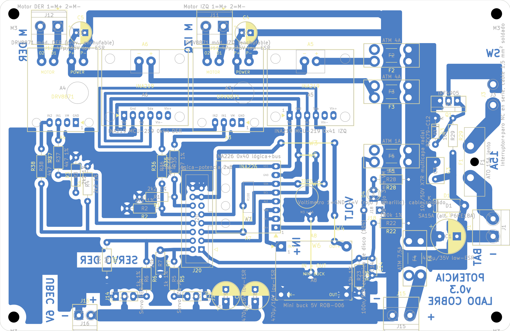

# Placa de potencia v0.3: PCB casera de una cara

Fecha: 31/10/2026. Reemplaza a la [v0.2](pcb_v0.2.md). Montaje: [DEC-20](../../planificacion/2026-10-26-decisiones-del-equipo.md). Reglas: [fabricación casera](../segway_base/reglas_fabricacion_casera.md). Supuestos: [lista](../segway_base/supuestos.md). Control eléctrico: [auditoria_electrica_v0.3.md](../auditoria_electrica_v0.3.md). Compras: [lista_compras_v0.3.md](../lista_compras_v0.3.md).

## Qué cambió desde la v0.2

- **Entra en placa virgen de 10 × 15 cm:** mide **148 × 96 mm** (antes 150 × 110), con 1 mm de margen a lo largo y 2 mm a lo ancho. Para lograrlo:
  - la franja de servos subió 13 mm;
  - la columna de entrada se corrió 2 mm al oeste;
  - las entradas del DRV derecho se volvieron a rutear a mano.
- **Sin D2.** El 5 V del buck A8 va directo al cable (5V_MCU, 5,0 V). La ESP32 ya no toma 5 V por su pin 5V, así que el USB no puede retroalimentar el buck.
- **Voltímetro (J18):** pasó a **2 pads para soldar** junto a F5: 1 = GND (negro), 2 = VM_LOG_F (rojo y amarillo juntos).
- **Retorno de los servos:** baja por el pad GND del buck (A8.2) a un bus inferior hasta J15 y el lomo.
- **Puentes:** 6, uno menos que en la v0.2.

## Resumen

| Dato | Valor |
|---|---|
| Contorno | 148 × 96 mm, esquinas de 3 mm, 4 agujeros M3 a 4 mm de cada esquina |
| Componentes | 48 del esquema y 6 puentes de alambre |
| Puentes ([lista](evidencia/puentes_pcb_v0.3.json)) | W1 y W2 (SDA, 7,6 mm), W3 (5V, 15,5 mm), W4 (5V, 7,6 mm), W5 (GND, 5,1 mm), W6 (GND, 15,5 mm) |
| DRC (kicad-cli 10.0.7, con paridad de esquema) | **0 errores, 0 sin conectar, 0 de paridad** ([informe](evidencia/drc_pcb_v0.3.json)) |
| Avisos | 5 `pth_inside_courtyard`: W1, W2, W4 y W6 bajo A7 y A8, que van soldados con espaciador. Los pads caseros son más grandes que los de la biblioteca. El resto es serigrafía, que solo va en la guía impresa. |

## Montaje de los módulos

| Módulo | Montaje |
|---|---|
| A3, A4 (DRV8871) | **Zócalo**: tira hembra 1 × 4 y 4 posiciones sueltas para los agujeros de las borneras. Al módulo se le desueldan sus borneras y se le ponen pines macho |
| A5, A6 (INA219) | **Soldados**, con pines macho en los agujeros de su bornera. Antes: puente A0 en A5 y A1 en A6 |
| A7 (INA226) | **Soldado**, con el pin 1 (IN+) en el pad cuadrado |
| A8 (buck de 5 V) | **Soldado** sobre 4 pines macho, con IN+ del lado de su rótulo |

Los módulos soldados quedan unos 2,5 mm sobre la placa (espaciador de la tira). Los puentes que pasan por debajo van pegados a la placa y enfundados en termocontraíble, y se montan antes.

**Q1:** la aleta del TO-220 es el drenador y queda con tensión de batería. El disipador va con mica y buje aislante, o sin tocar nada metálico (SUP-20).

## Conexiones externas

| Conector | Qué va | Cable |
|---|---|---|
| J1 | Batería: 1 = −, 2 = + (rótulos BAT y −), con un **fusible en línea de 20 A** junto al pack | 1,5 mm² |
| J3 (pads) | Interruptor general y contacto NC del hongo, **en serie**. Atar el cable con un precinto al separador de la esquina superior derecha | 1,5 mm², soldado |
| J11 / J12 | Motor IZQ / DER (1 = M+) | El del motor |
| J15 / J16 | Entrada del UBEC / salida del UBEC a 6,0 V | El del UBEC |
| J13 / J14 | Servo IZQ / DER: 1 = GND, 2 = V, 3 = señal. La señal de los dos queda hacia el centro | JR del servo |
| J18 (pads) | Voltímetro: 1 = GND (negro), 2 = rojo y amarillo juntos | Soldado |
| J20 | Cable plano a la placa de lógica, pin n con pin n (pin 11 sin conexión) | Plano de 16 hilos, corto |

## Archivos de fabricación (`fabricacion/rev-0.3/`)

| Archivo | Uso |
|---|---|
| `segway_potencia_cobre_BCu_1a1.pdf` | Transferencia de tóner. B.Cu + contorno, escala 1, **sin espejar** (SUP-07). En el papel, los rótulos se leen al revés |
| `segway_potencia_montaje_cara_superior.pdf` | Guía de montaje |
| `segway_potencia.drl`, `segway_potencia-drl_map.pdf`, `segway_potencia_taladros.rpt` | Taladros: 0,8 mm (42), 0,9 (14), 1,0 (58), 1,1 (3), 1,2 (4), 1,3 (16), 1,5 (8), 1,8 (18) y 2,0 (2). Sin metalizar: 4 M3 de 3,2 mm y la traba del portafusible ATO, de 2,5 mm |

## Pasos

1. **Imprimir** el PDF de cobre a tamaño real y verificar con calibre que el contorno mida **148,0 × 96,0 mm**.
2. **Planchar y atacar.** Después, **estañar** la barra VM_BUS, el lomo GND, las pistas de batería y de motores, el bus de servos y el cuello del drenaje de Q1.
3. **Taladrar** según el mapa.
4. **Montar** en este orden:
   1. Puentes W1–W6 (alambre estañado de 0,6 mm); los que quedan bajo A7 y A8, enfundados.
   2. Resistencias y diodos.
   3. Zócalos de A3 y A4.
   4. A5 y A6 con sus puentes de dirección ya hechos, A7 y A8, soldados y orientados.
   5. Portafusibles, Q1 con su disipador aislado, electrolíticos.
   6. Borneras, headers de servo e IDC.
   7. Cables soldados en J3 y J18.
5. **Comprobar sin batería:**
   - que no haya corto VM_BUS–GND, 5V_MCU–GND ni 3V3–GND;
   - continuidad de cada puente;
   - que los GND de los INA estén unidos al GND general.
6. **Primera alimentación**, con fuente limitada a 0,5 A, los DRV sin enchufar y la lógica desconectada:
   - J20.13 (5V_MCU) tiene que dar entre 4,8 y 5,2 V. Si da más de 5,5 V, A8 quedó soldado girado.
   - J20.9 no tiene que tener tensión. Si tiene, A7 quedó soldado girado.
   - Medir continuidad del cable armado: pin 1 con pin 1 y pin 13 con pin 13.
   - Recién entonces conectar el cable y enchufar los DRV.

## Pendiente y riesgos

- **Medidas antes de taladrar:** contornos, pinout y paso de las borneras del DRV8871, el INA219 y el buck comprados (grupo 3 de la [revisión](../../planificacion/2026-10-26-revision-supuestos-version-final.md)).
- **Mecánica:** fijación y largo del cable (SUP-05 y SUP-72). **Batería** sin confirmar (SUP-42).
- **Corriente:** las pistas de batería (3,5–4,5 mm) quedan por debajo de los 5 mm de SUP-10 para 10 A continuos. Se estañan, y en el primer ensayo de carga se mide su temperatura.
