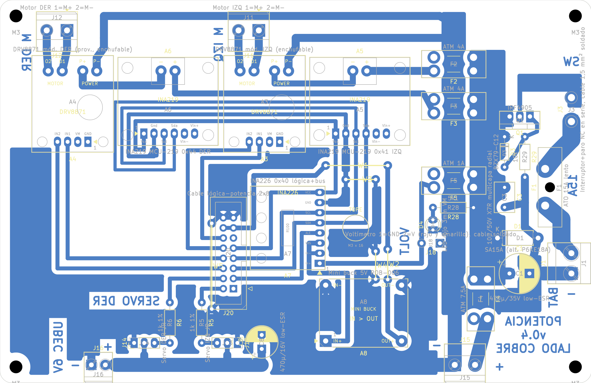

# Placa de potencia v0.4: PCB casera de una cara

Fecha: 31/10/2026. Reemplaza a la [v0.3](pcb_v0.3.md). Montaje: [DEC-20](../../planificacion/2026-10-26-decisiones-del-equipo.md). Reglas: [fabricación casera](../segway_base/reglas_fabricacion_casera.md). Supuestos: [lista](../segway_base/supuestos.md). Control eléctrico: [auditoria_electrica_v0.4.md](../auditoria_electrica_v0.4.md). Compras: [lista_compras_v0.4.md](../lista_compras_v0.4.md). Fotos de los módulos: [componentes_comprados/fotos](../../componentes_comprados/fotos/README.md).

## Qué cambió desde la v0.3

Con las fotos de los módulos comprados y el pedido del equipo de dejar en la placa solo lo que los módulos no traen:

- **INA226 (A7) corregido:** su tira es IN+, IN−, VBS, ALE, **SDA, SCL**, GND, VCC. En la v0.3 SDA y SCL estaban invertidos y el I2C del INA226 no hubiera andado. Con el orden real ya no se cruzan, y se fueron dos puentes.
- **Buck de 5 V (A8) corregido:** la huella estaba **espejada**. El IN− del módulo caía en la salida de 5 V y la ponía en corto. Ahora IN+ y OUT+ quedan abajo y GND arriba, y VM_LOG le llega por debajo del módulo.
- **Fuera lo que los módulos ya resuelven** (de 48 a 32 componentes):
  - C4 y C5: el DRV8871 comprado ya trae 47 µF/50 V.
  - R1–R4 y R35–R38: las entradas de los DRV van directo; el DRV tiene pull-down interno y no entra girado.
  - R7 y R8: pull-down de los servos.
  - C9: queda un solo 470 µF en los servos.
  - R22, R23 y C14: la batería la mide el INA226; J20.1 queda sin conexión.
- **Puentes:** 5 (antes 6). W5 lleva el GND del cable (J20.15/16) por encima de las líneas de los DRV y de los servos hasta el relleno principal.

## Resumen

| Dato | Valor |
|---|---|
| Contorno | 148 × 96 mm, esquinas de 3 mm, 4 agujeros M3 a 4 mm de cada esquina |
| Componentes | 32 del esquema y 5 puentes de alambre |
| Puentes ([lista](evidencia/puentes_pcb_v0.4.json)) | W1 (5V, 15,5 mm), W2 (5V, 7,6 mm), W3 (GND de los INA, 7,5 mm), W4 (GND, 7,0 mm), W5 (GND del cable, 21,5 mm) |
| DRC (kicad-cli 10.0.7, con paridad de esquema) | **0 errores, 0 sin conectar, 0 de paridad** ([informe](evidencia/drc_pcb_v0.4.json)) |
| Avisos | 4 `pth_inside_courtyard`: puentes junto a A7, A8 y J20 (W2 y W4 cerca de A8, W5 en el borde de J20). Los pads caseros son más grandes que los de la biblioteca. El resto es serigrafía, que solo va en la guía impresa. |

## Montaje de los módulos

| Módulo | Montaje |
|---|---|
| A3, A4 (DRV8871) | **Zócalo**: tira hembra 1 × 4 y 4 posiciones sueltas para los agujeros de las borneras. Al módulo se le desueldan sus borneras y se le ponen pines macho |
| A5, A6 (INA219) | **Soldados**, con pines macho en los agujeros de su bornera. Antes: puente A0 en A5 y A1 en A6 |
| A7 (INA226) | **Soldado**, con el pin 1 (IN+) en el pad cuadrado |
| A8 (buck de 5 V) | **Soldado** sobre 4 pines macho: IN+ abajo a la izquierda (pad cuadrado), OUT+ abajo a la derecha, IN− y OUT− arriba |

Los módulos soldados quedan unos 2,5 mm sobre la placa (espaciador de la tira). W2 y W4 llegan hasta el borde de A8: van pegados a la placa, enfundados en termocontraíble, y se montan antes.

**Q1:** la aleta del TO-220 es el drenador y queda con tensión de batería. El disipador va con mica y buje aislante, o sin tocar nada metálico (SUP-20).

## Conexiones externas

| Conector | Qué va | Cable |
|---|---|---|
| J1 | Batería: 1 = −, 2 = + (rótulos BAT y −), con un **fusible en línea de 20 A** junto al pack | 1,5 mm² |
| J3 (pads) | Interruptor general y contacto NC del hongo, **en serie**. Atar el cable con un precinto al separador de la esquina superior derecha | 1,5 mm², soldado |
| J11 / J12 | Motor IZQ / DER (1 = M+) | El del motor |
| J15 / J16 | Entrada del UBEC / salida del UBEC a 6,0 V | El del UBEC |
| J13 / J14 | Servo IZQ / DER: 1 = GND, 2 = V, 3 = señal. La señal de los dos queda hacia el centro | JR del servo |
| J18 (pads) | Voltímetro: 1 = GND (negro), 2 = rojo y amarillo juntos | Soldado |
| J20 | Cable plano a la placa de lógica, pin n con pin n (pines 1 y 11 sin conexión) | Plano de 16 hilos, corto |

## Archivos de fabricación (`fabricacion/rev-0.4/`)

| Archivo | Uso |
|---|---|
| `segway_potencia_cobre_BCu_1a1.pdf` | Transferencia de tóner. B.Cu + contorno, escala 1, **sin espejar** (SUP-07). En el papel, los rótulos se leen al revés |
| `segway_potencia_montaje_cara_superior.pdf` | Guía de montaje |
| `segway_potencia.drl`, `segway_potencia-drl_map.pdf`, `segway_potencia_taladros.rpt` | Taladros: 0,8 mm (14), 0,9 (10), 1,0 (56), 1,1 (3), 1,2 (4), 1,3 (16), 1,5 (8), 1,8 (18) y 2,0 (2). Sin metalizar: 4 M3 de 3,2 mm y la traba del portafusible ATO, de 2,5 mm |

## Pasos

1. **Imprimir** el PDF de cobre a tamaño real y verificar con calibre que el contorno mida **148,0 × 96,0 mm**.
2. **Planchar y atacar.** Después, **estañar** la barra VM_BUS, el lomo GND, las pistas de batería y de motores, el bus de servos y el cuello del drenaje de Q1.
3. **Taladrar** según el mapa.
4. **Montar** en este orden:
   1. Puentes W1–W5 (alambre estañado de 0,6 mm); los que llegan a A8, enfundados.
   2. Resistencias y diodos.
   3. Zócalos de A3 y A4.
   4. A5 y A6 con sus puentes de dirección ya hechos, A7 y A8, soldados y orientados.
   5. Portafusibles, Q1 con su disipador aislado, electrolíticos.
   6. Borneras, headers de servo e IDC.
   7. Cables soldados en J3 y J18.
5. **Comprobar sin batería:**
   - que no haya corto VM_BUS–GND, 5V_MCU–GND ni 3V3–GND;
   - continuidad de cada puente;
   - que los GND de los INA estén unidos al GND general.
6. **Primera alimentación**, con fuente limitada a 0,5 A, los DRV sin enchufar y la lógica desconectada:
   - J20.13 (5V_MCU) tiene que dar entre 4,8 y 5,2 V. Si da 0 V o la fuente limita, revisar la orientación de A8 antes de seguir.
   - J20.9 no tiene que tener tensión. Si tiene, A7 quedó soldado girado.
   - Medir continuidad del cable armado: pin 1 con pin 1 y pin 13 con pin 13.
   - Recién entonces conectar el cable y enchufar los DRV.

## Pendiente y riesgos

- **Medidas antes de taladrar:** contornos, pinout y paso de las borneras del DRV8871, el INA219 y el buck comprados (grupo 3 de la [revisión](../../planificacion/2026-10-26-revision-supuestos-version-final.md)).
- **Mecánica:** fijación y largo del cable (SUP-05 y SUP-72). **Batería** sin confirmar (SUP-42).
- **Corriente:** las pistas de batería (3,5–4,5 mm) quedan por debajo de los 5 mm de SUP-10 para 10 A continuos. Se estañan, y en el primer ensayo de carga se mide su temperatura.
