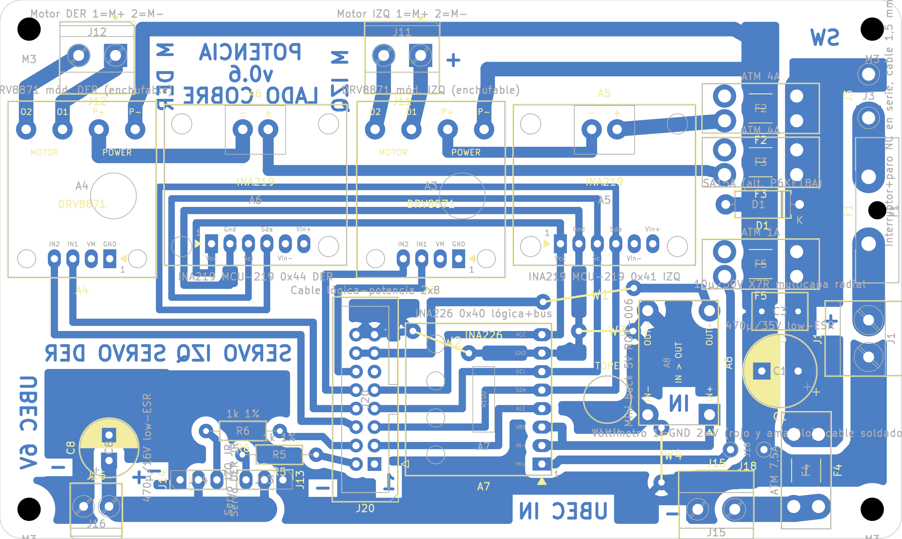

# Placa de potencia v0.6: PCB casera de una cara

Fecha: 31/10/2026. Reemplaza a la [v0.5](pcb_v0.5.md). Guía de montaje: [guia_montaje_v0.6.md](../guia_montaje_v0.6.md). Compras: [lista_compras_v0.6.md](../lista_compras_v0.6.md). Control eléctrico: [auditoria_electrica_v0.6.md](../auditoria_electrica_v0.6.md). Documentos para el equipo: [consolidado](../placas_v0.6_consolidado.pdf) y [completo](../placas_v0.6_completo.pdf).

## Qué cambió desde la v0.5

- **Compactada: 124 × 74 mm** (antes 148 × 96; 35 % menos de superficie), a pedido de Matías.
- **Sin protección electrónica contra batería invertida** (salen Q1 IRF4905, R29, D3 y el disipador): la batería se conecta con un **conector polarizado** en un cable corto atornillado a J1. J3 (interruptor y paro) alimenta directo la barra VM_BUS.
- **Retornos de masa** con conexión sólida: batería (J1.1 → lomo, ≥4,4 mm), servos (2,0 mm) y UBEC (2,6 mm).
- **4 puentes de alambre** (antes 5). Toda la masa va fija en el esqueleto: la construcción sale igual en cada corrida.
- Rótulos de cobre que ya no entran: −/BAT de J1 (queda el «+»), + de J15, VOLT/− de J18, 15A de F1 y 7,5A de F4. Esos datos están en la guía impresa.

## Resumen

| Dato | Valor |
|---|---|
| Contorno | 124 × 74 mm, esquinas de 3 mm, 4 agujeros M3 en (4; 4), (120; 4), (4; 70) y (120; 70) |
| Componentes | 27 del esquema: A3/A4 DRV8871, A5/A6 INA219, A7 INA226, A8 buck de 5 V, fusibles F1–F5, D1, C1, C3, C8, R5, R6 y conectores |
| Puentes ([lista](evidencia/puentes_pcb_v0.6.json)) | W1 5V_MCU 12,6 mm; W2 GND 8,3 mm (bajo A7, pegado); W3 GND 7,5 mm; W4 GND 7,5 mm (en parte bajo A8, pegado) |
| DRC (kicad-cli 10.0.7, con paridad de esquema) | **0 errores, 0 sin conectar, 0 de paridad** ([informe](evidencia/drc_pcb_v0.6.json)) |

## Disposición

- **Franja de motores (arriba):** A4 DRV DER, A6 INA DER, A3 DRV IZQ y A5 INA IZQ; J12 y J11 sobre las salidas, con el cable al norte.
- **Columna de fusibles (x 96–113):** F2, F3, D1 (TVS), F5, C3 y C1 saltan el lomo de masa; la barra VM_BUS va al este y toma J3.2. F4 va al pie de la barra.
- **Borde este:** J3 (pads del interruptor y el paro), F1 y J1 (batería, cable al este, rótulo «+» junto al pin 2). Debajo de J1 baja el retorno de masa de la batería, de 4,5 mm.
- **Banda lógica:** J20, A7 (INA226) a su este con el bus I2C bajo el cuerpo, A8 (buck) girado al este de A7; J15 (UBEC IN) en el borde sur.
- **Servos (oeste):** R6 y R5 sobre J14 y J13; J16 (UBEC 6V) en la esquina sudoeste con C8 encima; bus V_SERVO por el borde sur.

## Conexiones externas

| Conector | Qué va |
|---|---|
| J1 | Batería por cable corto con conector polarizado: 1 −, 2 + (y fusible en línea de 20 A junto al pack) |
| J3 (pads) | Interruptor general y botón de emergencia en serie (con traba, 15 A o más) |
| J11 / J12 | Motor IZQ / DER: 1 M+, 2 M− |
| J15 / J16 | UBEC entrada / salida 6,0 V: 1 −, 2 + |
| J13 / J14 | Servo IZQ / DER: 1 GND, 2 V, 3 señal |
| J18 (pads) | Voltímetro: 1 GND, 2 + |
| J20 | Cable plano a la lógica, pin n con pin n |

## Archivos de fabricación (`fabricacion/rev-0.6/`)

Cobre a escala 1 sin espejar (`segway_potencia_cobre_BCu_1a1.pdf`), guía de montaje impresa, taladros (`.drl`, mapa e informe) y modelo 3D (`segway_potencia_3d.step`; los módulos no tienen modelo).
