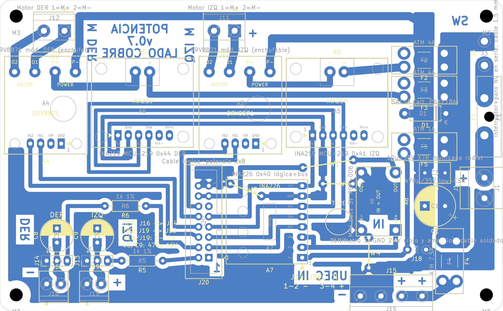

# Placa de potencia v0.7: PCB casera de una cara

Fecha: 01/11/2026. Reemplaza a la [v0.6](pcb_v0.6.md). La placa de lógica no cambia: sigue en la [v0.6](../segway_logica/pcb_v0.6.md). Guía de montaje: [guia_montaje_v0.7.md](../guia_montaje_v0.7.md). Compras: [lista_compras_v0.7.md](../lista_compras_v0.7.md). Control eléctrico: [auditoria_electrica_v0.7.md](../auditoria_electrica_v0.7.md). Documentos para el equipo: [consolidado](../placas_v0.7_consolidado.pdf) y [completo](../placas_v0.7_completo.pdf).

## Qué cambió desde la v0.6

Revisión del equipo del 01/11/2026: *«habíamos dimensionado un UBEC para cada servo, y en el diseño de la PCB hay uno solo para los dos»*. Dos DS3240 bloqueados toman entre 6,2 A (5 V) y 7,8 A (6,8 V) según la [ficha del servo](../../componentes_comprados/datasheets/ROB-010_DS3240MG/FICHA_Y_FUENTES.md) (p. 3): un UBEC de 6 A no alcanza para los dos.

- **Un UBEC por servo, con buses separados.** J16 recibe la salida del UBEC DER y alimenta J14 (servo DER) y C8. **J19** (nueva) recibe la del UBEC IZQ y alimenta J13 (servo IZQ) y **C9** (vuelve, igual que C8). Las nets V_SERVO_DER y V_SERVO_IZQ no se tocan.
- **J15 de 4 bornes** para la entrada de los dos UBEC: 1-2 GND y 3-4 VM_UBEC. Los + quedan del lado de F4 y los − del lado del relleno: así se rutea en una cara sin cruces ni puentes.
- **F4 compartido (7,5 A).** Con un servo por UBEC, cada uno toma como máximo ≈2,5 A de entrada (3,9 A × 6 V / 0,85 / 11,1 V): ≈5 A con los dos servos bloqueados.
- **Columnas de servo rehechas** en la esquina sudoeste. Cada columna tiene, de sur a norte, la bornera del UBEC, el header del servo y el capacitor; el retorno de cada servo vuelve directo a la bornera de su UBEC. Un bus GND por el borde sur une los − de J16 y J19 con el relleno.
- **77 mm de alto** (antes 74): la fila de borneras de los UBEC y J15 necesita 3 mm más hacia el sur.
- Rótulos de cobre: − y + de J15, − de J16, + de J19 y DER/IZQ en cada columna. En la guía impresa se ocultan los valores de J13, J14, J16 y J19, que se pisaban; quedan las referencias.

## Resumen

| Dato | Valor |
|---|---|
| Contorno | 124 × 77 mm, esquinas de 3 mm, 4 agujeros M3 en (4; 4), (120; 4), (4; 73) y (120; 73) |
| Componentes | 29 del esquema: A3/A4 DRV8871, A5/A6 INA219, A7 INA226, A8 buck de 5 V, fusibles F1–F5, D1, C1, C3, C8, C9, R5, R6 y conectores |
| Puentes ([lista](evidencia/puentes_pcb_v0.7.json)) | Los 4 de la v0.6, sin cambios: W1 5V_MCU 12,6 mm; W2 GND 8,3 mm (bajo A7, pegado); W3 GND 7,5 mm; W4 GND 7,5 mm (en parte bajo A8, pegado) |
| DRC (kicad-cli 10.0.7, con paridad de esquema) | **0 errores, 0 sin conectar, 0 de paridad** ([informe](evidencia/drc_pcb_v0.7.json)) |
| Control eléctrico | 0 fallas, 2 avisos (los de la v0.6); control nuevo «Un UBEC por servo»: OK |

## Disposición

- **Franja de motores (arriba), columna de fusibles y entrada (borde este), banda lógica (J20, A7, A8, J18):** igual que en la v0.6.
- **J15 (entrada de los UBEC):** borde sur, entre W4 y F4. VM_UBEC va de F4.2 a los bornes 3 y 4; los bornes 1 y 2 vuelven al lomo por el retorno de la banda lógica.
- **Servos (esquina sudoeste):** columna DER (J16, J14, C8) junto al borde oeste y columna IZQ (J19, J13, C9) a su lado. La señal DER sube entre las dos columnas, pasa por R6 (arriba de ellas) y baja a J20.4; la IZQ va de J13 por R5 a J20.2.

## Conexiones externas

| Conector | Qué va |
|---|---|
| J1 | Batería por cable corto con conector polarizado: 1 −, 2 + (y fusible en línea de 20 A junto al pack) |
| J3 (pads) | Interruptor general y botón de emergencia en serie (con traba, 15 A o más) |
| J11 / J12 | Motor IZQ / DER: 1 M+, 2 M− |
| J15 | Entrada de los dos UBEC: 1 y 2 −, 3 y 4 + |
| J16 / J19 | Salida 6,0 V del UBEC DER / IZQ: 1 −, 2 + |
| J14 / J13 | Servo DER / IZQ: 1 GND, 2 V, 3 señal |
| J18 (pads) | Voltímetro: 1 GND, 2 + |
| J20 | Cable plano a la lógica, pin n con pin n (sin cambios) |

## Archivos de fabricación (`fabricacion/rev-0.7/`)

Cobre a escala 1 sin espejar (`segway_potencia_cobre_BCu_1a1.pdf`), guía de montaje impresa, taladros (`.drl`, mapa e informe) y modelo 3D (`segway_potencia_3d.step`; los módulos no tienen modelo).
