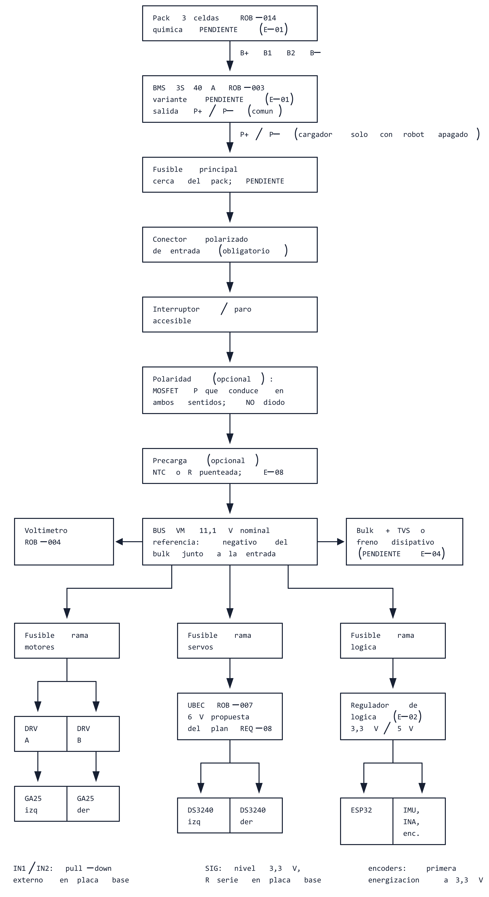

# Distribución de energía y protecciones — borrador revisado

Fecha: 2026-10-17. Estado: **borrador revisado** (ELE-017 preparatorio; incorpora 31 observaciones de tres verificadores, ver §11). Responsable: Matías. Redactado a partir de los datasheets archivados y de los documentos del repositorio; no contiene resultados de ensayos.

Enlaces: [requisitos y decisiones](../requisitos_y_decisiones.md) · [plan de electrónica y PCB](../planificacion/2026-10-15-plan-electronica-pcb.md) · [plan de ensayos](../ensayos/plan_de_ensayos.md) · [inventario](../componentes_comprados/inventario/inventario_robotica.md) · [índice de datasheets](../componentes_comprados/datasheets/README.md) · [método de la cátedra para batería](../../guias_catedra/procedimiento_dimensionamiento_bateria_robotica_II_UNCUYO.md) · [parámetros del modelo](../../modelado/parametros/parametros_fisicos.m).

Convención de fuentes usada en todo el documento:

| Marca | Significado |
|---|---|
| **[M]** | Confirmación de Matías (solo DEC-01…05 y REQ-22) |
| **[P]** | Propuesta del plan o de un requisito abierto, **no** confirmada por Matías (por ejemplo, 6 V de servos, REQ-08) |
| **[V]** | Dato de vendedor, anuncio, etiqueta o ficha de distribuidor |
| **[D p.x]** | Dato del datasheet del integrado o de la familia, con página |
| **[H]** | Hipótesis, interpretación o cálculo derivado; no es especificación |
| **PENDIENTE** | Falta medir o identificar; se indica el ensayo que lo cierra |

Notas de alcance de las fuentes:

- Los datasheets describen integrados o familias; nada de lo que dicen vale para el módulo físico hasta verificarlo (REQ-22). La placa ESP32 y el módulo MPU6050 exactos no están identificados [M]; aquí **no se asigna ningún GPIO**.
- **[D BMS]** = ficha de la familia BMS-40A-3S-S/E/B (Shenzhen Global Technology, copia Mantech), con coincidencia visual y revisión no confirmada ([ficha ROB-003](../componentes_comprados/datasheets/ROB-003_BMS_3S_40A/FICHA_Y_FUENTES.md)). Sus umbrales aplican al ejemplar solo si E-01 confirma la variante.
- **[D DS3240]** = ficha de distribuidor (Micro Robotics) sobre la familia DS3240, no hoja del fabricante DSSERVO; variante angular (180°/270°/-FB, p.1) y cableado del ejemplar PENDIENTE E-01/E-05.
- **[V familia GA25]** = tabla de familia de un distribuidor; la versión de 300 RPM no figura y la [ficha ROB-011](../componentes_comprados/datasheets/ROB-011_GA25-370_300RPM/FICHA_Y_FUENTES.md) prohíbe trasladar sus corrientes y pares. Tampoco se trasladan parámetros del JGB37-520 del modelo.

## 1. Alcance y estado

Este borrador organiza la arquitectura de energía del plan §3 en un árbol de ramas, fija el método de dimensionado de cada elemento y enumera qué ensayo produce cada dato faltante. Cubre: pack → BMS → protecciones → bus VM; rama de motores (dos DRV8871); rama de servos (UBEC a 6 V [P]); rama de lógica (ESP32, MPU6050, INA); medición de corriente; retornos y masa; frenado regenerativo; secuencia de encendido.

Lo que **no** hace: no fija valores de fusibles, calibres ni conectores (REQ-15 exige medir primero); no elige la placa ESP32 ni el regulador de lógica (depende de E-01/E-02); no asigna GPIO; no reabre DEC-01…05.

Decisiones cerradas que se respetan [M]: dos GA25-370 y dos DS3240 MG (DEC-01); ESP32 y MPU6050 sin variante asumida (DEC-02); fuente nominal de 11,1 V con tres celdas y un controlador, química pendiente (DEC-03); todos los componentes como módulos completos y la PCB como placa base de interconexión (DEC-04/REQ-22); KiCad + IA + MCP (DEC-05/REQ-23).

Antecedentes de septiembre (ELE-001…012, evidencia perdida): fusibles 15 A / 5 A por motor / 10 A entrada BEC, LiPo 3S con Mini-Tamiya, INA226 con R010 por rama, ACS712, cemento 0,01 Ω/5 W. Se tratan como **antecedentes no verificados** y se citan solo como tales.

## 2. Árbol de energía

Fuente editable: [arbol_energia.bob](diagramas/arbol_energia.bob) · vector: [arbol_energia.svg](diagramas/arbol_energia.svg) (generados con la skill `svgbob-diagrams` el 2026-10-17; PNG verificado visualmente).

Cadena de entrada propuesta [H]: pack de 3 celdas (ROB-014) → BMS 3S 40 A (ROB-003) por B+/B1/B2/B− → salida P+/P− del BMS → fusible principal cerca del pack → conector polarizado de entrada (obligatorio) → interruptor/paro accesible → protección de polaridad activa opcional (solo MOSFET que conduzca en ambos sentidos, §2.4) → precarga opcional (§8) → **bus VM** con bulk y supresión de transitorios (§7). Del bus VM salen tres ramas: motores (dos DRV8871, sin regulador intermedio), servos (UBEC a 6 V [P]) y lógica (regulador por definir → ESP32, IMU, INA, encoders). El voltímetro ROB-004 cuelga del bus VM aguas abajo del interruptor.

Por qué el bus se toma de P+/P− y no de B+/B−: la figura de conexión del BMS muestra pads 0V/4.2V/8.4V/12.6V hacia las celdas y un único par ⊕/⊖ "Charge&Discharge" (puerto común de carga y descarga) [D BMS p.1]; tomar de B+/B− saltaría toda la protección. El cargador también entra por P+/P− [D BMS p.1], con el robot apagado.

**Referencia de instrumentos y USB:** toda la electrónica del robot se referencia a **P−**. En estas placas los MOSFET de protección suelen estar en el negativo, de modo que P− y B− no son el mismo nodo [H; confirmar en E-01 midiendo continuidad B−↔P− y B+↔P+ sin carga]. Regla para ensayos y uso: la masa de osciloscopio, fuente de banco, PC por USB y adaptadores se conecta **solo a P−**; tensiones de celda o de B− solo con multímetro flotante o con el robot sin cargas. Una sonda con masa a tierra conectada a B− o a un tap de celda mientras hay cargas puentea los MOSFET del BMS: la corriente del motor circula por la sonda o el cable USB y el BMS deja de proteger.

### 2.1 Tensiones del bus VM

Los valores del BMS son de la familia [D BMS]; aplican al ejemplar solo si E-01 confirma la variante.

| Condición | Valor | Fuente | Observación |
|---|---|---|---|
| Nominal de diseño | 11,1 V | [M] DEC-03 / REQ-03 | Única cifra confirmada |
| Máximo **si** las celdas son de litio 3,7/4,2 V | 12,6 V (3 × 4,2 V); protección de sobrecarga del BMS 4,2–4,3 V/celda (típ. 4,25 V) → 12,6–12,9 V de pack | [D BMS p.2]; química PENDIENTE (E-01, REQ-04) | 12,6 V solo aplica si se confirma la química. Con cargador hasta 13,6 V (rango de carga del BMS, p.1) el bus puede verse más alto durante la carga |
| Mínimo por corte del BMS | ≈ 7,5 V (3 × 2,5 V; tabla del BMS 2,4–2,6 V; el texto de fallas dice 2,7 V: inconsistencia interna) | [D BMS p.2] | Demasiado bajo para cuidar celdas: la alarma de batería baja del firmware (REQ-17) debe actuar antes, umbral PENDIENTE |
| "Baja" del modelo | 9,6 V | comentario de `o.V_bat`, parametros_fisicos.m l. 122 [H] | No es el umbral del BMS; no usar como especificación |
| Elevación por frenado | PENDIENTE | REQ-16, ver §7 | Medir con osciloscopio en E-04/E-08, con el elemento de polaridad elegido instalado |

### 2.2 Tabla por rama

Columna "corriente de diseño": todo PENDIENTE; se indica el ensayo que la produce. Columna "protección": método, no valor.

| Rama | Tensión nominal / extremos | Corriente de diseño | Conector / calibre | Protección | Punto de medida | Retorno |
|---|---|---|---|---|---|---|
| Pack → BMS (B+, B1, B2, B−) | 11,1 V nom; extremos según química PENDIENTE | PENDIENTE: I_bat de §3 medida en E-08 | Pads del BMS 0V/4.2V/8.4V/12.6V [D BMS p.1] y cables del pack; calibre por método §2.3 | La del BMS (familia): sobrecorriente 70–90 A (B/E) o 54–66 A (S) con retardo 100–200 ms [D BMS p.2]; protección de cortocircuito **no documentada** → **no protege nada del robot** | Tensión por celda solo con multímetro flotante o sin cargas | B− es la referencia del pack; no tocar desde la PCB ni con instrumentos referidos a tierra (§2) |
| BMS P+/P− → fusible principal → conector polarizado → interruptor/paro → polaridad (opc.) → precarga (opc.) → bus VM | 11,1 V nom | PENDIENTE: suma de ramas, pico, duración e inrush (E-08) | Cable del pack al conector de entrada de la placa base; tipo PENDIENTE (Mini-Tamiya solo antecedente) | Fusible principal por método §2.3; interruptor/paro en serie accesible; polaridad por método §2.4; precarga según §8 | Voltímetro ROB-004 en bus VM; punto de prueba VM/P− en la placa base | Retorno de potencia hacia P− |
| Motores: bus VM → DRV8871 A y B → GA25-370 | VM directa; chip 6,5–45 V recomendado, UVLO 6,1–6,5 V [D DRV8871 p.4, p.5, p.10] | PENDIENTE (E-04: I_VM en vacío, arranque, bloqueo breve, inversión). Techo del chip: 3,6 A pico [D p.1, p.4]; ≈ 2 A RMS medidos por TI a 25 °C en FR-4 estándar [D p.12], no aplicable al módulo sin ensayo; ver térmica §2.5 | Pads/pines del módulo DRV8871 PENDIENTE (E-01); cables M+/M− rojo/blanco [V inventario ROB-011] | Fusible por rama (método §2.3): protege cable y batería, **no** al driver (OCP 3,7–6,4 A actúa antes [D p.5]). Entradas IN1/IN2 con pull-down externo en la placa base (§8.1) | I_VM en la entrada de cada módulo (plan §3); VM con osciloscopio para REQ-16; temperatura del módulo (E-04) | Retorno de potencia corto hacia el nodo de referencia de entrada; ver §6 |
| Servos: bus VM → UBEC → DS3240 ×2 | Entrada UBEC 2–6S [V ficha YSIDO]; salida 6 V [P] (REQ-08: "ensayo inicial propuesto a 6 V"; no confirmado por Matías), dentro de 4,8–6,8 V [D DS3240 p.2]; **7,4 V excluido**. Señal: pulso de 3,3–5 V ("VCC:(3.3-5)V"), 500–2500 µs, neutro 1500 µs, 50–330 Hz [D DS3240 p.3] | PENDIENTE (E-05 un servo, E-06 ambos). Referencia de familia: bloqueo 3,1 A @5 V, 3,9 A @6,8 V [D p.3]; ≈ 3,5 A @6 V interpolado [H]; dos servos ≈ 7 A [H] > 6 A rotulados del UBEC [V] | Entrada UBEC: conector rojo de 2 vías en la captura, de aspecto tipo RCY/JST [H]; tipo, paso y polaridad PENDIENTE E-01. Salida: conector de servo 3 pines. Servo: JR-3pin 2,54 mm GND–V+–SIG (marrón/rojo/naranja) [D p.3, p.4]; orden y colores a verificar en el servo físico (E-01/E-05) | Fusible en la entrada del UBEC (método §2.3; 10 A histórico = antecedente); el UBEC no documenta protección propia. Resistencia serie en cada SIG en la placa base (≈ 330 Ω–1 kΩ [H], valor tras E-05): el header JR invertido pone SIG sobre GND y el GPIO quedaría en cortocircuito (IOH típ. 40 mA [D ESP32 p.52]) | Tensión en el header de cada servo (mínimo bajo pico); corriente de entrada del UBEC; respuesta a pulso de 3,3 V medido en el header (E-05) | Retorno de servos hacia el nodo de referencia de entrada; nunca a través de la zona de IMU/I²C |
| Lógica: bus VM → regulador → ESP32, IMU, INA ×3, encoders | 5 V y/o 3,3 V según placa ESP32 PENDIENTE (REQ-09); SoC 3,0–3,6 V [D ESP32 p.51]; MPU6050 2,375–3,46 V [D p.14]; INA219 VS 3–5,5 V [D p.3, p.6]; INA226 VS 2,7–5,5 V [D p.3, p.6] | PENDIENTE (E-02 con firmware representativo). Mínimo documental: ≥ 0,5 A solo para el SoC [D ESP32 p.19, p.51]; ráfaga TX 240 mA [D p.52]; IMU 3,9 mA [D p.14]; INA219 0,7 mA, INA226 0,33 mA típ. [D INA219 p.6; INA226 p.6] | Pines de la placa ESP32 y de los módulos PENDIENTE (E-01) | Fusible lento o polyfuse en la entrada del regulador; el límite de corriente del regulador (LM2596 3,6–6,9 A pico [D p.7]) **no** protege la rama | Salida del regulador, pin 3V3 de la ESP32, VCC de la IMU | Por el plano de masa común; ver §6 |
| Voltímetro ROB-004 | Alimentación 4/5–30 V [V ficha DIYMORE de referencia; equivalencia con el ejemplar no demostrada] | > 20 mA permanentes [V ídem] | 3 cables rojo/negro/amarillo [V inventario]; asignación PENDIENTE (E-01) | Dentro del fusible principal; interruptor opcional | — | P− |

### 2.3 Método para dimensionar fusibles y calibres (sin valores)

1. Medir por rama la corriente media, el pico y su duración (E-04 motores, E-06 servos, E-02 lógica, E-08 conjunto), más el inrush de encendido (§8).
2. Fijar la corriente nominal del fusible por encima de la corriente de trabajo con el margen de la cátedra (≥ 1,5×, ≈ 2× sin buenos datos) [cátedra §B], y por debajo de la corriente admisible del cable y conector elegidos.
3. Elegir característica lenta para ramas con arranque de motor o servo (picos de decenas a centenas de ms [H]), rápida solo si se demuestra que el pico no la funde.
4. Comprobar que el fusible principal sea mayor que la suma de los de rama y que ambos queden muy por debajo del disparo por sobrecorriente del BMS (54–90 A [D BMS p.2]): el BMS es la última barrera, no la primera.
5. Calibre: sección por corriente continua con el mismo margen, longitud real del mazo (cable del servo 300 ± 5 mm [D DS3240 p.2]) y caída admisible; el modelo asume R_bat = 0,05 Ω total incluyendo cables (parametros_fisicos.m l. 123 [H]): el cableado de potencia debería quedar en decenas de mΩ.
6. Los valores históricos 15 A / 5 A / 10 A se contrastan con la medida y se descartan o se adoptan con evidencia.

### 2.4 Protección de polaridad (método) y compatibilidad con el frenado

**Restricción por REQ-16.** En coast y en inversión la corriente del motor vuelve a VM por los diodos de cuerpo del DRV8871 [D DRV8871 p.8 Fig. 4, p.14]. Cualquier elemento en serie que **bloquee la corriente inversa** (diodo Schottky, controlador de "diodo ideal", MOSFET con control que lo abra ante corriente inversa) impide que esa energía llegue al pack aun con el BMS sano: en cada frenada VM sube hasta donde la absorban los capacitores del bus, exactamente el escenario de §7. Por eso:

- (a) **Conector polarizado único en la entrada** del pack: obligatorio en cualquier caso.
- (b) Diodo en serie: **descartado** salvo que se añada freno disipativo en el bus que absorba toda la energía regenerada [H]; además tiene pérdida permanente (≈ 0,3–0,5 V a la corriente total [H]).
- (c) Si se añade protección activa: **MOSFET de canal P simple** en el lado alto, con compuerta referida a P− por resistencia y zener de protección compuerta-fuente [H]. Con polaridad correcta queda encendido y, una vez encendido, conduce en ambos sentidos, de modo que no bloquea la regeneración; con polaridad invertida queda apagado. Caída I·RDS(on) del MOSFET elegido [H]. Alternativa equivalente: MOSFET de canal N en el retorno con compuerta tomada del bus [H]. Su compuerta con RC puede además dar arranque suave (§8) [H].

Criterio: (a) siempre; (c) si la corriente total medida y la caída tolerable lo permiten. La decisión se valida en E-04/E-08 midiendo VM al frenar **con el elemento de polaridad elegido ya instalado** (vinculada a la decisión 9 de §10). El voltímetro ROB-004 declara protección contra polaridad inversa [V anuncio de compra, inventario ROB-004; también ficha DIYMORE de referencia], no verificada en el ejemplar y que no cubre al resto: no contar con ella hasta E-01.

### 2.5 Térmica del DRV8871 (cálculo con datos del chip; módulo PENDIENTE)

Potencia disipada por el puente con corriente RMS de motor: P_D = I_RMS² · (R_DS(on)HS + R_DS(on)LS) [D DRV8871 p.12 ec. 2; p.16 ec. 3]. Con R_DS(on) = 307 + 258 mΩ típ. y 360 + 320 mΩ máx. (VM = 24 V, 1 A, 25 °C) [D p.5] y RθJA = 41,1 °C/W **en placa JEDEC** [D p.4]:

| I_RMS [H] | P_D (típ.–máx.) | ΔT_J = P_D · 41,1 °C/W | T_J con 25 °C ambiente |
|---|---|---|---|
| 1,0 A | 0,57–0,68 W | 23–28 °C | 48–53 °C |
| 1,5 A | 1,27–1,53 W | 52–63 °C | 77–88 °C |
| 2,0 A | 2,26–2,72 W | 93–112 °C | 118–137 °C |

Lectura [H]: a 2 A RMS la juntura queda cerca del umbral de TSD (150 °C mín., 175 °C típ. [D p.5]) aun con la placa JEDEC; R_DS(on) crece con la temperatura [D p.6 Fig. 1, p.16], así que la tabla es optimista. El "2 A RMS" de TI vale para FR-4 estándar a 25 °C y depende de PCB, ambiente y frecuencia PWM [D p.12]. **RθJA del módulo comprado: PENDIENTE** (cobre y disipación desconocidos). Un TSD deshabilita el puente y se recupera solo, sin aviso [D p.10]: el robot perdería par en pleno equilibrio.

Acciones: en E-04 registrar temperatura del encapsulado/pad del módulo a la corriente RMS medida y el tiempo hasta TSD con bloqueo breve; en E-07 correlacionar con la lectura del INA219. Si la corriente real se acerca a 2 A RMS: plano de cobre bajo el módulo o disipador en la placa base, o bajar la corriente de regulación con R_ILIM (I_TRIP = V_ILIM / R_ILIM, V_ILIM 59–64–69 kV [D p.5, p.9 ec. 1]); R_ILIM del módulo PENDIENTE (E-01).

## 3. Fórmula de I_bat del plan §3

`I_bat ≈ I_VM_izq + I_VM_der + V_servo·(I_servo_izq + I_servo_der)/(η_UBEC·V_bat) + P_lógica/(η_lógica·V_bat)`

| Variable | Qué es | De dónde sale | Estado |
|---|---|---|---|
| I_VM_izq, I_VM_der | Corriente en la **entrada** de cada módulo DRV8871 (ya incluye el PWM promediado), no la corriente instantánea del bobinado | E-04 por motor; E-07 para su sensor | PENDIENTE |
| V_servo | Tensión de la rama de servos | 6 V [P] propuesta del plan (REQ-08), no confirmada; medir real en E-06 | 6 V (propuesta) |
| I_servo_izq, I_servo_der | Corriente de cada servo a V_servo | E-05 (uno), E-06 (ambos simultáneos; Paso B de la cátedra exige todos los servos a la vez) | PENDIENTE |
| η_UBEC | Rendimiento del UBEC a 11,1 V de entrada y 6 V de salida | No documentado [V]; E-02 (entrada/salida con carga) | PENDIENTE |
| P_lógica | Potencia consumida por ESP32 + IMU + INA + encoders + voltímetro (si cuelga del regulador) | E-02/E-03 con firmware representativo; con y sin radio | PENDIENTE |
| η_lógica | Rendimiento del regulador de lógica | LM2596: ≈ 0,80 a 5 V/3 A y ≈ 0,73 a 3,3 V/3 A con VIN 12 V [D LM2596 p.6, p.8]; a cargas menores cae; mini buck PENDIENTE | Valor inicial solo para LM2596 |
| V_bat | Tensión real del pack durante la medida | Voltímetro o INA226 por VBUS (§5) | 11,1 V nominal |

Reglas de uso: no sumar corrientes medidas a tensiones distintas (por eso las ramas reguladas se refieren por potencia); para autonomía usar la corriente media en batería (Paso C de la cátedra: Ah = I_media × t, selección × 1,3–1,5); para fusibles, cables y reguladores usar picos y duración. El consumo del DRV8871 en sí es 3 mA típ/10 mA máx a 12 V [D p.5] y el del BMS 12–24 µA [D BMS p.2]: despreciables.

Orden de magnitud **solo para elegir el rango de los instrumentos de banco** (no de diseño): motores ~1,3 A de bloqueo [H, tomado de la tabla de la familia GA25 [V familia p.1], que no incluye 300 RPM y cuyos datos no se trasladan al motor comprado]; servos ~3,5 A por servo a 6 V [H]; lógica ≥ 0,5 A [D ESP32 p.19]. Dos servos bloqueados a la vez ya superarían los 6 A rotulados del UBEC antes de aplicar el margen 1,5 de la cátedra [H]: E-06 decide si el UBEC se valida o se reemplaza (REQ-08).

## 4. Rama de lógica: opciones comparadas

### 4.1 Candidatos

| Opción | Hechos de datasheet / ficha | A favor | En contra | Qué verificar en E-02 |
|---|---|---|---|---|
| (a) Mini buck 5 V fijo (ROB-006, ×5) → entrada 5 V/VIN de la placa ESP32 (si la placa la tiene, PENDIENTE E-01) | Chip **no identificado**; MP1584 solo candidato: 4,5–28 V, 3 A, hasta 1,5 MHz, IQ 100 µA, ICL 4,0–4,7 A [D MP1584 NO CONFIRMADO p.1–3, p.8]; inductor 4R7 en la foto [V] | Compacto, salida fija (sin potenciómetro), rizado bajo esperable con cerámicos y alta frecuencia [H] | Sin límites documentados; corriente térmica real dudosa con inductor tan pequeño [H]; sin pin EN expuesto (según foto) | Marcado del chip; entrada a 11,1 y 12,6 V; carga escalonada 0,5/1/2 A con temperatura; rizado con osciloscopio |
| (b) LM2596 ajustable (ROB-001, ×2) a 5 V | 3 A, VIN 4,5–40 V (45 V abs.), 150 kHz, IQ 5 mA, ICL 3,6–6,9 A, η ≈ 0,80 a 5 V/3 A [D LM2596 p.1, p.5, p.7, p.6/p.8]; dropout ≈ 0,95 V @1 A [D p.8–9]; RθJA TO-263 20–50 °C/W según cobre [D p.5, p.33]; ΔTJ ≈ 45–50 °C a 2 A/5 V con 9 in² [D p.33–34] | Chip documentado; margen de entrada ante elevación del bus; regulado hasta el corte del BMS (7,5 V − 0,95 V > 5 V) | Potenciómetro multivuelta: giro accidental cambia la tensión (sellar y añadir punto de prueba) [D p.27–29]; rizado de salida típicamente 1–2 % de VOUT; menos de 15 mV exige post-filtro LC [D p.17 §9.1.3, p.21–23]; inductor de núcleo abierto radia a pistas cercanas [D p.19, p.23]; térmica del módulo sin datos | Marcados reales (chip, diodo "SS34", 100 µF/50 V, 220 µF/35 V [V foto]); rizado a 5 V; temperatura a 0,5/1/2 A |
| (c) Mini buck 3,3 V fijo (ROB-005, ×5) → pin 3V3 de la ESP32 directo | Chip no identificado (ídem a) | Ahorra una conversión; única vía si la placa ESP32 no tiene regulador propio | Solo si la placa admite alimentación externa en 3V3 sin dañar su regulador (PENDIENTE REQ-01); debe sostener ≥ 0,5 A del SoC [D ESP32 p.19] más IMU/INA/encoders; el 3,3 V queda expuesto al rizado del buck sin LDO intermedio [H] | Continuidad 3V3 ↔ salida del regulador de la placa; comportamiento con USB conectado |
| (d) Compartir el UBEC con la lógica | UBEC 5/6/7,4 V, 6 A rotulados [V] | Un regulador menos | Los transitorios de los servos (picos de ~4 A por servo [H]) entrarían en la alimentación de ESP32/IMU; 6 V no sirve para la ESP32 sin otra etapa | **Desaconsejado**; no ensayar salvo decisión explícita |

Recomendación provisional: (a) con (b) como respaldo si la placa ESP32 tiene entrada de 5 V con regulador; (c) si no lo tiene. Decidir tras E-02 y tras identificar la placa ESP32 (E-01). Ningún regulador del inventario protege la rama: el fusible/polyfuse de la rama de lógica es independiente de la elección.

### 4.2 Cómo alimentar la ESP32 (5 V a VIN vs 3,3 V directo)

Depende de la placa, PENDIENTE (REQ-01): no se asume que tenga conector USB, pin VIN/5V ni regulador on-board. Hechos del SoC que condicionan la decisión: todos los VDD a 3,3 V (3,0–3,6 V con flash en encapsulado; 3,6 V absoluto) [D ESP32 p.51]; fuente ≥ 0,5 A [D p.19, p.51]; ráfagas de 240 mA en TX [D p.52]; CHIP_PU no debe quedar flotante, t_STBL ≥ 50 µs con rieles estables antes de subir EN, y con batería se recomienda llevar CHIP_PU a bajo si la alimentación cae por debajo de 2,3 V [D p.19 §2.5.3]. Qué verificar en E-01/E-03: existencia y datos del regulador on-board (marcado, Vin admisible, Iout, dropout), si el pin 3V3 admite entrada externa, y consumo de la placa completa (LED, USB-UART, LDO) con y sin radio.

Criterio: si la placa tiene entrada de 5 V con regulador 5 V → 3,3 V documentado y con corriente suficiente, usar (a) por VIN; el LDO de la placa filtra el rizado del buck para el SoC y la IMU [H]. Si no tiene regulador, o no es adecuado, (c) con desacoplo local y verificación de rizado.

### 4.3 Evitar realimentación por USB

Problema (solo **si la placa tiene USB y entrada de 5 V**, PENDIENTE E-01): con el cable USB conectado para programar o diagnosticar (REQ-23, ensayos) y la placa base energizada, el 5 V del USB y el 5 V del regulador de lógica pueden quedar en paralelo si la placa no tiene diodo o conmutación entre ambos. Riesgo: corriente del regulador hacia el puerto USB del PC o del USB hacia la rama de lógica, y 5 V del PC inyectado al bus de la placa base. Además, la masa del USB del PC debe llegar solo a P− (§2).

Medidas para la placa base (a decidir tras E-01):

1. Medir en E-01, sin alimentar, la continuidad entre el 5 V del conector USB de la placa y su pin VIN/5V (si existen); si hay continuidad directa, nunca conectar USB y alimentación externa a la vez hasta tener la medida 2 o 3.
2. Puente/jumper en la placa base que abre la línea 5 V del regulador hacia la ESP32 durante la programación (opción simple, requiere disciplina).
3. Diodo Schottky o diodo ideal en serie entre el regulador de lógica y VIN de la ESP32 (impide retorno hacia el regulador; añade caída que el LDO de la placa debe tolerar) [H]. Esta rama de lógica no tiene el problema de regeneración de §2.4.
4. Alternativa de diagnóstico sin USB de alimentación: adaptador USB-UART **con niveles de 3,3 V** (o selector en 3,3 V), conectando solo TX/RX/GND y dejando su 5 V sin conectar; un TX de 5 V superaría VIH máx = VDD + 0,3 V ≈ 3,6 V [D ESP32 p.52]. Resistencia serie opcional en la línea hacia el RX de la ESP32 [H]. Pines: el UART0 por defecto del SoC usa U0TXD/U0RXD por IO_MUX [D p.15] y la UART puede reubicarse en otros pines por la GPIO Matrix [D p.37]; qué pines expone la placa y si U0 ya está tomado por su propio puente USB-UART: PENDIENTE E-01. No se asignan pines aquí.

Los módulos INA y la IMU deben alimentarse del mismo 3,3 V que fija los niveles I²C de la ESP32: VIH mín = 0,7·VS en INA219/INA226 [D INA219 p.5; INA226 p.5] y SCL ≤ VS + 0,3 V [D INA219 p.4]; VLOGIC ≤ VDD en la MPU6050 [D p.14, p.23]. Si un módulo se alimentara a 5 V, el nivel alto de 3,3 V no alcanzaría el VIH garantizado (0,7 × 5 V = 3,5 V).

## 5. Medición de corriente

### 5.1 Análisis del shunt R100 (0,1 Ω supuesto [H] a partir del marcado [V])

| Módulo | Fondo de escala de shunt | I_FS con 0,1 Ω | Caída y potencia a I_FS | Resolución | Fuente |
|---|---|---|---|---|---|
| INA219, PGA /8 (defecto) | ±320 mV | 3,2 A | 0,32 V; 1,02 W | 100 µA/LSB (LSB 10 µV) | [D INA219 p.5, p.19] + cálculo [H] |
| INA219, PGA /4 | ±160 mV | 1,6 A | 0,16 V; 0,26 W | 100 µA/LSB | ídem |
| INA219, PGA /2 | ±80 mV | 0,8 A | 80 mV; 64 mW | 100 µA/LSB | ídem |
| INA219, PGA /1 | ±40 mV | 0,4 A | 40 mV; 16 mW | 100 µA/LSB | ídem |
| INA226 (fijo) | ±81,92 mV | 0,819 A | 82 mV; 67 mW | 25 µA/LSB (LSB 2,5 µV) | [D INA226 p.5] + cálculo [H] |
| INA226 con 0,01 Ω (antecedente R010) | ±81,92 mV | 8,19 A | 36 mV; 0,13 W a 3,6 A | 250 µA/LSB | [D INA226 p.5] + ELE-011/012 [H] |

Consecuencias:

- Rama de motor con el techo del DRV8871 (3,6 A pico [D p.4]): el INA219 con R100 saturaría (0,36 V > 0,32 V) y el shunt disiparía ≈ 1,3 W; solo es aceptable si la corriente real medida en E-04 queda bien por debajo de 3,2 A y la potencia nominal del shunt del módulo (PENDIENTE, encapsulado no confirmado) lo soporta. La elección del PGA depende únicamente de la medida de E-04.
- INA226 con R100 no sirve para una rama de motor (saturación 4,4× a 3,6 A); sí para la rama de lógica si su pico es < 0,819 A (antecedente ELE-010, coincide con el recálculo) o para medir la tensión del bus por VBUS sin corriente por el shunt (antecedente ELE-008).
- Shunt en serie con el total del robot: con R100 a 5 A serían 2,5 W y 0,5 V de caída (plan §4 l. 88): prohibido; para el total haría falta R010 o menor, de potencia, con conexión Kelvin [D INA219 p.27; INA226 p.14].
- Tensión de bus: INA219 mide en IN− respecto de GND, sin pin VBUS separado [D p.3, p.10]; INA226 tiene VBUS independiente [D INA226 p.3 (pin VBUS), p.5 (impedancia 830 kΩ), p.15 (ejemplo VBUS a IN−)], por lo que puede medir el bus mientras su shunt está en otra rama (si el módulo no une VBS a IN−: PENDIENTE E-01).
- Límites de modo común: INA219 26 V es **máximo absoluto** en IN+/IN− [D p.4 §7.1]; la condición recomendada es VCM nominal 12 V [D p.4 §7.3], ya superada por el pack lleno (12,6 V) sin que el datasheet fije un máximo recomendado distinto; INA226 0–36 V de bus [D p.5].
- Tiempos: INA219 12 bits 532 µs por canal (≈ 1,06 ms el par) [D p.5, p.20]; INA226 por defecto 1,1 ms × 2; configuración 588 µs/588 µs/AVG 4 ≈ 4,7 ms [D p.13, p.23]. Son lecturas de diagnóstico, fuera del lazo de 5 ms (plan §4).

### 5.2 Propuesta de asignación (propuesta, no decisión)

| Rama | Módulo propuesto | Shunt | Condición | Cambio requerido |
|---|---|---|---|---|
| Motor izquierdo (entrada del DRV8871 A) | INA219 n.º 1 (dirección distinta de la n.º 2 vía A0/A1 [D p.14]) | R100 de fábrica, PGA según E-04 | Pico medido < 1,6 A (PGA /4) o < 3,2 A (PGA /8) y temperatura del shunt aceptable en E-07 | Ninguno si se cumple; si no, shunt externo 0,01–0,02 Ω con Kelvin y recalibración [H] |
| Motor derecho (entrada del DRV8871 B) | INA219 n.º 2 | ídem | ídem | ídem |
| Bus VM total / batería | INA226 | Opción "solo tensión": IN+ e IN− unidos entre sí y al bus (V_shunt = 0), VBUS al bus; válida solo si E-01 confirma que el módulo no une VBS a IN−. Opción "I_bat total": shunt R010 de potencia con Kelvin | Verificar en E-01 VBS–IN− y si ALE es ALERT con pull-up. Si VBS e IN− están unidos, decidir entre R010 o reasignar el INA226 a la rama de lógica | Opción con R010: antecedente ELE-011/012 (cemento 0,01 Ω/5 W), a validar en E-07 |
| Lógica | Sin sensor permanente; medir en E-02 con instrumento de banco | — | — | Alternativa: INA226 con R100 en lógica (< 0,819 A) y bus sin corriente, si la prioridad es P_lógica en vez de I_bat |

Uso del ALERT del INA226: salida open-drain con pull-up a VS, funciones SOL/SUL/BOL/BUL/POL o CNVR, polaridad y enclavamiento configurables [D INA226 p.3, p.12, p.26–28]. Como alarma de batería baja (BUL) o sobrecorriente (SOL) por hardware hacia una entrada de la ESP32 cubre parte de "fallo/habilitación" del presupuesto de recursos; el GPIO no se asigna hasta identificar la placa. Con IN+/IN− unidos, SOL/SUL no tienen sentido; solo BUL/BOL. Hay que confirmar en E-01 que el pin "ALE" del módulo es ALERT [V inventario ROB-009].

Direcciones I²C: los tres INA arrancan en 0x40 [D INA219 p.14; INA226 p.18]; el INA226 no expone A0/A1 en sus 8 pines [V], así que su dirección se fija por puentes internos PENDIENTE. La MPU6050 usa 0x68/0x69 [D p.15]. Pull-ups del conjunto: inventariar las de cada módulo antes de añadir ninguna; la ventana de valores (orden de 1–3,5 kΩ a 400 kHz) es un cálculo [H] a partir de t_r = 20 + 0,1·C_b y C_b ≤ 400 pF [D MPU6050 p.18], no una cifra del datasheet.

Filtrado: pads no montados para 10 Ω serie + 0,1–1 µF en IN+/IN− y TVS, recomendados ante transitorios de puente H [D INA219 p.11, p.27; INA226 p.14].

## 6. Retornos y masa

Principios (plan §3 l. 60: "la separación funcional de ramas no implica masas flotantes ni cortar arbitrariamente el plano de tierra"):

1. **Referencia común única y plano continuo.** Toda la electrónica comparte una masa (P−) y un plano de masa continuo, sin cortes ni islas; la separación de ramas es de **ubicación y trazado**, no galvánica. Los INA miden la tensión de bus respecto de su GND [D INA219 p.3], por lo que su GND debe estar en la masa del bus medido.
2. **Nodo de referencia en la entrada de potencia.** El punto de referencia del sistema es el negativo del bulk del bus VM, junto al conector de entrada [H]. Allí confluyen el retorno de VM de cada DRV8871 (PGND) y el de la entrada del UBEC, por pistas/zonas anchas y cortas [D DRV8871 p.15 §10.1–10.2]; el regulador de lógica se ubica al lado y el GND de los INA se toma de esa zona. Los bloques de potencia (entrada, bulk, DRV8871, UBEC) se agrupan cerca de ese nodo para que sus corrientes de retorno no atraviesen la zona de ESP32/IMU/I²C, sin necesidad de cortar el plano.
3. **Qué no debe compartir tramos:** el retorno de los servos (picos de ~4 A [H]) con el entorno de la IMU; el retorno de los DRV8871 con la referencia del I²C. Una caída I·R en el retorno de potencia (decenas de mΩ por picos de amperios [H]) aparecería como error de tensión de bus en los INA y como rebote de referencia del I²C. Verificar en E-01 si el módulo DRV8871 une GND lógico y PGND y si el pad térmico va a plano: define si la corriente de motor puede circular por el retorno lógico (PENDIENTE). En E-08 medir con osciloscopio la diferencia entre la masa de la zona de lógica y el PGND de cada DRV8871 durante inversión de motor.
4. **Masa del servo y referencia de señal:** el header JR de 3 pines lleva GND–V+–SIG [D DS3240 p.3–4; orden a verificar en el ejemplar]; la señal de 3,3 V se referencia a esa misma masa, de modo que el GND del servo debe llegar al nodo de potencia y la pista de señal cruzar lo mínimo, con su resistencia serie (§2.2).
5. **Encoders:** V+ y GND del encoder (azul/negro [V inventario ROB-011]) desde la rama de lógica. El vendedor indica 3,3–5 V en una línea y 3,5–5 V en otra [V inventario ROB-011]. **Regla: la primera energización del encoder se hace a 3,3 V**, para que sus salidas no puedan superar VIH máx ≈ 3,6 V de la ESP32 [D ESP32 p.52]; solo si no funciona a 3,3 V se evalúa 5 V, y entonces con salidas verificadas ≤ 3,6 V o con adaptación de nivel (E-04). Tipo de salida (push-pull o colector abierto) PENDIENTE E-01/E-04: los pines solo-entrada del SoC carecen de pull-up/pull-down interno [D ESP32 p.17], así que la placa base prevé por canal A/B pads para pull-up, resistencia serie (ESD/cable largo [H, ESD del SoC D p.53]) y divisor opcional, con valores tras E-04. Sin asignar GPIO.
6. **Ubicación de la IMU:** sobre plano de masa continuo, sin pistas ni vías bajo el módulo, sin nodos conmutados (SW de bucks, salidas del DRV8871, UBEC) debajo ni encima, a más de 6 mm de conectores y tornillos [D MPU6050 p.43]; lejos de fuentes de calor (límite 85 °C [D p.14]), de los DRV8871 (§2.5) y del inductor de núcleo abierto del LM2596 [D LM2596 p.19, p.23]. Posición asumida por el modelo d_imu = [−18,5 21,0] mm respecto del centro de la cabina (parametros_fisicos.m l. 143): informar a modelado si la PCB la ubica en otro punto. Montaje en placa separada sigue siendo opción (plan §2).
7. **Capacitancia local:** 0,1 µF junto a VM de cada DRV8871 más bulk con tensión nominal por encima de VM y margen para regeneración [D DRV8871 p.3, p.11, p.14]; el electrolítico que trae cada módulo tiene valor y tensión PENDIENTE (E-01); la placa base prevé bulk adicional y supresión de transitorios en el bus VM (≥ 25 V como hipótesis, §7). Capacitor de bajo ESR junto a cada header de servo [H, motor de escobillas con reducción 342 D DS3240 p.2]. Capacitor de entrada de baja ESR en cada regulador (RMS ≥ ½ I_carga [D LM2596 p.16–18; MP1584 p.11 NO CONFIRMADO]).

## 7. Frenado regenerativo y BMS

Mecanismo: en coast (IN1 = IN2 = 0) y en inversión, la corriente del motor fluye por los diodos de cuerpo hacia VM y devuelve energía a la fuente [D DRV8871 p.8 Fig. 4, p.14]; en freno (1,1) recircula por los MOSFET de lado bajo sin retornar [D p.8]. En un péndulo invertido las inversiones son frecuentes. Para que la energía llegue al pack, ningún elemento en serie entre bus y pack puede bloquear la corriente inversa (§2.4).

Riesgo: el BMS no documenta absorción de energía desde la carga; solo protección de sobrecarga a 4,2–4,3 V/celda y puerto común [D BMS p.1–2]. Con pack lleno, si una celda supera el umbral el BMS abre el MOSFET de carga y la energía ya no tiene sumidero: VM sube hasta donde la absorban los capacitores del bus [H]. El fabricante del BMS advierte que los picos inversos de motores de escobillas pueden romper los MOSFET y pide un capacitor no polarizado de 10–100 µF/≥ 25 V entre bornes del motor [D BMS p.2 Nota 3]; aplicado literalmente entre bornes de un motor con PWM cargaría al DRV8871 en cada flanco, así que la absorción se ubica en el bus VM cerca de los drivers [H]. Una fuente de laboratorio tampoco absorbe (plan §3): en banco, prever carga disipativa o diodo + resistencia en paralelo.

Límites que fija la elevación de VM: DRV8871 45 V recomendado / 50 V absoluto [D p.4, p.3]; INA219 26 V absoluto en entradas, 12 V nominal recomendado [D p.4]; INA226 36 V en VBUS [D p.5]; LM2596 40 V (45 V abs.) [D p.5]; MP1584 28 V (30 V abs.) **si fuera ese chip** [D NO CONFIRMADO p.2]; electrolíticos de los módulos (LM2596: 100 µF/50 V entrada según foto [V]; DRV8871: PENDIENTE); UBEC entrada hasta 6S ≈ 25,2 V [V]. El elemento más limitado en el bus es el INA219 (26 V absoluto) y el electrolítico del DRV8871 si fuera de 16 V [H].

Qué observar en E-04 (un motor) y E-08 (conjunto): osciloscopio en VM (referido a P−) durante frenado desde velocidad máxima e inversión brusca, con y sin bulk adicional y **con el elemento de polaridad elegido instalado**; pack recién cargado (peor caso) y pack a media carga; si el BMS abre y cuánto sube VM; tensión por celda antes y después; temperatura del BMS. Decisiones derivadas: capacidad de bulk, TVS en el bus (solo recorta picos breves; no absorbe energía repetida [H]), limitación de deceleración por firmware (preferir marcha/freno que recircula [D DRV8871 p.8]) o freno disipativo (resistencia + MOSFET, hipótesis). Ensayar con el robot sobre soporte (plan §5).

## 8. Secuencia de encendido y estado seguro

| Paso | Qué ocurre | Hechos que lo respaldan | PENDIENTE |
|---|---|---|---|
| 0. Reposo | Interruptor abierto; BMS en autoconsumo 12–24 µA [D BMS p.2] | — | — |
| 1. Cierre del interruptor | Bus VM energizado; voltímetro muestra V_bat; el bulk (electrolíticos de los módulos + bulk adicional) se carga de golpe aguas abajo del BMS | Sobrecorriente del BMS con retardo 100–200 ms [D BMS p.2]; **protección de cortocircuito del BMS sin umbral ni tiempo documentados**: un inrush de decenas de amperios podría dispararla en cada encendido [H]. El BMS declara recuperación automática [D BMS p.1] | Medir el pico de inrush con osciloscopio y shunt de banco (o sonda de corriente) con el bulk completo (E-02/E-08); registrar si el BMS corta y cómo se rearma. Opciones de precarga a decidir tras E-08 [H]: NTC en serie, resistencia de precarga puenteada por el interruptor o un MOSFET, o arranque suave por la compuerta del MOSFET de polaridad (§2.4) |
| 2. DRV8871 sin órdenes | IN1/IN2 con pull-down interno 100 kΩ [D p.5] → coast y sleep (High-Z) [D p.8]; las entradas pueden energizarse antes que VM [D p.8 §7.3.1]; el orden inverso no está documentado en contra [H] | Estado seguro **solo** con el pull-down externo de §8.1 y la regla de selección de pines | Verificar IN1/IN2 durante reset, flasheo y brown-out con osciloscopio (E-04/E-09) |
| 3. Regulador de lógica arranca | ESP32 con rieles 3,3 V estables ≥ 50 µs antes de CHIP_PU [D p.19]; MPU6050 VDD ≤ 100 ms monotónico y VLOGIC ≤ VDD siempre [D p.14, p.23]; INA sin requisito de secuencia entre VS y bus [D INA219 p.9; INA226 p.10] | GPIO en el estado de reset de la tabla IO_MUX hasta que el firmware los configura [D ESP32 p.62] | Circuito EN/auto-reset de la placa y brown-out (E-01/E-09) |
| 4. UBEC y servos | El UBEC entrega 6 V [P] apenas hay VM; un servo sin pulso puede quedar libre u oscilar (no documentado) | — | Comportamiento sin señal, con pulso fuera de 500–2500 µs y bajo 4,8 V (E-05/E-09). Opción de diseño: conmutar la entrada del UBEC con MOSFET de lado alto gobernado por la ESP32 para que los servos solo se energicen con firmware listo [H]; decidir en §10 |
| 5. Habilitación explícita | Firmware: calibración de IMU en reposo (≥ 30 ms tras encender [D MPU6050 p.12]), lectura de V_bat, chequeo de direcciones I²C, luego habilita servos y por último motores | REQ-17: watchdog, datos vencidos, batería baja, caída | Orden a acordar con control y mecánica (E-09) |
| Fallo | Motores: ambas entradas en bajo → coast, o 1,1 → freno; no hay pin de fallo ni enable en el DRV8871 [D p.3]; OCP/TSD se recuperan solos sin aviso [D p.10] | Detección por INA (corriente) + encoder (velocidad) en firmware; MCPWM admite entrada de fallo que fuerza salidas por hardware [D ESP32 p.39–40] | Qué hacen las patas al quitar energía (caer o plegar) con mecánica (plan §5) |
| Apagado | Interruptor/paro abre VM; los capacitores de bulk descargan por las cargas; un apagado/encendido rápido puede no resetear bien la ESP32 si hay condensador grande en EN [D p.19] | — | Circuito de descarga o retardo mínimo entre apagado y encendido |

### 8.1 Pull-down externo en IN1/IN2 (cálculo)

Problema: si el pin de la ESP32 conectado a IN1 o IN2 tiene el pull-up interno habilitado durante el reset, el flasheo o por función de arranque, el pull-down interno del DRV8871 no alcanza. Datos: R_PU interno de la ESP32 = 45 kΩ **típico, sin mínimo/máximo publicados** [D ESP32 p.52 Tabla 5-3]; corriente del pull-up ≈ 75 µA [D p.62]; R_PD del DRV8871 = 100 kΩ, VIL máx = 0,5 V, VIH mín = 1,5 V [D DRV8871 p.5]. Con VDD = 3,3 V [H]:

| Pull-down equivalente en IN | V_IN = 3,3 V · R_eq / (45 kΩ + R_eq) | Resultado |
|---|---|---|
| Solo interno, 100 kΩ | 2,28 V | > VIH mín 1,5 V: **el puente se activa sin firmware** |
| 10 kΩ externo ∥ 100 kΩ = 9,09 kΩ | 0,55 V | > VIL máx 0,5 V: insuficiente |
| 4,7 kΩ externo ∥ 100 kΩ = 4,49 kΩ | 0,30 V (0,34 V con el modelo de 75 µA) | < 0,5 V con ≈ 0,2 V de margen |
| 2,2 kΩ externo ∥ 100 kΩ = 2,15 kΩ | 0,15 V | margen amplio ante la tolerancia desconocida de R_PU |

Propuesta [H]: pull-down externo por cada IN1/IN2 en la placa base, **≤ 4,7 kΩ** (2,2 kΩ si se quiere margen ante la tolerancia de R_PU); costo: 3,3 V / 2,2 kΩ = 1,5 mA por pin en alto, muy por debajo de IOH típ. 40 mA [D ESP32 p.52], y con VOH ≥ 0,8·VDD = 2,64 V > VIH 1,5 V del DRV8871. Verificar en E-01 si el módulo DRV8871 ya trae resistencias en IN1/IN2. Un pull-down **no** contrarresta un pin manejado activamente en alto, por lo que se fija además una **regla de selección de pines, sin asignarlos**: para IN1/IN2 usar solo pines cuyo estado "At Reset"/"After Reset" en la tabla IO_MUX no tenga pull-up [D ESP32 p.62], que no sean pines de strapping [D p.22 Tabla 3-1] ni los de UART0 de arranque (U0TXD/U0RXD [D p.15]), y que la placa no use para otra función. Valor final y pines: esquemático, tras E-01; verificación con osciloscopio en E-04/E-09.

Umbral de batería baja: el corte del BMS a ≈ 2,5 V/celda [D BMS p.2] es demasiado bajo; el firmware debe avisar antes. El supervisor externo que recomienda Espressif con batería [D ESP32 p.19] y el ALERT (BUL) del INA226 (§5) son dos mecanismos candidatos de hardware; el valor del umbral depende de la química (PENDIENTE).

## 9. Incógnitas y ensayos que las cierran

| # | Incógnita | Por qué importa | Ensayo / acción |
|---|---|---|---|
| 1 | Química, capacidad, C-rate, conector y cargador del pack ROB-014; cuál de los dos BMS está conectado | Extremos de tensión (12,6 V solo si litio 4,2 V), umbrales válidos del BMS, pasos C y D de la cátedra, entrada por P+/P− | E-01: fotos de celdas y BMS, tensión por celda; confirmación de Matías |
| 2 | Variante real del BMS (S/E/B), revisión, umbrales reales, si conmuta el negativo (B−↔P−), protección de cortocircuito, comportamiento con corriente regenerada | REQ-16; protección del bus; referencia de instrumentos; inrush | E-01 (continuidad sin carga) + ensayo de frenado (§7) + inrush (§8) |
| 3 | Corriente media/pico/duración por rama de motor (entrada del driver), R_ILIM del módulo DRV8871 y su temperatura | Fusible de rama, elección de shunt (§5), térmica (§2.5), saturación de par para el modelo | E-04, E-07; medir R_ILIM con el módulo sin alimentar |
| 4 | Corriente de servos a 6 V [P]: movimiento, sostén, bloqueo; con ambos simultáneos; tensión mínima en el header; respuesta a pulso de 3,3 V | Validación del UBEC (6 A rotulados vs ≈ 7 A de bloqueo doble [H]); fusible de servos; nivel de señal | E-05, E-06 |
| 5 | η_UBEC, salida configurada y método de selección del UBEC, tipo de sus conectores | Fórmula de I_bat; interfaz física en la placa base | E-01 (multímetro en vacío antes de conectar servos), E-02 |
| 6 | P_lógica con y sin radio; η_lógica y rizado del regulador elegido; corriente térmica del módulo | Dimensionado de la rama de lógica y de su protección | E-02, E-03 |
| 7 | Placa ESP32: existencia de USB, VIN/5V y regulador on-board; entrada por VIN o 3V3; continuidad USB-5V ↔ VIN; circuito EN y de arranque (pines de strapping); pines expuestos y ocupados | §4.2, §4.3; regla de selección de pines para IN1/IN2 (§8.1) | E-01, E-03 |
| 8 | Módulo MPU6050: regulador, rail de VLOGIC, pull-ups y su rail, AD0 | Compatibilidad 3,3 V; secuencia VLOGIC ≤ VDD; bus I²C | E-01, E-03 |
| 9 | Shunts reales (valor, tolerancia, potencia), pull-ups, pistas Kelvin, VBS–IN− y ALE de los módulos INA; direcciones | §5 | E-01, E-07 |
| 10 | Valor y tensión del electrolítico, presencia del 0,1 µF y de resistencias en IN1/IN2 en el módulo DRV8871; unión GND/PGND; cobre/disipación del módulo | Bulk del bus, retornos (§6), límite de VM en frenado (§7), pull-down (§8.1), térmica (§2.5) | E-01, E-04 |
| 11 | Elevación de VM al frenar/invertir con pack lleno, con el elemento de polaridad instalado | Límites de INA219, electrolíticos, LM2596/MP1584; validez de §2.4 | E-04 (un motor), E-08 (conjunto) |
| 12 | Encoder: funcionamiento a 3,3 V, nivel y tipo de salida, consumo | Rama de alimentación de encoders y adaptación hacia la ESP32 (§6.5) | E-01, E-04 (primera energización a 3,3 V) |
| 13 | Comportamiento del servo sin señal / fuera de rango / bajo tensión | Estado seguro (§8) | E-05, E-09 |
| 14 | Inrush al cerrar el interruptor con el bulk elegido y reacción del BMS | Tipo de fusible e interruptor; necesidad de precarga | E-02/E-08 |
| 15 | Autonomía objetivo e I_media real | Capacidad del pack (cátedra Paso C), REQ-18 | Acuerdo del equipo; E-08 con INA226 en el bus |
| 16 | Consumo real, asignación de cables y protección de polaridad real del voltímetro | Carga permanente; evitar conectar la línea de medida como alimentación | E-01 |

Preparación de ensayos que se propone añadir al [plan de ensayos](../ensayos/plan_de_ensayos.md) (no modificado por este borrador): en E-01 y E-08, referencia de todo instrumento y del USB solo a P− y tensiones de celda con multímetro flotante (§2); en E-04/E-08, VM con el elemento de polaridad instalado (§2.4) y temperatura del módulo DRV8871 (§2.5); en E-02/E-08, inrush (§8).

## 10. Decisiones que requieren confirmación de Matías

1. **Rama de lógica:** adoptar provisionalmente mini buck 5 V → VIN de la ESP32 (si la placa tiene esa entrada) con LM2596 como respaldo, o mini buck 3,3 V si no la tiene; descartar compartir el UBEC con la lógica (§4.1).
2. **Topología de entrada:** confirmar el orden pack → BMS (P+/P−) → fusible principal → conector polarizado → interruptor/paro → polaridad (opcional) → precarga (opcional) → bus VM, y que el cargador entre por P+/P− con el robot apagado (§2).
3. **Protección de polaridad:** conector polarizado obligatorio; descartar diodo en serie (bloquea la regeneración, REQ-16); decidir si se añade MOSFET bidireccional (§2.4). Se decide junto con la 9.
4. **Asignación de sensores de corriente:** INA219 ×2 en las entradas de los DRV8871 y INA226 en el bus (tensión por VBUS con IN+/IN− unidos, o shunt R010) como propuesta; confirmar o cambiar tras E-01/E-04/E-07 (§5.2). Autorizar o no el reemplazo de shunts de fábrica.
5. **Uso de ALERT del INA226** como alarma de hardware (batería baja o sobrecorriente) dentro de las señales de fallo/habilitación.
6. **Conmutación de la rama de servos** por la ESP32 (MOSFET en la entrada del UBEC) frente a servos siempre energizados con VM (§8, paso 4).
7. **Umbral de batería baja** del firmware y si se implementa además un supervisor de tensión externo para CHIP_PU (§8); requiere conocer la química.
8. **Fusibles por rama** además del principal (sí/no), y aceptar que los valores se fijen solo tras E-04/E-06/E-08 (§2.3), dejando 15 A / 5 A / 10 A como antecedentes.
9. **Bulk adicional y supresión en el bus VM** (tensión ≥ 25 V como hipótesis) y estrategia ante regeneración (limitar deceleración, marcha/freno, freno disipativo) tras el ensayo de §7, con el elemento de polaridad de la decisión 3 instalado.
10. **Segundo canal DRV8871:** comprar un módulo idéntico tras validar el primero (REQ-06), de modo que ambas ramas de motor queden iguales en R_ILIM, capacitor y térmica.
11. **Ubicación de la IMU:** en la placa base sobre plano continuo o en placa separada, e informar la posición final a modelado (§6).
12. **Voltímetro ROB-004:** mantenerlo permanente en el bus (> 20 mA [V]) o con interruptor.
13. **Precarga / arranque suave** del bus VM si E-02/E-08 muestran que el inrush dispara el BMS (§8).
14. **Pull-down externo en IN1/IN2** (≤ 4,7 kΩ; 2,2 kΩ propuesto [H]) y regla de selección de pines (§8.1); **resistencia serie en SIG de servos** (§2.2); **pads de pull-up/serie/divisor en encoders** con primera energización a 3,3 V (§6.5).
15. **Disciplina de ensayos:** instrumentos y USB referidos solo a P− (§2), e incorporación de esa regla al plan de ensayos.

## 11. Observaciones de revisión no aplicadas

Se aplicaron las 31 observaciones de los tres verificadores (con duplicados entre ellos), salvo los ajustes siguientes:

- **Origen de la protección de polaridad del voltímetro (rev. 14):** la observación atribuía el dato solo a la ficha DIYMORE de referencia. El [inventario](../componentes_comprados/inventario/inventario_robotica.md) (ROB-004) registra que el propio anuncio de compra la declara, y la ficha DIYMORE también. Se cita ambas fuentes como [V] y se aplica la parte sustantiva (no contar con ella hasta verificar el ejemplar).
- **Cita del máximo absoluto de 3,6 V para el RX de la ESP32 (rev. 17):** la Tabla 5-1 de [D ESP32 p.51] da 3,6 V para los pines de alimentación, no para las E/S. Para las entradas se cita VIH máx = VDD + 0,3 V [D p.52], que con VDD = 3,3 V da el mismo 3,6 V.
- **Mención de GPIO numerados en reglas de selección (rev. 17):** la observación proponía nombrar números concretos de GPIO (UART0 de arranque y pines solo-entrada) en las reglas de selección. Para cumplir la regla de no asignar ni nombrar GPIO del proyecto, las reglas se expresan por función del SoC (UART0 U0TXD/U0RXD [D p.15], pines de strapping [D p.22], pines solo-entrada sin pull interno [D p.17]).
- **Incorporar la regla de referencia a P− y otras preparaciones en el plan de ensayos (rev. 17):** se aplica en este documento (§2, §9, decisión 15); el [plan de ensayos](../ensayos/plan_de_ensayos.md) no se modifica en esta revisión por restricción de alcance. Queda pendiente para Matías.
- **Corrientes de reposo del INA (rev. 13 y 14):** la rev. 13 pedía localizar la página; la rev. 14 la dio (p.6 en ambos). Se verificó en el PDF y se aplicó p.6.

---

Registro: incorporar este borrador revisado a `BACKLOG.md` (ELE-017) con estado "borrador revisado" y enlazar desde el plan §3 (no realizado aquí por restricción de alcance). Diagramas: [arbol_energia.bob](diagramas/arbol_energia.bob), [arbol_energia.svg](diagramas/arbol_energia.svg), [arbol_energia.png](diagramas/arbol_energia.png), generados con la skill `svgbob-diagrams` el 2026-10-17.
