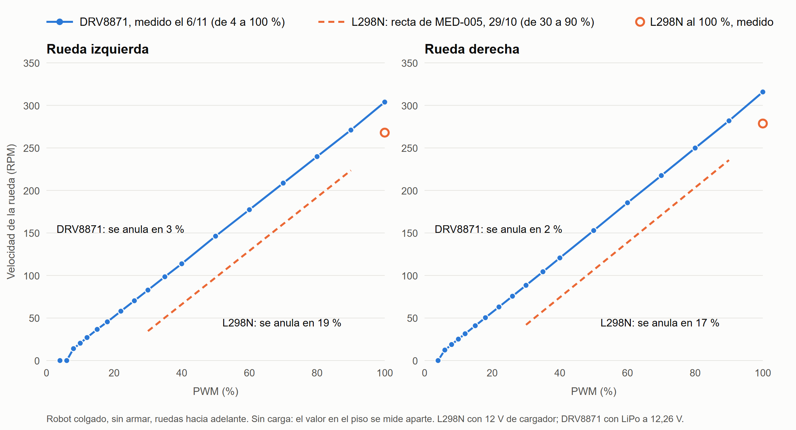

# Comparación de los drivers de motor: L298N y DRV8871

Ensayo de las ruedas en el aire con los dos drivers: el prototipo con L298N (MED-005, 29/10/2026) y la versión
final con DRV8871 en la placa de potencia (MED-006, 6/11/2026). Pensado como base para el informe.

## Resultado principal

Al cambiar el L298N por el DRV8871, **la zona muerta de las ruedas en vacío bajó de 0,17-0,19 a 0,02-0,03 de PWM**,
**la pendiente de velocidad por PWM no cambió** (314 y 323 contra 315 y 323 RPM por unidad de PWM, en el mismo
tramo) y **la velocidad a fondo subió 13 %**. La caída de tensión del L298N, de unos 2 V, se comportaba como una zona
muerta y no como una pérdida de ganancia.

> **Falla abierta:** en este ensayo la rueda izquierda **no giró hacia atrás** (FW-022), aunque antes giraba, también
> con el DRV8871. No es una característica del driver: la causa está sin aclarar, y falta ese dato.

Figura vectorial: [`comparacion_L298N_DRV8871.svg`](comparacion_L298N_DRV8871.svg). Se regenera con
[`graficar_drivers.py`](../herramientas/graficar_drivers.py).

## Comparación

| Magnitud (izq. / der.) | L298N | DRV8871 |
|---|---|---|
| Velocidad se anula, en fracción de PWM | 0,19 / 0,17 | **0,031 / 0,021** (recta hasta 40 %) |
| Lo mismo, en tensión equivalente | 2,3 / 2,0 V | **0,38 / 0,26 V** |
| Arranca desde parada, adelante | 30 / 22 % | **8 / 6 %** |
| Arranca desde parada, atrás | 24 / 20 % | **no gira (FW-022)** / 6 % |
| Girando, deja de moverse al bajar | ver nota 1 | entre 4 y 6 % en las dos |
| Pendiente de 30 a 90 %, RPM por unidad de PWM | 315 / 323 | **314 / 323** |
| Pendiente hacia atrás, de 30 a 90 % | sin dato anotado | no gira / 321 |
| Pendiente, RPM por voltio de alimentación | 26,2 / 26,9 | 25,7 / 26,4 |
| Avance de la rueda por unidad de PWM (radio de 40 mm) | 1,32 / 1,35 m/s | 1,32 / 1,35 m/s |
| Velocidad al 35 % de PWM | ~50 / ~58 RPM (de la recta) | **98,5 / 104,4 RPM** (medido) |
| Velocidad al 100 % de PWM | 268 / 279 RPM | **303,9 / 315,8 RPM** (13 % más) |
| Velocidad al −100 % de PWM | sin dato anotado | no gira / 314,0 RPM |
| Corriente en vacío al 100 % de PWM | sin medir | ~60 mA, igual que la ficha |
| Constante de tiempo de la rueda libre | ~25 ms | sin medir |

**Nota 1.** En MED-005 quedó anotado "girando, la velocidad se anula en 0,19 y 0,17", sin aclarar si salió de bajar
el PWM o de la recta. Para el DRV8871 se dan los dos datos por separado.

## Condiciones de cada ensayo

| | L298N (MED-005) | DRV8871 (MED-006) |
|---|---|---|
| Fecha | 29/10/2026 | 6/11/2026 |
| Alimentación | Cargador de 12 V constantes | LiPo 3S de 2200 mAh, ~12,26 V |
| Robot | Colgado, sin armar | Colgado, sin armar |
| Barrido | 4 a 40 % desde parado, cada rueda y sentido; 20 a 100 % con las dos ruedas | Cada rueda por separado, en los dos sentidos: 4 a 40 % desde parada, bajando sin parar y subiendo a 100 % |
| Ajuste de la recta | Entre 30 y 90 % | Pendiente, entre 30 y 90 %; dónde se anula, puntos de más de 15 RPM hasta 40 % |
| Medida | Encoders a 50 Hz | Encoders e INA219 por telemetría |
| Datos | Solo los valores de [`BACKLOG.md`](../../BACKLOG.md): los crudos no se guardaron | [`barrido_motores_drv8871_2026-11-06.csv`](barrido_motores_drv8871_2026-11-06.csv) |

## Interpretación

- **La zona muerta era sobre todo el driver.** La caída equivalente con el L298N, de 2,0-2,3 V, coincide con la que
  se le atribuye a ese driver ([arquitectura](arquitectura_v0_1.md)). Con el DRV8871, que tiene salidas MOSFET, quedan
  0,3-0,4 V, más cerca de lo que corresponde a la fricción del motor y el reductor. Es una interpretación: no se midió
  la tensión en bornes del motor.
- **La ganancia no cambió.** En el mismo tramo, la velocidad sube lo mismo por unidad de PWM. En términos de lazo,
  se corrió el punto de arranque de la recta, no su pendiente. Por este lado, las ganancias del LQR no piden cambio.
  Falta comprobarlo con el robot equilibrando.
- **El motor rinde más.** Con el mismo PWM gira casi el doble en la zona baja, y 13 % más a fondo.
- **El motor sería de unos 300 RPM.** A fondo da 304-316 RPM con 12,2 V, ~60 mA. El modelo ajustado supuso la
  versión de 350 RPM para explicar lo medido con el L298N. A revisar.

## Lo que implica para el proyecto

| Parámetro | Con el L298N | Con el DRV8871 |
|---|---|---|
| `DEFAULT_DEADBAND` (quieto) | 0,16, ajustado en el piso | 0,05 como valor de arranque, **sin probar en el piso** |
| `MOV_FF`, comando por m/s | 1,20 | A medir en el piso. En vacío haría falta ~0,77 |
| Modelo: `caida_driver` | 2,0 V | A rehacer: la caída no es una constante que reste ganancia |
| Modelo: `zona_muerta_motor` | 0,14 | A reajustar |
| Modelo: `w_nl_motor_rpm` | 7000 (350 RPM de salida) | A revisar: la medida da 304-316 RPM con 12,2 V |

## Límites de esta comparación

- **En vacío.** Con el robot colgado no hay peso sobre las ruedas ni par real. El valor de `deadband` para equilibrar
  se ajusta en el piso; con el L298N, el que mejor anduvo (0,16) incluso fue menor que el medido en el aire (0,17-0,19),
  porque también lo limita la vibración de 16 Hz.
- **Cambió más de una cosa.** Entre los dos ensayos pasaron 8 días, y cambiaron la fuente (cargador contra LiPo) y el
  cableado (protoboard contra placa). Los motores son los mismos, pero tuvieron más uso, y eso puede bajar la fricción.
- **Una rueda sola contra las dos.** Con el L298N, de 20 a 100 % se midió con las dos ruedas a la vez; con el DRV8871,
  de a una. En vacío no debería cambiar, salvo por la caída en la alimentación.
- **Marcha atrás incompleta.** De la izquierda no hay dato (FW-022), y de la pendiente hacia atrás con el L298N no
  quedó anotado el valor, solo que era simétrica.
- **Tensión de referencia.** La tensión de la batería sale de los INA219, y falta confirmarla con un instrumento
  confiable. El INA226 lee ~5 % de más y el firmware lo corrige.
