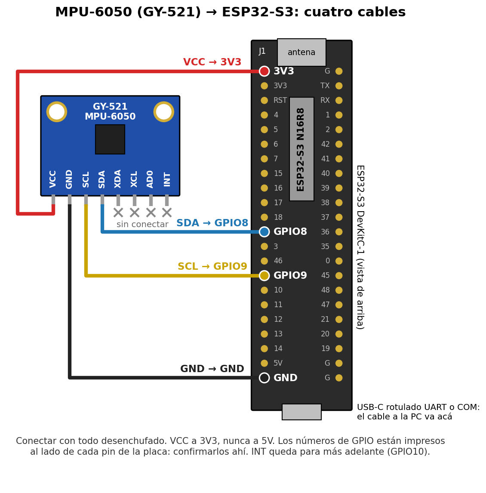

# Prueba de la IMU (MPU-6050)

Objetivo: conectar la IMU, comprobar que responde, decirle al firmware cómo está montada (qué eje del
sensor mira hacia adelante y cuál hacia arriba) y verificar que el ángulo medido sigue la inclinación
real. Es el paso 2 de la [puesta en marcha](arquitectura_v0_1.md#9-orden-de-puesta-en-marcha) (`FW-003`).
Todo se hace con la tarjeta **IMU** del [banco de pruebas](../../gui_hmi/README.md#banco-de-pruebas).
Los motores pueden quedar sin energizar.

## 1. Conexión

| GY-521 | ESP32-S3 | Pin de la hilera izquierda (J1), contando desde la antena |
|---|---|---|
| VCC | 3V3 | 1 |
| GND | GND | 22 (o cualquier `G`) |
| SCL | GPIO9 | 15 |
| SDA | GPIO8 | 12 |
| XDA, XCL, AD0, INT | sin conectar | — |

- **VCC a 3V3, no a 5V.** El regulador del GY-521 funciona con 3,3 V de entrada (SUP-36).
- AD0 al aire deja la dirección en 0x68, que es la que usa el firmware.
- Son los pines de prueba de [`board_pins.h`](../segway_v01/main/board_pins.h). La placa definitiva usa
  otros (GPIO16/17/18, SUP-28): cuando esté, se cambian ahí.
- La IMU tiene que quedar **rígida** contra el chasis. El pegamento caliente sirve para esta prueba,
  pero para equilibrar conviene atornillarla (tiene dos agujeros de 3 mm): si vibra, el ángulo trae
  ruido y el control lo amplifica.
- La figura se regenera con `python firmware/docs/conexion_imu.py`.

## 2. Grabar y ver que responde

1. Cable USB al conector rotulado **UART** o **COM** de la placa (la consola va por ahí, no por el USB
   nativo).
2. Desde la raíz del repo: `gui_hmi\banco -Grabar`. Compila, graba y abre el banco de pruebas. La
   primera vez hay que tocar **Conectar** y elegir el puerto de la placa.
3. **Cortar la alimentación y volver a darla** (desenchufar y enchufar el USB) con el robot **quieto y
   parado**: al grabar, el ESP32 se reinicia pero la IMU no, y a veces queda trabada en cero o en
   `FAULT` hasta que se la apaga (visto por Francisco el 29/10). Los primeros 2 s calibra el giróscopo.

Tiene que quedar así: estado `DISARMED`, la tarjeta **IMU** en `ok` y **|a| ≈ 9,81** con el robot quieto.

- `sin lectura` o estado `FAULT`: revisar VCC/GND, que SDA y SCL no estén cruzados y que los cables
  hagan contacto, y volver a cortar la alimentación.

## 3. Identificar los ejes

La IMU está montada de canto, así que los valores por defecto de
[`board_config.h`](../segway_v01/main/board_config.h) (pensados para la IMU acostada) no sirven todavía:
la inclinación que muestra la tarjeta va a dar cualquier cosa. Lo que vale acá es el **acelerómetro
crudo** (x, y, z, en los ejes del sensor):

1. **Lectura A:** robot parado derecho y quieto. Anotar x, y, z.
2. **Lectura B:** inclinarlo unos 30° **hacia adelante** (el sentido en que avanza) y mantenerlo
   quieto. Anotar x, y, z.

Con las dos lecturas se completan los seis valores (x = 0, y = 1, z = 2):

| En `board_config.h` | Valor |
|---|---|
| `IMU_AXIS_UP` | El eje que en A marca ≈ ±9,8 |
| `IMU_SIGN_UP` | `1.0f` si en A dio positivo, `-1.0f` si dio negativo |
| `IMU_AXIS_FWD` | De los otros dos, el que más cambió de A a B (llega a ≈ ±4,9 con 30°) |
| `IMU_SIGN_FWD` | `1.0f` si en B dio **negativo**, `-1.0f` si dio positivo |
| `IMU_AXIS_PITCH` | El eje que queda (es el que más se mueve en el giróscopo al cabecear) |
| `IMU_SIGN_PITCH` | `IMU_SIGN_UP` × `IMU_SIGN_FWD` × c, con c = +1 si el par (arriba, adelante) es (x, y), (y, z) o (z, x), y c = −1 en los otros tres casos |

Ejemplo: en A, y = −9,8; en B, z = +4,9 → `UP = 1`, `SIGN_UP = -1`, `FWD = 2`, `SIGN_FWD = -1`,
`PITCH = 0` y, como (y, z) da c = +1, `SIGN_PITCH = (-1)·(-1)·(+1) = 1`.

Guardar `board_config.h` y volver a grabar con `gui_hmi\banco -Grabar` (y cortar la alimentación).

## 4. Verificar el ángulo

Mirar la **inclinación** y los **°/s** de la tarjeta IMU; para la deriva, `theta_deg` en la pestaña
**Gráficos**.

| Prueba | Qué hacer | Qué tiene que pasar |
|---|---|---|
| Signo | Inclinar hacia adelante | La inclinación sube, y los °/s son positivos mientras se mueve |
| Escala | Apoyarlo a 30° adelante y a 30° atrás, medidos con transportador o con la app de nivel del celular | ±30°, con ±2° de diferencia |
| 90° | Acostarlo de frente | Cerca de +90° |
| Movimiento | Sacudirlo rápido y volver a dejarlo quieto | Vuelve al mismo valor en 1-2 s, sin saltos |
| Deriva | Dejarlo quieto 60 s | No se mueve más de ~0,5° |

- Si el ángulo da bien parado e inclinado, pero en movimiento se va para el otro lado y tarda en
  volver, el signo del giróscopo está al revés: cambiar `IMU_SIGN_PITCH`.
- Si al inclinar hacia adelante el ángulo baja, cambiar `IMU_SIGN_FWD` e `IMU_SIGN_PITCH`.

Por último, sostener el robot con dos dedos en el punto donde no tiende a caer para ningún lado y anotar
la inclinación: es el ángulo de equilibrio, que después se carga con `set ref <grados>` (casilla `ref`
de la barra de comandos) y en `DEFAULT_THETA_REF_DEG`.

Registrar en el `BACKLOG.md` de la raíz (`FW-003`) los seis valores y el resultado de cada prueba.
