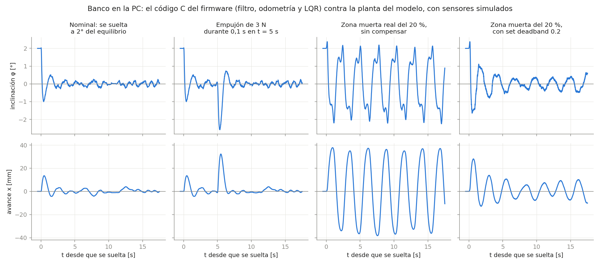

# segway_v01 — firmware prototipo v0.1

Equilibrio solo con IMU (MPU-6050) y un L298N para las ruedas, sobre ESP32-S3 N16R8 con ESP-IDF v6.1.
Los servos de las patas todavía no participan del control, pero se pueden posicionar a mano.
La arquitectura, la máquina de estados y el orden de puesta en marcha están en
[`../docs/arquitectura_v0_1.md`](../docs/arquitectura_v0_1.md).

## Dónde cambiar cosas

| Qué | Archivo |
|---|---|
| Pines (encoders en 11-14) | [`main/board_pins.h`](main/board_pins.h) |
| Ganancias iniciales, límites, frecuencias, montaje de la IMU, sentido de motores, encoders y servos, rango de los servos | [`main/board_config.h`](main/board_config.h) |

## Compilar, grabar y monitorear

Igual que `servo_test`: con la extensión ESP-IDF de VS Code abriendo esta carpeta, o desde la
terminal de ESP-IDF. La compilación va a `C:\esp\build\segway_v01`, fuera de OneDrive.

```powershell
idf.py -B C:\esp\build\segway_v01 -p COM4 build flash monitor
```

## Consola

Al arrancar imprime una línea CSV cada 20 ms. Las líneas que empiezan con `#` son mensajes.

```text
t_ms,estado,theta_deg,theta_dot_dps,u,loop_us_max,overruns,enc_l,enc_r,m_l,m_r,servo_l_deg,servo_r_deg,ax_ms2,ay_ms2,az_ms2,gx_dps,gy_dps,gz_dps,x_mm,v_mms
```

| Columnas | Qué son |
|---|---|
| `theta_deg`, `theta_dot_dps` | Inclinación filtrada (+ adelante) y su velocidad, sin sesgo |
| `u` | Salida del lazo de equilibrio (0 fuera de `BALANCING`) |
| `loop_us_max`, `overruns` | Peor ciclo de control de los últimos 200 ms y ciclos excedidos desde el arranque |
| `enc_l`, `enc_r` | Cuentas acumuladas de los encoders (x4; avanzar suma) |
| `m_l`, `m_r` | Lo aplicado a cada puente H, de −1 a 1: `u` armado, el motor a mano desarmado |
| `servo_l_deg`, `servo_r_deg` | Ángulo actual de cada servo; `nan` si está suelto |
| `ax_ms2` … `gz_dps` | IMU cruda: acelerómetro (m/s²) y giróscopo (°/s, con sesgo) **en los ejes del sensor**, sin la rotación de `board_config.h`; `nan` si la lectura falló |
| `x_mm`, `v_mms` | Avance y velocidad de las ruedas respecto del piso (odometría del LQR): x = 0 donde se armó |

Son unos 135 caracteres por línea a 50 Hz, la mitad de lo que entra a 115200 baudios. Para verlas
graficadas, probar cada sensor y actuador y mandar comandos con botones, usar la
[interfaz web](../../gui_hmi/README.md) por USB (pestaña **Banco de pruebas**).
Prueba de los encoders a mano: [`../docs/prueba_encoders.md`](../docs/prueba_encoders.md).
Conexión de la IMU y orientación de sus ejes: [`../docs/prueba_imu.md`](../docs/prueba_imu.md).

| Comando | Efecto |
|---|---|
| `arm` / `disarm` | Armar (solo desde DISARMED y a menos de 5° de la referencia) o desarmar |
| `set kp 0.8` | Cambiar `kp`, `ki`, `kd`, `ref` (grados), `umax` o `deadband` en vivo |
| `set lqr 1` | Equilibrar con el LQR (`0`: con el PID). Vale desde el próximo `arm` |
| `set kx 6.1` | Ganancias del LQR: `kx`, `kv`, `kphi`, `kw` |
| `set notch 7.5` | Rechaza banda del comando del LQR, en Hz (`0` lo apaga) |
| `servo 20` / `servo l 20` / `servo r 10` | Mover los dos servos o uno (grados del servo y a 90°/s; fuera de sus límites se rechaza sin moverse). Suelto, la posición es desconocida: el primer ángulo va **directo**, sin rampa |
| `servo off` / `servo l on` | Soltar (posición desconocida desde ahí) o agarrar donde está; `on` no hace nada si la posición es desconocida |
| `servo lim l 5 25` | Achicar los límites de un servo en vivo, siempre dentro de **0-30°**: más allá se rompe el cuatro barras, y el firmware no deja salir de ahí (`SERVO_HARD_*`) |
| `cal` | Recalibrar el giróscopo sin reiniciar (solo en DISARMED; dejar quieto 2 s) |
| `get` | Ver los parámetros vigentes, la posición y los límites de los servos (contesta 40 ms después, con los `set` ya aplicados) |
| `tlm on` / `tlm off` | Activar o pausar la telemetría (`tlm on` reimprime el encabezado) |
| `enc reset` | Poner en cero las cuentas de los dos encoders |

Los cambios se pierden al reiniciar: cuando las ganancias funcionen, copiarlas en `board_config.h`.
Las ganancias del PID arrancan en cero, así que `arm` no mueve nada hasta cargarlas o pasar al LQR.

## LQR

`u = kx·x + kv·v + kphi·(theta − ref) + kw·omega`, con los cuatro estados positivos hacia adelante.
Las ganancias de `board_config.h` salen del modelo para el L298N
([resumen](../../simulacion/pendulo_invertido/resultados/ganancias_firmware.md)); `x` y `v` las da
[`odometry.h`](components/control/include/odometry.h), que suma la inclinación al giro de la rueda
porque el encoder mide la rueda respecto del cuerpo.

**Lo que equilibró el robot el 29/10** (40 s sin caerse, patas en 15°): las ganancias por defecto de
`board_config.h` (el LQR más suave del modelo) con `set notch 7.5`, `set umax 0.6`, `set deadband 0.18` y
`set ref 1` (el ángulo en que quedó equilibrado). El **rechaza banda** es lo que hizo la diferencia: el robot
tiene una vibración propia de 7-8 Hz y, sin el filtro, el LQR la realimentaba hasta llevar el motor de tope a
tope. Con la referencia mal puesta el robot igual se para, pero se corre ~5 cm por cada grado de error.
Procedimiento, protecciones y qué rehacer con el robot armado completo: [`../docs/prueba_equilibrio.md`](../docs/prueba_equilibrio.md).

**Antes de `set lqr 1`**, con el robot colgado:

1. IMU orientada: inclinar hacia adelante da `theta_deg` y `theta_dot_dps` positivos ([guía](../docs/prueba_imu.md)).
2. Motor positivo hacia adelante en las dos ruedas (`MOTOR_*_INVERT`).
3. Encoders sin cruzar y positivos hacia adelante: girar a mano la rueda izquierda mueve `enc_l` hacia arriba
   ([guía](../docs/prueba_encoders.md)). Si están cruzados, intercambiar `PIN_ENC_L_*` y `PIN_ENC_R_*`.
4. `ENC_COUNTS_PER_REV` medido (10 vueltas a mano) y `ref` medido (el ángulo en que el robot no cae para ningún lado).
5. `set deadband` con el PWM mínimo que mueve las ruedas (el escalón del banco lo da).
6. Sin armar, girar las ruedas a mano hacia adelante: `x_mm` y `v_mms` tienen que subir.
7. En el aire, con `set kx 0`, `set kv 0` y `set umax 0.3`: armar, y al inclinarlo hacia adelante las ruedas
   avanzan. **En el aire no se ponen `kx` ni `kv`:** sin el péndulo, avanzar pide avanzar más y las ruedas se
   disparan. Es lo esperado (en el piso, para volver al lugar el robot primero tiene que inclinarse hacia
   atrás, y para eso las ruedas avanzan), pero en el aire no hay nada que lo frene.

## Pruebas en la PC

La lógica sin hardware (`components/control/` y `main/supervisor.c`) se prueba con gcc
(MSYS2), desde esta carpeta:

```bash
gcc -std=c11 -Wall -Wextra -Icomponents/control/include -Imain test_host/test_control.c components/control/*.c main/supervisor.c -lm -o test_control && ./test_control
```

**Banco del LQR** ([`banco_lqr.c`](test_host/banco_lqr.c)): corre el filtro, la odometría y el LQR de
`components/control/` cada 5 ms contra la planta del modelo en C, con la IMU, los encoders y el motor
simulados, y la compara primero con la planta de MATLAB. Los valores de la planta los escribe
`simulacion/pendulo_invertido/exportar_planta_al_banco.m` en `test_host/planta_modelo.h`.

```bash
gcc -std=c11 -O2 -Wall -Wextra -Icomponents/control/include -Imain test_host/banco_lqr.c components/control/*.c -lm -o test_host/banco_lqr && test_host/banco_lqr
python test_host/graficar_banco.py    # figura en ../docs/banco_lqr.png
```



