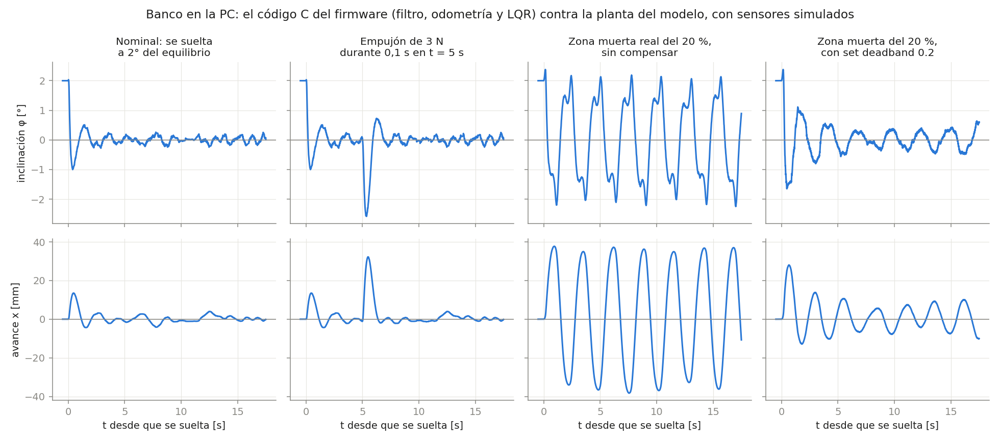

# segway_v02 — firmware de la versión final (placas soldadas)

Copia de [`segway_v01`](../segway_v01/README.md) hecha el 6/11/2026, para las funciones de la versión final en
las placas de lógica v0.6 y potencia v0.7: medición de energía con los INA, carga y autonomía de la batería.
Lo de abajo sigue valiendo salvo donde se indica. El resto del repositorio (bancos de `simulacion/escalon`) todavía
compila el control de `segway_v01`; hoy es el mismo código.

Equilibrio solo con IMU (MPU-6050) y un L298N para las ruedas, sobre ESP32-S3 N16R8 con ESP-IDF v6.1.
Los servos de las patas todavía no participan del control, pero se pueden posicionar a mano.
La arquitectura, la máquina de estados y el orden de puesta en marcha están en
[`../docs/arquitectura_v0_1.md`](../docs/arquitectura_v0_1.md).

## Dónde cambiar cosas

| Qué | Archivo |
|---|---|
| Pines (encoders en 11-14) | [`main/board_pins.h`](main/board_pins.h) |
| Ganancias iniciales, límites, frecuencias, montaje de la IMU, sentido de motores, encoders y servos, rango de los servos, puertos UDP y velocidades de `mov` | [`main/board_config.h`](main/board_config.h) |
| Red WiFi (nombre y clave; no se versiona) | `main/wifi_secrets.h`, copiado de [`main/wifi_secrets.h.ejemplo`](main/wifi_secrets.h.ejemplo) en la primera compilación |

## Compilar, grabar y monitorear

Igual que `servo_test`: con la extensión ESP-IDF de VS Code abriendo esta carpeta, o desde la
terminal de ESP-IDF. La compilación va a `build/`, dentro de esta carpeta.

```powershell
idf.py -p COM5 build flash monitor
```

## Consola

Al arrancar imprime una línea CSV cada 20 ms. Las líneas que empiezan con `#` son mensajes.
Todo sale por el cable y, si hay red, también [por WiFi](#wifi).

```text
t_ms,estado,theta_deg,theta_dot_dps,u,loop_us_max,overruns,enc_l,enc_r,m_l,m_r,servo_l_deg,servo_r_deg,ax_ms2,ay_ms2,az_ms2,gx_dps,gy_dps,gz_dps,x_mm,v_mms,vref_mms,giro,ref_deg
```

| Columnas | Qué son |
|---|---|
| `theta_deg`, `theta_dot_dps` | Inclinación filtrada (+ adelante) y su velocidad, sin sesgo |
| `u` | Salida del lazo de equilibrio (0 fuera de `BALANCING`) |
| `loop_us_max`, `overruns` | Peor ciclo de control de los últimos 200 ms y ciclos excedidos desde el arranque |
| `enc_l`, `enc_r` | Cuentas acumuladas de los encoders (x4; avanzar suma) |
| `m_l`, `m_r` | Lo aplicado a cada puente H, de −1 a 1: `u` armado, el motor a mano desarmado |
| `servo_l_deg`, `servo_r_deg` | Ángulo actual de cada servo; `nan` si está suelto |
| `ax_ms2` … `gz_dps` | IMU cruda: acelerómetro (m/s²) y giróscopo (°/s, con sesgo) **en los ejes del sensor**, sin la rotación de `board_config.h`; `nan` si la lectura falló |
| `x_mm`, `v_mms` | Avance y velocidad de las ruedas respecto del piso (odometría del LQR): x = 0 donde se armó |
| `v_bat`, `soc`, `autonomia_min`, `bateria` | Tensión de la batería (V), carga (%), minutos que quedan y nivel (`SIN`, `NORMAL`, `BAJA`, `CRITICA`). Ver «Medición de energía» |
| `i_l_ma`, `i_r_ma`, `i_log_ma`, `v_l`, `v_r` | Corriente de entrada a cada driver y de la lógica (mA), y tensión en cada driver (V); `nan` sin medidor |
| `vref_mms`, `giro` | Lo que el control está aplicando de `mov`: referencia de velocidad (mm/s) y PWM sumado a la izquierda y restado a la derecha |
| `ref_deg` | Ángulo de equilibrio que está usando el control (de la tabla según la altura de las patas, más la corrección de `set ref`); desde el 3/11 |

Son unos 190 caracteres por línea (39 columnas) a 50 Hz, el 85 % de lo que entra a 115200 baudios. Para verlas
graficadas, probar cada sensor y actuador y mandar comandos con botones, usar la
[interfaz web](../../gui_hmi/README.md) por USB (pestaña **Banco de pruebas**).
Prueba de los encoders a mano: [`../docs/prueba_encoders.md`](../docs/prueba_encoders.md).
Conexión de la IMU y orientación de sus ejes: [`../docs/prueba_imu.md`](../docs/prueba_imu.md).

| Comando | Efecto |
|---|---|
| `arm` / `disarm` | Armar (desde DISARMED o FALLEN, a menos de 5° de la referencia; si no arma, dice por qué) o desarmar. **Patas (7/11):** nunca arma con una pata suelta, y el primer armado desde que se prendió pide las dos mandadas al mismo ángulo (±0,5°). Si no, no arma y manda las dos a 15° (`ARM_PATAS_DEG`; una suelta va directo, a la velocidad del servo): armar de nuevo cuando lleguen. Los armados siguientes respetan dónde quedaron, aunque sean distintas. Lo decide el firmware, venga el `arm` de donde venga; `get` dice si el primero ya pasó |
| `set ref 8` | Cambiar `ref` (grados), `umax` o `deadband` en vivo |
| `set kx 1.52` | Ganancias fijas del LQR, el único control desde el 2/11 (el PID se sacó): `kx`, `kv`, `kphi`, `kw`. Se usan con `lqrpata 0` |
| `set lqrpata 1` | (por defecto desde el 3/11) Las ganancias salen de `LQR_TABLA` según la altura de las patas: el LQR recalculado con el modelo ajustado con el robot (CTL-301). `get` muestra las que se están usando; `0` vuelve a las fijas |
| `set lqrpata 2` | Las de `LQR_TABLA_DRV`: el mismo criterio con el modelo del DRV8871 (7/11). Con el mismo PWM el motor hace ~44 % más de par que con el L298N, así que dan 15-20 % menos ganancia. Para compararlas en el piso con las de `lqrpata 1` (MED-007) |
| `set notch 7.5` | Rechaza banda ancho del comando, en Hz (`0` lo apaga); `notch2`: otro angosto (Q = 2) |
| `set lp 10` | Pasabajos del comando, en Hz (`0` lo apaga). Retrasa el lazo: con 9-11 Hz el robot se hamacaba |
| `set refauto 1` | La referencia se corrige sola si el robot se queda corrido de su consigna (~10 s, ±6° como mucho) |
| `set fren 0.3` | Manejo con el joystick: `vmax` (m/s a fondo), `acel` y `fren` (rampas, m/s²), `ff` (comando anticipado) y `xlibre` (1: fija la posición al terminar de frenar) |
| `set margen 0.85` | Prioridad al equilibrio: con el comando a los motores por encima, la velocidad pedida retrocede (`0` lo apaga). `prio` (grados): con una perturbación mayor suelta la velocidad pedida (apagado: en la simulación no ayudó) |
| `set velpata 20` | Velocidad con que las patas van a la posición pedida, en °/s |
| `servo 20` / `servo l 20` / `servo r 10` | Mover los dos servos o uno (grados del servo y a 90°/s; fuera de sus límites se rechaza sin moverse). Suelto, la posición es desconocida: el primer ángulo va **directo**, sin rampa |
| `servo off` / `servo l on` | Soltar (posición desconocida desde ahí) o agarrar donde está; `on` no hace nada si la posición es desconocida. `off` no se acepta equilibrando (la pata se soltaría de golpe) |
| `servo lim l 5 25` | Achicar los límites de un servo en vivo, siempre dentro de **0-30°**: más allá se rompe el cuatro barras, y el firmware no deja salir de ahí (`SERVO_HARD_*`) |
| `cal` | Recalibrar el giróscopo sin reiniciar (solo en DISARMED; dejar quieto 2 s) |
| `get` | Ver los parámetros vigentes, la posición y los límites de los servos y el estado del WiFi (contesta 40 ms después, con los `set` ya aplicados) |
| `mov 0.5 -0.2` | Avance y giro, de −1 a 1 (ver [Movimiento](#movimiento)). Sin respuesta, para que el joystick pueda mandarlo seguido |
| `tlm on` / `tlm off` | Activar o pausar la telemetría (`tlm on` reimprime el encabezado) |
| `grabar` | Graba 8 s a 200 Hz (armado o no) y los manda como el registro de la bajada (líneas `#r`); SHARE en el joystick |
| `enc reset` | Poner en cero las cuentas de los dos encoders. Solo desarmado (o en falla): equilibrando, la odometría saltaría todo lo recorrido y el robot pegaría un tirón |
| `set tau 1` | Constante del filtro de inclinación, en s (0,5 al arrancar, `ATTITUDE_TAU_S`). La auditoría de un amigo propone 1 s: menos vaivén lento, a cambio de que un error del giróscopo pese el doble. Para compararlas en el robot (auditoría del 5/11) |
| `set velf 10` | Pasabajos de la velocidad de las ruedas, en Hz (20 al arrancar, `VEL_FILTER_HZ`; de 2 a 80; `0` = sin filtro). En el modelo, 10 Hz deja más margen que 20 (×3,1 contra ×2,5, margen de fase 41° contra 37°) y la mitad del ruido del encoder en el comando; sin filtro queda en ×1,55 ([explicación](../docs/lazo_equilibrio_explicado.md)). Para compararlo en el robot (7/11) |
| `set trim 0.02` | Compensación entre motores: fracción de PWM que se le da de más a la rueda izquierda y de menos a la derecha, cada una en su sentido (de −0,10 a 0,10; 0,03 al arrancar, `DEFAULT_MOTOR_TRIM`, ajustado el 9/11 con el ensayo A1). Cada rueda recibe la mitad, y crece de a poco hasta \|u\| = 0,05 para no saltar al cruzar por cero (`balance_trim`). Se ajusta con el ensayo E5 de [`ensayos/`](../../ensayos/README.md) hasta que los dos encoders giren igual (9/11: con el mismo comando la izquierda gira 0,6-0,8 rad/s menos). No se aplica a `motor` (desarmado). `get` lo muestra |
| `set dlpf 2` | Filtro interno de la IMU: `1` = 188 Hz (~1,9 ms de retardo; al arrancar, `IMU_DLPF_DEFAULT`, elegido el 9/11 con el ensayo A2), `2` = 98 Hz (~2,8 ms), `3` = 42 Hz (~4,8 ms, el de antes), `4` = 20 Hz (~8,3 ms). Menos filtro es menos retardo y más vibración en la medida; para compararlos con el barrido E3. `get` muestra el que tiene el sensor |
| `get`, línea `# ciclo` | Tiempos del ciclo de control en el último segundo, en µs: el ciclo entero (medio y máximo), la lectura de la IMU, la lectura de un registro de los INA y el intervalo más largo entre dos ciclos. 9/11, desarmado: ciclo 3,26 ms de media y 4,7 de máximo; la IMU 2,03 ms y cada lectura de INA 0,99 ms, con el bus I2C a 100 kHz |
| `set inacada 1` | Cada cuántos ciclos de 5 ms se lee un registro de los INA (5 al arrancar: cada motor a 13 Hz). Con 1, cada motor a ~67 Hz: para los ensayos del motor ([`ensayo_motor.py`](../herramientas/ensayo_motor.py), MED-007) |

Los cambios se pierden al reiniciar: cuando las ganancias funcionen, copiarlas en `board_config.h`.
Arranca con lo que mejor anduvo el 2/11: el LQR suave (desde el 3/11 según la altura de las patas,
`lqrpata` 1), `ref` de la tabla de patas medida el 3/11 (13,0° con las patas en 15°), `umax` 1,0, `deadband` 0,16 quieto y 0 andando (`dbmov`; 3/11: andando, 0 anduvo mucho
mejor, pero quieto no sostenía la x) y `notch` 7,5 Hz, así que `arm` equilibra sin cargar nada.

## WiFi

El robot se conecta a una **red existente** (2,4 GHz). Nombre y clave van en `main/wifi_secrets.h`,
que no se versiona: la primera compilación lo copia de la plantilla con la red vacía (sin WiFi, todo
sigue por el cable). Completarlo y volver a compilar. Al conectarse informa por la consola:

```text
# wifi: red=MiRed ip=192.168.0.57 rssi=-48 telemetria=broadcast
```

Si no encuentra la red: `# wifi: buscando la red MiRed (último motivo de desconexión: N)`, y sigue
reintentando sola. `get` también muestra esa línea. Se pueden poner hasta cuatro redes (`WIFI_SSID2` a
`WIFI_SSID4` con sus claves): si una no aparece, prueba la siguiente. Las abiertas van sin clave,
también las abiertas con cifrado (OWE). Motivo 201: no la encuentra (por ejemplo, una red solo de
5 GHz, como «Facultad de Ingeniería» donde se probó el 5/11; ahí anduvo el celular como punto de acceso
en 2,4 GHz).

- **Telemetría y mensajes**: las mismas líneas que por el cable, por UDP al puerto **4210** de la PC que
  se anunció con `hola` en los últimos 5 s; si ninguna, por broadcast a toda la red.
  [`puente.py`](../../gui_hmi/puente.py) dice `hola` cada 1 s, así que recibe todo y la
  [interfaz web](../../gui_hmi/README.md) lo muestra eligiendo **Puente**. A una PC nueva se le repite
  el encabezado del CSV.
- **Comandos**: los mismos de la tabla de arriba, uno por línea, por UDP al puerto **4211** del robot.
  El puente reenvía ahí lo que manda la página. Se aceptan a la vez por el cable y por WiFi.
- El WiFi arranca después de los motores y del control, y si falla el robot sigue por el cable. Va
  sin ahorro de energía (con él, lo que llega al robot puede demorar ~100 ms).
- **UDP no garantiza la entrega**: un `disarm` por WiFi puede perderse. El corte confiable sigue
  siendo el de la alimentación de los motores. Los motores a mano (`motor`) **no tienen tiempo de
  espera**: si se corta la red con una rueda girando, sigue girando.
- Puertos y tiempo de espera en [`board_config.h`](main/board_config.h) (`WIFI_*`).

## Movimiento

`mov <avance> <giro>`, los dos de −1 a 1, solo tiene efecto **armado**. Lo manda la aplicación del
joystick ([`Aplicacion/joystick.py`](../../Aplicacion/joystick.py)) 25 veces por segundo:

- **Avance** ([`movimiento.c`](components/control/movimiento.c)): la velocidad pedida va hacia
  `avance · vmax` (0,40 m/s con el stick a fondo; las flechitas, 0,20) con una **rampa de subida**
  (`acel`, 0,5 m/s²) y una **de frenado** (`fren`, 0,5 m/s²). Con `xlibre 1` (desde el 3/11),
  mientras hay velocidad pedida el LQR sigue solo la velocidad: la consigna de posición acompaña al
  robot. Al soltar, la velocidad pedida baja por la rampa de frenado y, cuando llegó a cero y el
  robot casi no se mueve, la posición queda fija ahí. `ff` (0,85 desde el 7/11; 1,20 con el L298N,
  que se comía 0,17 de PWM) suma al comando lo que hace falta para sostener la velocidad pedida; con
  menos, el robot va más rápido que lo pedido, y con más, más lento. Con `xlibre 0`
  queda como antes: la consigna de posición es la integral de la velocidad pedida, el robot se le
  adelanta 10-25 cm para moverse y al soltar frenaba en seco donde se soltó (por eso se cambió).
  Los cinco se cambian en vivo (`set vmax 0.4`, `set acel 0.5`, `set fren 0.3`, `set ff 0.8`,
  `set xlibre 1`) o desde la tarjeta Control de la interfaz, y `get` los muestra.
  El 2/11 se probó a fondo con 1,12 m/s, el 100 % de los motores: muy rápido.
- **Giro**: `giro · giromax` (0,30 de PWM desde el 3/11; antes 0,15, en vivo con `set giromax`) se
  suma a la rueda izquierda y se resta a la derecha (positivo gira a la derecha), con rampa de 0,6
  por segundo. Las dos quedan dentro del `umax` de ese momento. En el joystick, el stick (o el
  derecho en la opción 2) y los gatillos: **R2 gira a la derecha y L2 a la izquierda sobre su eje**,
  más rápido cuanto más se aprietan.
- **Tiempo de espera**: sin un `mov` nuevo en **300 ms**, los dos vuelven a cero con sus rampas: el
  robot frena y se queda equilibrando donde esté.
- Al armar y fuera de BALANCING todo vuelve a cero.

Probado el 2/11 con el joystick a 0,2 m/s: sigue la consigna y al soltar se queda donde quedó. A más
velocidad, subir el stick de a poco y mirar en Gráficos que `v_mms` siga a `vref_mms`.

## Bajada de escalón (△), parada (□) y registro

La maniobra de [`maniobra.c`](components/control/maniobra.c), la misma que corre la simulación
([`simulacion/escalon/`](../../simulacion/escalon/README.md)), ya la llama el control
([`control_task.c`](main/control_task.c)). Solo equilibrando:

- **`escalon`** (△ del joystick): baja el escalón que tiene **atrás**. Mientras el sensor de
  distancia no esté conectado, **no lo busca**: supone el borde a `d_borde` detrás del apoyo de la
  rueda en el momento de apretar (30 cm, `MAN_D_BORDE_M`). `escalon 25` baja con el borde a 25 cm
  (y lo deja para los △ siguientes); con el sensor, `man d_borde 0` y lo busca; `escalon medir` lo
  busca, frena y dice a cuánto lo vio (para compararlo con una regla), sin bajar.
  Patas a 15°, quieto, acelera hacia atrás para pasar el borde a ~0,5 m/s (pide 0,54), en el aire
  estira a 30° y el LQR sigue mandando, al tocar patas a 25° y frena a 1 m/s². **Sin estirar las
  patas antes del borde** (`d_salto -1`; el equipo no lo ve viable). La consola cuenta cada etapa
  (`# bajada: ...`) y por qué abortó, si abortó.
- **`man`** muestra los parámetros de la bajada y **`man <nombre> <valor>`** cambia uno (los nombres
  del banco: `v_salida`, `pata_largada`, `pata_final`, `motor_vuelo`, `a_frenado`, `d_borde`, ...);
  no en plena bajada. Se pierden al reiniciar.
- **`parar`** (□): **parada controlada**: frena, baja las patas al mínimo (0°, a `velpata`), corre la
  referencia hacia atrás (hasta `parinc`, 6°) y, con el cuerpo `parsuelta` (3°) detrás de su
  equilibrio, desarma: se deja caer apenas para atrás desde lo más bajo. Cada etapa tiene 4 s como
  mucho. Si en 4 s el cuerpo no se tiró atrás, **no desarma** (con el robot derecho caería para
  cualquier lado): la referencia vuelve y sigue equilibrando, con las patas abajo («parada: no se tiró
  atrás a tiempo»; auditoría del 5/11). **Sin probar todavía**: la primera vez, con alguien atajando (y ojo con lo que haya en la
  cara de atrás: ahí va el sensor de distancia).
- **◯ (`disarm`) corta cualquiera de las dos**; si se cae (FALLEN) o hay falla, también.
- **Caída libre**: desde el 3/11 una lectura de la IMU con menos de 0,1 g no es una falla (antes, a
  los 25 ms de caída el robot pasaba a FAULT en el aire): el ángulo sigue con el giróscopo y recién
  más de 0,6 s seguidos cuentan como falla (`IMU_BAJA_G_MAX_S`). En el vuelo de la bajada el
  supervisor no corta por inclinación.
- **Registro**: cada bajada se graba a 200 Hz (8 s: ángulo, velocidad angular, x, v, consigna,
  comando, patas, |a|, sensor, referencia) y al terminar el robot lo manda solo (líneas `#r`, ~11 s
  sin telemetría; `escalon datos` lo vuelve a mandar). [`Aplicacion/puente.py`](../../Aplicacion/puente.py)
  lo guarda en `Aplicacion/registros/bajada_<fecha>.csv` y
  [`comparar_prueba.py`](../../simulacion/escalon/comparar_prueba.py) lo compara con la simulación
  de la misma bajada (figura y tabla en `simulacion/escalon/resultados/pruebas/`). Desde el 7/11 trae
  también la corriente de entrada de cada driver, el comando de cada motor y las cuentas de cada encoder
  (`i_l_ma`, `i_r_ma`, `m_l`, `m_r`, `enc_l`, `enc_r`), para ajustar el motor del modelo; se manda de a
  2 líneas por vuelta (~16 s). **`grabar`** (o
  SHARE en el joystick) graba lo mismo durante 8 s desde ese momento, armado o no, y lo manda al
  terminar (también va a `bajada_<fecha>.csv`): para soltar el robot y ver cuánto rebota (abajo).
- **Sensor de distancia** (Sharp GP2Y0A60SZLF, Pololu #2474, en GPIO3): se lee en cada ciclo y la
  telemetría trae `sharp_mv`, `dist_mm` y dónde pega el haz respecto del apoyo de la rueda
  (`haz_x_mm` hacia atrás, `haz_z_mm` de alto: en piso plano ~0). No hace falta instalar nada: es una
  entrada analógica. **Tiene que ir con el divisor 10k/15k** (como J27): sin él, a 10 cm la salida
  llega a 3,6 V y el pin aguanta 3,3 V. Calibración en vivo: `set sharpk`, `set sharpv0`,
  `set sharpdiv`; dónde está montado: `set sensx`, `set sensz` (cm, respecto del eje del servo, x
  adelante, z arriba) y `set sensang` (grados del haz desde la vertical hacia atrás). `get` los
  muestra.

Probar la bajada sin el sensor (escalón de 10,5 cm, 3/11; en la simulación anda en las 24
variaciones, también puesto 6 cm más cerca o más lejos y con escalones de 9 a 12 cm):

1. LiPo cargada (anotar la tensión). Abajo del escalón, 1 m libre.
2. El robot arriba, **de espaldas al escalón y derecho** (las dos ruedas a la misma distancia del
   borde: si una cae antes, se tuerce), con el apoyo de las ruedas a **30 cm del borde**.
3. ✕ para armar; que se quede quieto unos segundos y volver a medir: si se corrió, desarmar y
   acomodarlo (o `escalon <cm>` con la distancia de verdad).
4. Alguien con las manos cerca, sin tocarlo. △. Mejor filmarlo de costado, en cámara lenta.
5. Al terminar, el registro llega solo; después `python simulacion/escalon/comparar_prueba.py --lipo <V>`
   (con el DRV8871 no hay caída en el driver; para los registros con el L298N, hasta el 5/11, `--caida 2`).

Soltarlo, para ver cuánto rebota (la goma y cuánto ceden las patas; idea de Joaquín, 5/11): desde
5, 10, 15 y 20 cm, que cubren los escalones de 10,5 y 16,6 cm. El 5/11, con la placa vieja, el ESP32
se reiniciaba con los golpes (pines flojos): con las PCB, repetirlo.

1. Robot **desarmado**, patas en 30° (`servo 30`, como al tocar en la bajada), con el robot en la mano
   (sueltos, los servos van directo), sobre el mismo piso de la escalera, con una cinta métrica
   parada atrás. Antes de cada caída, que `get` o la página muestren los servos en 30 (si el robot se
   reinició, quedan sueltos).
2. `grabar` (o SHARE) y, en los 8 s, sostenerlo derecho desde arriba de la cabina, con las dos ruedas a
   la misma altura (**5 cm** del piso a la goma), y soltarlo abriendo los dedos de golpe, sin
   acompañarlo. Alguien con las manos alrededor, sin tocarlo, lo agarra apenas rebota (sin motor se
   cae). Esperar `# fin del registro` antes de la siguiente.
3. Lo mismo desde **10, 15 y 20 cm**, dos veces cada una, de menor a mayor. Después de cada una,
   mirar que las patas vuelvan a 30° y que los servos no hagan ruido ni tengan juego: si algo
   cambia, no seguir subiendo. 20 cm solo si 15 anduvo bien.
4. Filmarlo de costado en cámara lenta. La altura la da la caída en la IMU (5 cm, 101 ms; 10, 143;
   15, 175; 20, 202).
5. `python simulacion/escalon/rebote.py Aplicacion/registros/bajada_<fecha>.csv`: la misma caída en
   el banco, y con qué goma y qué servos se parece más.

## Medición de energía (INA)

Tres medidores en la placa de potencia, en el mismo bus I2C que la IMU ([`components/ina`](components/ina/ina.c)):

| Módulo | Qué da |
|---|---|
| INA219 antes de cada DRV8871 | Corriente de **entrada** del driver, con signo (negativa: frenando, devuelve a la batería), y tensión en su entrada. Es parecida a \|PWM\| × la del motor: no es directamente el par. Su tensión sirve de referencia para comparar con la del INA226 |
| INA226 en la rama de lógica | **Tensión de la batería** y corriente de la lógica (hasta 0,82 A). No ve los motores. Da de más: el 6/11 leía 12,86 V con 12,20 y 12,25 V en los INA219, con continuidad entre los pines `VBS` e `IN−` del módulo (falta probar la unión de `VBS` con la pata 8 del chip). Se corrige con `INA226_V_GANANCIA` e `INA226_V_CERO` (`board_config.h`), calibrado contra los INA219; `ina` muestra la lectura sin corregir |
| Servos (UBEC) | Sin medidor |

- **Cuándo se leen:** un registro cada `INA_CADA_CICLOS` (40 por segundo; en vivo `set inacada`, 1 = 200 por
  segundo para los ensayos del motor), al final del ciclo de control y solo si
  quedan `INA_MARGEN_US`: el comando ya salió, así que no le agrega retardo, no compite con la IMU por el bus y
  no puede ser lo que haga exceder el ciclo. Medido el 6/11 sin armar: cada lectura cuesta ~1 ms (el peor ciclo
  de la ventana pasa de 3,3 a 4,3 ms de 5), sin ciclos excedidos ni fallas de la IMU en 80 s.
- **Si un módulo falla:** el que falta al arrancar no se usa, y el que falla 5 veces seguidas deja de leerse hasta
  reiniciar. El robot sigue igual. `set ina 0` deja de leerlos a todos, para descartarlos ante un problema en el bus.
- **`ina`** dice qué módulo responde en cada dirección: los identifica por su valor de fábrica, no por lo que
  debería haber ahí. También lo muestra `get`.

**Carga y autonomía** ([`main/bateria.c`](main/bateria.c)), solo con la tensión: filtrada con 20 s para sacar los
picos de consumo, da la carga con la curva de una LiPo **genérica** (`BAT_TABLA_*` en `board_config.h`, sin medir
con este pack); la autonomía es esa carga dividida por lo que viene bajando en los últimos 5 minutos, y no se
calcula hasta tener un minuto ni si no baja (fuente de banco). Es orientativa: a mitad de carga la tensión de una
LiPo casi no cambia. 0 % = 10,5 V; `BAJA` desde 11,2 V y `CRITICA` desde 10,5 V (provisorios, y por ahora solo
avisan: no cortan nada).

La página los muestra en la vista **Energía** de [`Aplicacion`](../../Aplicacion/README.md).

**Ensayos del motor (MED-007).** Con la corriente de cada driver se mide lo que el modelo todavía supone:
[`firmware/herramientas/ensayo_motor.py`](../herramientas/ensayo_motor.py) `wifi aire` (colgado: velocidad por
voltio y roce), `frenada l|r` (la rueda sostenida: resistencia), `peso l|r <g> adelante|atras` (levantando un
peso con un hilo: el rendimiento del reductor) y `escalon` (200 Hz: la inercia del rotor), y
[`modelado/ajuste/ajustar_motor.py`](../../modelado/ajuste/ajustar_motor.py) da los parámetros. Como el driver
frena en el apagado del PWM, la corriente del motor es la del INA219 dividida por |PWM|.

## LED de estado

El LED RGB de la placa ([`led_estado.c`](main/led_estado.c), colores en `board_config.h`):

| Color | Estado |
|---|---|
| Azul | Calibrando el giróscopo: no mover el robot |
| Blanco | `DISARMED` |
| Verde | `BALANCING`: motores activos |
| Verde con destellos amarillos | `BALANCING` con los motores cerca del tope (`set margen`, o 95 % de `umax`): queda poco para equilibrar |
| Violeta | `BALANCING` con la bajada de escalón (△) o la parada (□) en curso: el joystick no manda |
| Rojo fijo | `FALLEN`: levantarlo y mandar `arm` o `disarm` |
| Rojo parpadeando | `FAULT`: revisar la IMU y mandar `cal` |
| Ámbar / cian, más fuerte cuanto más cerca de la referencia | Guía de armado, fuera de la ventana de ±`ARM_WINDOW_DEG`: ámbar = corrido hacia adelante (llevarlo hacia atrás), cian = corrido hacia atrás (llevarlo hacia adelante) |
| Ámbar / cian parpadeando | Guía de armado, dentro de la ventana: ya se puede armar |
| Destello rojo sobre cualquier color (blanco, si ya está en rojo) | Batería baja: cada 3 s; crítica: cada 1 s |

La guía se prende con un `arm` que no armó y se apaga con `disarm` o al armar. **No arma sola:** con el
LED parpadeando hay que mandar `arm` otra vez. Después de una caída el LED queda rojo hasta el próximo `arm`.
`FAULT` no tiene guía (`arm` no sale de ahí). Si el LED no prende, probar `PIN_LED_RGB` en 38 (DevKitC v1.1).

## LQR

`u = kx·x + kv·v + kphi·(theta − ref) + kw·omega`, con los cuatro estados positivos hacia adelante.
Las ganancias de `board_config.h` salen del modelo para el L298N
([resumen](../../simulacion/pendulo_invertido/resultados/ganancias_firmware.md)); `x` y `v` las da
[`odometry.h`](components/control/include/odometry.h), que suma la inclinación al giro de la rueda
porque el encoder mide la rueda respecto del cuerpo.

**Lo que equilibró el robot el 29/10** (40 s sin caerse, patas en 15°): las ganancias por defecto de
`board_config.h` (el LQR más suave del modelo) con `set notch 7.5`, `set umax 0.6`, `set deadband 0.18` y
`set ref 1` (el ángulo en que quedó equilibrado). El **rechaza banda** es lo que hizo la diferencia: el robot
tiene una vibración propia de 7-8 Hz y, sin el filtro, el LQR la realimentaba hasta llevar el motor de tope a
tope. Con la referencia mal puesta el robot igual se para, pero se corre ~5 cm por cada grado de error.
Procedimiento, protecciones y qué rehacer con el robot armado completo: [`../docs/prueba_equilibrio.md`](../docs/prueba_equilibrio.md).

**Antes de armar por primera vez** (o después de tocar la IMU, los motores o los encoders), con el robot colgado:

1. IMU orientada: inclinar hacia adelante da `theta_deg` y `theta_dot_dps` positivos ([guía](../docs/prueba_imu.md)).
2. Motor positivo hacia adelante en las dos ruedas (`MOTOR_*_INVERT`).
3. Encoders sin cruzar y positivos hacia adelante: girar a mano la rueda izquierda mueve `enc_l` hacia arriba
   ([guía](../docs/prueba_encoders.md)). Si están cruzados, intercambiar `PIN_ENC_L_*` y `PIN_ENC_R_*`.
4. `ENC_COUNTS_PER_REV` medido (10 vueltas a mano) y `ref` medido (el ángulo en que el robot no cae para ningún lado).
5. `set deadband` con el PWM mínimo que mueve las ruedas (el escalón del banco lo da).
6. Sin armar, girar las ruedas a mano hacia adelante: `x_mm` y `v_mms` tienen que subir.
7. En el aire, con `set lqrpata 0` (si no, las ganancias salen de la tabla y `set kx` no hace nada),
   `set kx 0`, `set kv 0` y `set umax 0.3`: armar, y al inclinarlo hacia adelante las ruedas
   avanzan. **En el aire no se ponen `kx` ni `kv`:** sin el péndulo, avanzar pide avanzar más y las ruedas se
   disparan. Es lo esperado (en el piso, para volver al lugar el robot primero tiene que inclinarse hacia
   atrás, y para eso las ruedas avanzan), pero en el aire no hay nada que lo frene.

## Pruebas en la PC

La lógica sin hardware (`components/control/`, `main/supervisor.c`, `main/led_estado.c` y `main/bateria.c`) se prueba con gcc
(MSYS2), desde esta carpeta:

```bash
gcc -std=c11 -Wall -Wextra -Icomponents/control/include -Imain test_host/test_control.c components/control/*.c main/supervisor.c main/led_estado.c main/bateria.c -lm -o test_control && ./test_control
```

**Banco del LQR** ([`banco_lqr.c`](test_host/banco_lqr.c)): corre el filtro, la odometría y el LQR de
`components/control/` cada 5 ms contra la planta del modelo en C, con la IMU, los encoders y el motor
simulados, y la compara primero con la planta de MATLAB. Los valores de la planta los escribe
`simulacion/pendulo_invertido/exportar_planta_al_banco.m` en `test_host/planta_modelo.h`.

```bash
gcc -std=c11 -O2 -Wall -Wextra -Icomponents/control/include -Imain test_host/banco_lqr.c components/control/*.c -lm -o test_host/banco_lqr && test_host/banco_lqr
python test_host/graficar_banco.py    # figura en ../docs/banco_lqr.png
```



