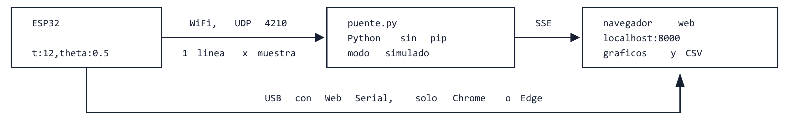

# Interfaz de telemetría (`gui_hmi/`)

Página web para ver en tiempo real las variables del Segway durante pruebas y operación: un gráfico
por variable, valor actual, pausa, cursor para leer valores, consola con los `Serial.println()` del
robot y grabación a CSV.



([vectorial](diagramas/arquitectura.svg), [fuente editable](diagramas/arquitectura.bob))

## Cómo correrla

Requisito: **Python 3.9 o más nuevo**, el mismo que ya usan para las figuras de `modelado/`. No hace falta
`pip install`, Node ni nada más.

```bash
python gui_hmi/puente.py --simular
```

Abrir <http://localhost:8000>. Con `--simular` el puente genera datos falsos (parecidos a un Segway
que oscila y recibe empujones) para probar la interfaz sin robot. Con el robot de verdad:

```bash
python gui_hmi/puente.py
```

y la compu tiene que estar en la misma red WiFi que el ESP32. La primera vez Windows pregunta si deja
pasar a Python por el firewall: aceptar **también en redes públicas**, porque la red que arma el ESP32
suele quedar clasificada como pública.

Opciones: `--http 8000` (puerto de la página), `--udp 4210` (puerto donde llegan los datos),
`--hz 100` (frecuencia de los datos simulados).

### Por USB, sin puente

Con el ESP32 enchufado por USB, la página puede leer el puerto serie directamente (Web Serial). Elegir
**USB directo** en el selector, la velocidad igual a `Serial.begin(...)` y **Conectar**. Solo anda en
Chrome o Edge (Firefox y Safari no tienen Web Serial). Sirve para el banco; con el robot equilibrando, el
cable estorba y conviene WiFi. El puente igual tiene que estar corriendo, porque es el que sirve la página.

**Hoy es el único camino con el robot real**: `firmware/segway_v01` todavía no tiene WiFi. Hay que cerrar
`idf.py monitor` antes, porque ocupa el puerto.

### Comandos

Al conectar aparece una barra con los comandos de texto de `segway_v01`
([lista](../firmware/segway_v01/README.md#consola)): **Desarmar** (también con **Esc** desde cualquier lado
de la página), **Armar**, **Parar motores**, **Calibrar**, **Leer parámetros**, **Encoders a cero**, casillas
de `kp`, `ki`, `kd` y `ref` que se mandan con `set` (y se llenan solas con la respuesta de `get`) y una
línea para cualquier otro comando. Lo enviado aparece en **Mensajes del robot** precedido de `>`.

Por USB los comandos van al puerto serie. Con el puente solo los entiende el robot simulado de
`--simular`, que imita la consola de `segway_v01` (CSV, estados, `arm`, `disarm`, `get`, `enc reset`,
`motor`: a 100 % las ruedas simuladas giran a 370 RPM con 880 cuentas por vuelta).
Esc no es una parada de emergencia: depende de que el cable y la página respondan.

### Motores a mano

El recuadro **Motores** tiene un deslizador por rueda, de −100 a 100 % de PWM (positivo hacia
adelante), y manda `motor`, `motor l` o `motor r`, como mucho 10 veces por segundo mientras se arrastra.
El firmware los aplica solo en `DISARMED` o `FAULT`, limitados por `umax` (por ejemplo,
`set umax 0.3` para probar con poco); en otro estado el recuadro se deshabilita.

- **juntos** (tildado de entrada): mover un deslizador mueve los dos.
- **mantener al soltar**: sin tildar, la rueda frena al soltar el deslizador (hay que mantenerlo
  apretado para que gire). Tildado, queda girando hasta mover el deslizador a 0, **Parar motores** o Esc.

El firmware no tiene tiempo de espera: aplica el último `motor` hasta que llega otro. Por eso la página
frena sola al soltar (sin "mantener"), al desconectar, al cambiar de pestaña o minimizar y al cerrarla.
**Si se corta el cable USB con la rueda girando, nadie la frena**: desconectar la alimentación de los
motores. Los comandos salen de a uno y en orden, así el `motor stop` del final nunca se pierde.

## Qué tiene que mandar el ESP32

Entiende dos formatos. El de `firmware/segway_v01` es **CSV con encabezado**: una línea
`# t_ms,estado,theta_deg,…` con los nombres y después una línea de valores por muestra. Las líneas que
empiezan con `#` van a la consola; las columnas de texto (`estado`) se muestran en la tabla y en la
barra de arriba sin graficarse. Si la página se conecta con el robot ya andando, manda `tlm on` para que
el firmware repita el encabezado (y además ya conoce las columnas de `segway_v01`).

El otro formato es una línea por muestra con pares `nombre:valor` separados por comas:

```text
t:123456,theta:0.52,dtheta:-3.10,u_izq:0.40,u_der:0.38,vbat:11.92
```

- Los nombres son libres: cada variable nueva aparece sola en la tabla. Las seis primeras se grafican
  de entrada y el resto se activa con un clic.
- `t` (o `t_ms`) es opcional: son los `millis()` del ESP32. Si está, el eje de tiempo es el del robot y no el de
  llegada a la compu, así que los retrasos de WiFi no deforman las curvas. Si `t` vuelve atrás (el ESP32
  se reinició), los gráficos se reinician.
- `nan` e `inf` se aceptan y se dibujan como un hueco.
- Una línea que no tiene ese formato (por ejemplo `Iniciando IMU... ok`) va a **Mensajes del robot**.
- Es el mismo formato que entiende el Serial Plotter del IDE de Arduino.

Ejemplo de firmware (Arduino core para ESP32). **No está probado en hardware**: es una referencia
para cuando se escriba `firmware/`.

```cpp
#include <WiFi.h>
#include <WiFiUdp.h>

WiFiUDP udp;
const uint16_t PUERTO_TELEMETRIA = 4210;

void setup() {
  Serial.begin(115200);
  WiFi.softAP("segway", "segway1234");  // el ESP32 arma su propia red; las compus se conectan a ella
}

// Llamar a ~50-100 Hz desde una tarea aparte, no desde el lazo de control.
void enviarTelemetria(float theta, float dtheta, float u_izq, float u_der) {
  char linea[160];
  int n = snprintf(linea, sizeof linea, "t:%lu,theta:%.3f,dtheta:%.3f,u_izq:%.3f,u_der:%.3f\n",
                   millis(), theta, dtheta, u_izq, u_der);
  udp.beginPacket(WiFi.softAPBroadcastIP(), PUERTO_TELEMETRIA);  // broadcast: la recibe toda la red
  udp.write((const uint8_t *)linea, n);
  udp.endPacket();
  Serial.write(linea, n);  // la misma línea sirve por USB
}
```

Como el paquete va por *broadcast*, varias compus pueden correr el puente a la vez y todas ven los
datos. Además, el puente acepta conexiones de la red: desde un celular conectado a la misma WiFi
alcanza con abrir `http://<ip-de-la-compu>:8000` (el puente imprime esa dirección al arrancar).

Cuidados del lado del robot:

- **La telemetría no puede frenar el control.** El lazo de 200 Hz va en su propia tarea (o núcleo) del
  ESP32 y la telemetría en otra, a menor frecuencia. Mandar algo por WiFi tarda un tiempo variable.
- Por USB, a 115200 baudios entran unas 11 500 letras por segundo: con 6-8 variables a 100 Hz no
  alcanza. Subir a 921600 en `Serial.begin` y en el selector de la página.
- UDP puede perder paquetes; para mirar curvas no importa, pero **no sirve como parada de emergencia**.

## Archivos

| Archivo | Qué hace |
|---|---|
| `puente.py` | Recibe UDP, genera datos simulados y sirve la página. Reenvía los datos al navegador con Server-Sent Events. Usa solo la biblioteca estándar |
| `web/index.html`, `web/estilo.css` | La página |
| `web/app.js` | Interpreta las líneas, guarda 60 s por variable, dibuja en `<canvas>`, lee USB y graba el CSV. No usa bibliotecas |
| `diagramas/` | Diagrama de arquitectura (`.bob` editable, `.svg`, `.png`) |

El CSV grabado tiene una columna `pc_ms` (hora de la compu, en ms desde 1970) y una columna por
variable, con las variables en el orden en que aparecieron. Se abre con `readtable` en MATLAB.

## Qué falta

- WiFi en el firmware, y que el puente reenvíe los comandos por UDP.
- Probar Web Serial con la placa real (lectura y comandos): verificado solo con `--simular`.
