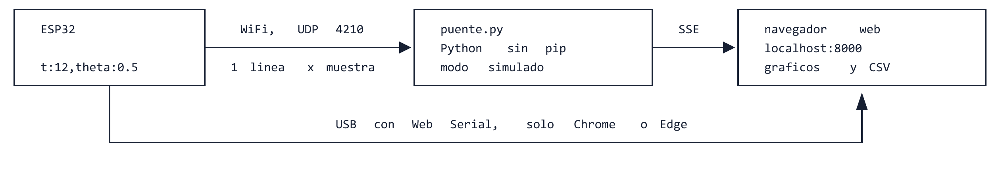
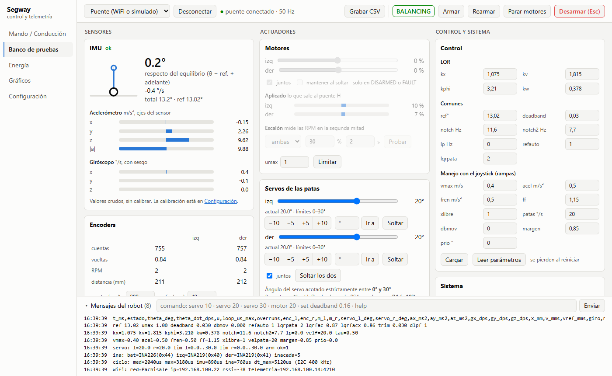

# Interfaz de telemetría (`gui_hmi/`)

Página web para probar el Segway y ver sus variables en tiempo real. Tiene tres secciones, que se
eligen en el menú lateral:

- **[Banco de pruebas](#banco-de-pruebas)**: cada sensor y cada actuador por separado, en tres grupos
  (sensores, actuadores, control y sistema). IMU cruda, encoders con RPM, motores a mano con prueba de
  escalón, servos de las patas, parámetros del control y estado del sistema.
- **Gráficos**: un gráfico por variable, valor actual, ventana, pausa y cursor para leer valores.
- **[Configuración](#configuración)**: lo que se ajusta una vez: comprobar la aplicación puente del
  joystick y calibrar la IMU.

Las tres comparten la barra de arriba (conexión, **Grabar CSV**, estado del robot, **Armar**, **Parar
motores** y **Desarmar**) y la de abajo (mensajes del robot y línea de comandos).



([vectorial](diagramas/arquitectura.svg), [fuente editable](diagramas/arquitectura.bob))

## Cómo correrla

Requisito: **Python 3.9 o más nuevo**, el mismo que ya usan para las figuras de `modelado/`. No hace falta
`pip install`, Node ni nada más. Para USB directo, **Chrome o Edge**.

### En un solo comando (Windows)

Desde la raíz del repo, o con doble clic en `gui_hmi/banco.cmd`:

| Comando | Qué hace |
|---|---|
| `gui_hmi\banco` | Puente + página + conexión USB automática |
| `gui_hmi\banco -Grabar` | Antes compila y graba `firmware/segway_v01` |
| `gui_hmi\banco -Simular` | Sin robot, con datos falsos |

- Abre la página en una ventana propia de Chrome o Edge, ya en **USB directo**.
- **La primera vez** hay que tocar **Conectar** y elegir el puerto de la placa. Desde ahí el navegador
  lo recuerda: al abrir la página o al enchufar la placa se conecta sola, sin diálogo.
- `-Grabar` activa ESP-IDF (instalación del instalador EIM en `C:\Espressif`), busca el puerto (el único
  que haya, o el del conversor CH343) y corre `idf.py build flash` en la misma carpeta `build/` que usa
  VS Code. Con varios puertos: `-Puerto COM5`. No abre el monitor, así que el puerto queda libre.
- Si ya hay un puente corriendo, abre la página y no levanta otro. Ctrl+C cierra el puente.

### A mano, en cualquier sistema

```bash
python gui_hmi/puente.py --simular
```

Abre <http://localhost:8000> (`--sin-navegador` para que no lo haga). Con `--simular` el puente
genera datos falsos (parecidos a un Segway que oscila y recibe empujones) para probar la interfaz sin
robot. Con el robot de verdad:

```bash
python gui_hmi/puente.py
```

Abre la página en **USB directo**. Para **WiFi**, la compu tiene que estar en la misma red que el robot
([red y puertos del firmware](../firmware/segway_v01/README.md#wifi)) y hay que elegir **Puente** en el
selector. El puente le dice `hola` al robot cada 1 s (por broadcast hasta conocer su IP), recibe la
telemetría en el puerto UDP 4210 y le reenvía los comandos de la página al 4211. La primera vez Windows
pregunta si deja pasar a Python por el firewall: aceptar, y **también en redes públicas** si la red quedó
clasificada así.

Opciones: `--http 8000` (puerto de la página), `--udp 4210` (puerto donde llegan los datos),
`--robot 192.168.0.57` (IP del robot, si la red no deja pasar el broadcast; el robot la imprime por el
cable al conectarse), `--hz 100` (frecuencia de los datos simulados).

### Por USB, sin puente

Con el ESP32 enchufado por USB, la página puede leer el puerto serie directamente (Web Serial). Elegir
**USB directo** en el selector, la velocidad igual a la del firmware (115200) y **Conectar**. Solo anda en
Chrome o Edge (Firefox y Safari no tienen Web Serial). Sirve para el banco; con el robot equilibrando, el
cable estorba y conviene WiFi. El puente igual tiene que estar corriendo, porque es el que sirve la página.

Hay que cerrar `idf.py monitor` antes, porque ocupa el puerto. Cable y WiFi andan a la vez: el robot
manda todo por los dos y acepta comandos de los dos.

### Comandos

Al conectar aparecen arriba a la derecha los comandos de seguridad de `segway_v01`
([lista](../firmware/segway_v01/README.md#consola)), visibles desde cualquier sección: **Armar**,
**Parar motores** y **Desarmar** (también con **Esc** desde cualquier lado de la página). Abajo, al lado
de **Mensajes del robot**, hay una línea para cualquier otro comando; lo enviado aparece en los mensajes
precedido de `>`. Los parámetros del control están en la tarjeta **Control** del
[banco de pruebas](#banco-de-pruebas), y recalibrar el giróscopo (`cal`), en [Configuración](#configuración).

Por USB los comandos van al puerto serie; con el puente, al robot por UDP (o al robot simulado de
`--simular`, que imita la consola de `segway_v01` (CSV con las mismas columnas, estados, `arm`, `disarm`,
`get`, `enc reset`, `set` de cualquier parámetro, que `get` devuelve; `motor`: a 100 % las ruedas
simuladas giran a 370 RPM con 880 cuentas por vuelta; `servo`: arrancan sueltos y se mueven a 90 °/s; la
IMU cruda sale del ángulo simulado). Armado, el ángulo oscila y recibe empujones; desarmado se aquieta,
como el robot apoyado, y así se puede probar la calibración de la IMU).
Esc no es una parada de emergencia: depende de que el cable (o la red) y la página respondan. Por WiFi,
UDP puede perder un `disarm`.

## Banco de pruebas



Para los ensayos de puesta en marcha (E-03 a E-06 del
[plan de electrónica](../electronica/ensayos/plan_de_ensayos.md), [prueba de encoders](../firmware/docs/prueba_encoders.md)).
Con el robot en `DISARMED` (o en `FAULT`, si no hay IMU) se mueve cada cosa a mano. Las tarjetas van en
tres columnas fijas (sensores, actuadores, control y sistema), así no saltan de lugar cuando cambia el
alto de alguna. Los valores se apagan si pasa más de 1 s sin datos.

(La captura es anterior al menú lateral.)

| Tarjeta | Qué muestra | Qué se puede hacer |
|---|---|---|
| **IMU** | En grande, la inclinación **respecto del equilibrio** (θ − `ref`, la que usa el control; `ref` se lee con `get`, que la página pide sola después de un `set` a mano) y si está dentro de los ±5° para armar; debajo, el ángulo total de la IMU y `ref`. Velocidad angular y un dibujo del robot; acelerómetro (m/s²) y giróscopo (°/s) **crudos, en los ejes del sensor y con sesgo**; \|a\|, que quieto tiene que dar 9,81. `sin lectura` si falla el I²C | — (la calibración está en [Configuración](#configuración)) |
| **Encoders** | Cuentas, vueltas, RPM y distancia de cada rueda | **Encoders a cero**; cargar las cuentas por vuelta (880 si el encoder es de 11 pulsos) y el radio de la rueda, que se recuerdan |
| **Motores** | El PWM **aplicado** de verdad a cada puente H, que puede ser menos que lo pedido por `umax` | Deslizadores (ver abajo); **escalón**; **umax** |
| **Servos de las patas** | Ángulo actual de cada servo, o `suelto` | Deslizador, pasos ±1/±5° una vez agarrado, **Ir a** un ángulo escrito y **Soltar**, todo dentro de los límites de `board_config.h` |
| **Control** | Los parámetros que devuelve `get`: controlador (PID o LQR), `kp ki kd`, `kx kv kphi kw`, `ref`, `deadband` y `notch` | **Cargar** manda un `set` por casilla y después `get`; **Leer parámetros** (`get`). Se piden solos al conectar y se pierden al reiniciar la placa; `lqr` vale desde el próximo `arm` |
| **Sistema** | Estado, tiempo encendido, muestras por segundo, ciclos excedidos y peor ciclo de control contra los 5000 µs del período | — |

Para orientar la IMU (paso 2 de la puesta en marcha): inclinar el robot hacia adelante tiene que
dar inclinación y °/s positivos. Si no, cambiar `IMU_AXIS_*` e `IMU_SIGN_*` en
[`board_config.h`](../firmware/segway_v01/main/board_config.h). El acelerómetro crudo dice qué eje
del sensor apunta hacia arriba (el que marca ~9,8) y el giróscopo, alrededor de cuál se cabecea.

**Escalón**: pone una o las dos ruedas al % pedido durante el tiempo pedido, frena y anota en la
tarjeta y en los mensajes las RPM medias de la **segunda mitad**, cuando la rueda ya aceleró. Sirve
para encontrar la zona muerta (subir el % hasta que gire) y para la curva PWM → velocidad del
ensayo E-04. Se corta al mover un deslizador, con **Parar motores**, **Desarmar**, Esc, al
ocultar la pestaña o si el robot sale de `DISARMED`/`FAULT`.

**Servos**: a diferencia de los motores, quedan donde se los deja, porque sostienen la pata. Se
mueven a cualquier ángulo (del servo, no de la pata) dentro de sus límites, cada uno por separado.
Los límites son `SERVO_L_MIN_DEG` … `SERVO_R_MAX_DEG` de
[`board_config.h`](../firmware/segway_v01/main/board_config.h): la página los lee de la placa al
conectar (respuesta de `get`), los muestra al lado de cada servo y no deja pasarlos con el
deslizador, los pasos ni **Ir a**. Si igual llega un pedido de afuera, el firmware lo rechaza sin moverse. Un servo no
informa dónde está: **suelto (al encender o después de Soltar) su posición es desconocida** y el
primer ángulo lo hace ir directo, a la velocidad del servo. Por eso, suelto, el deslizador manda el
ángulo una sola vez, al soltarlo, y los pasos ±1/±5 se habilitan recién cuando está agarrado. Ya
agarrado, se mueve a 90 °/s como máximo.

Las RPM (`rpm_l`, `rpm_r`) y \|a\| (`a_ms2`) los calcula la página y se agregan a cada muestra:
también aparecen en **Gráficos** y en el CSV grabado. Las RPM son la derivada de las cuentas en
0,2 s; con 880 cuentas por vuelta, una cuenta en esa ventana son 0,34 RPM.

### Motores a mano

La tarjeta **Motores** tiene un deslizador por rueda, de −100 a 100 % de PWM (positivo hacia
adelante), y manda `motor`, `motor l` o `motor r`, como mucho 10 veces por segundo mientras se arrastra.
El firmware los aplica solo en `DISARMED` o `FAULT`, limitados por `umax` (por ejemplo,
`set umax 0.3` para probar con poco); en otro estado el recuadro se deshabilita.

- **juntos** (tildado de entrada): mover un deslizador mueve los dos.
- **mantener al soltar**: sin tildar, la rueda frena al soltar el deslizador (hay que mantenerlo
  apretado para que gire). Tildado, queda girando hasta mover el deslizador a 0, **Parar motores** o Esc.

El firmware no tiene tiempo de espera: aplica el último `motor` hasta que llega otro. Por eso la página
frena sola al soltar (sin "mantener"), al desconectar, al cambiar de pestaña o minimizar y al cerrarla.
**Si se corta el cable USB con la rueda girando, nadie la frena**: desconectar la alimentación de los
motores. Los comandos salen de a uno y en orden, así el `motor stop` del final nunca se pierde.

## Configuración

Lo que se ajusta una vez, separado del banco para no tocarlo por error. Lo hace
[`web/configuracion.js`](web/configuracion.js). Nada de esta sección cambia el firmware.

### Joystick (aplicación puente)

El joystick de PS4 se conecta por Bluetooth a la laptop. Una **aplicación puente en la laptop** (todavía
no existe) lo lee y manda los comandos de movimiento al robot por WiFi. La tarjeta **Joystick** solo
comprueba que esa aplicación ande: mientras Configuración está a la vista, cada 2 s (cada 10 s si no
responde, y en el momento con **Comprobar**) le pide `GET <dirección>/estado`. La dirección, `http://localhost:8001` de entrada, se
recuerda. Muestra si la aplicación responde, si tiene el joystick conectado, a dónde está mandando y,
en **Prueba**, el avance y el giro que manda (para ver que la palanca llega).

Formato propuesto de la respuesta (todos los campos son opcionales; se puede cambiar cuando se escriba
la aplicación):

```json
{
  "joystick": { "conectado": true, "nombre": "Wireless Controller", "bateria": 80 },
  "robot":    { "conectado": true, "destino": "192.168.4.1:4211" },
  "mando":    { "avance": 0.25, "giro": -0.10 }
}
```

`avance` y `giro` van de −1 a 1. La página se sirve desde otro puerto, así que la aplicación tiene que
contestar con el encabezado `Access-Control-Allow-Origin: *`; si no, el navegador descarta la
respuesta y la tarjeta dice que no responde.

### Calibración de la IMU

Se hace una vez. La página la calcula con la **telemetría cruda que ya manda `segway_v01`** (columnas
`ax_ms2 … gz_dps` y `theta_deg`, en los ejes del sensor): promedios con el robot quieto. Cada medición
se descarta si el robot se movió (giróscopo con más de 1 °/s de desvío o acelerómetro con más de
0,15 m/s²); el indicador **quieto / en movimiento** del título avisa antes de medir.

| Paso | Cómo | Resultado |
|---|---|---|
| **Sesgo del giróscopo** | Quieto, en cualquier posición, 3 s | Sesgo de x, y, z en °/s y el ruido |
| **Acelerómetro, 6 posiciones** | Apoyarlo con cada eje del sensor hacia arriba y hacia abajo, 2 s cada una (la página detecta qué cara está arriba y rechaza si está inclinado más de 14°) | Por eje, con sus dos caras: offset = (arriba + abajo)/2 y escala = (arriba − abajo)/(2 g). El 29/10 \|a\| daba 10,31 (escala ~5 % alta) |
| **Cero de inclinación** | Sostenido en su punto de equilibrio, con las patas en la posición de uso, 3 s | θ₀ promedio. **Usar como ref** lo manda con `set ref` (vale desde ya, se pierde al reiniciar) |

El resultado queda en este navegador (`localStorage`) y **Copiar** lo pasa al portapapeles como texto y
JSON. **Guardar en la placa** está deshabilitado hasta que el firmware pueda guardarlo en la memoria no
volátil (NVS), que `idf.py flash` no borra (`idf.py erase-flash` sí). Mientras tanto, el firmware actual
sigue midiendo solo el sesgo de cabeceo al encender (2 s quieto); **Recalibrar (cal)** lo repite.

La telemetría trae el giróscopo con 0,1 °/s de resolución; el ruido del sensor hace que el promedio de
150 muestras resuelva por debajo, pero el firmware que guarde la calibración debería medir el sesgo él
mismo, a 200 Hz y con resolución completa.

## Qué tiene que mandar el ESP32

Entiende dos formatos. El de `firmware/segway_v01` es **CSV con encabezado**: una línea
`# t_ms,estado,theta_deg,…` con los nombres y después una línea de valores por muestra
([columnas](../firmware/segway_v01/README.md#consola); el banco de pruebas usa las que estén y deja
`—` en las que falten, así que un firmware viejo se sigue leyendo). Las líneas que
empiezan con `#` van a la consola; las columnas de texto (`estado`) se muestran en la tabla y en la
barra de arriba sin graficarse. Si la página se conecta con el robot ya andando, manda `tlm on` para que
el firmware repita el encabezado (y además ya conoce las columnas de `segway_v01`).

El otro formato es una línea por muestra con pares `nombre:valor` separados por comas:

```text
t:123456,theta:0.52,dtheta:-3.10,u_izq:0.40,u_der:0.38,vbat:11.92
```

- Los nombres son libres: cada variable nueva aparece sola en la tabla. Las seis primeras se grafican
  de entrada y el resto se activa con un clic.
- `t` (o `t_ms`) es opcional: son los `millis()` del ESP32. Si está, el eje de tiempo es el del robot y no el de
  llegada a la compu, así que los retrasos de WiFi no deforman las curvas. Si `t` vuelve atrás (el ESP32
  se reinició), los gráficos se reinician.
- `nan` e `inf` se aceptan y se dibujan como un hueco.
- Una línea que no tiene ese formato (por ejemplo `Iniciando IMU... ok`) va a **Mensajes del robot**.
- Es el mismo formato que entiende el Serial Plotter del IDE de Arduino.

Ejemplo de firmware (Arduino core para ESP32). **No está probado en hardware**: es una referencia
para cuando se escriba `firmware/`.

```cpp
#include <WiFi.h>
#include <WiFiUdp.h>

WiFiUDP udp;
const uint16_t PUERTO_TELEMETRIA = 4210;

void setup() {
  Serial.begin(115200);
  WiFi.softAP("segway", "segway1234");  // el ESP32 arma su propia red; las compus se conectan a ella
}

// Llamar a ~50-100 Hz desde una tarea aparte, no desde el lazo de control.
void enviarTelemetria(float theta, float dtheta, float u_izq, float u_der) {
  char linea[160];
  int n = snprintf(linea, sizeof linea, "t:%lu,theta:%.3f,dtheta:%.3f,u_izq:%.3f,u_der:%.3f\n",
                   millis(), theta, dtheta, u_izq, u_der);
  udp.beginPacket(WiFi.softAPBroadcastIP(), PUERTO_TELEMETRIA);  // broadcast: la recibe toda la red
  udp.write((const uint8_t *)linea, n);
  udp.endPacket();
  Serial.write(linea, n);  // la misma línea sirve por USB
}
```

Como el paquete va por *broadcast*, varias compus pueden correr el puente a la vez y todas ven los
datos. Además, el puente acepta conexiones de la red: desde un celular conectado a la misma WiFi
alcanza con abrir `http://<ip-de-la-compu>:8000` (el puente imprime esa dirección al arrancar).

Cuidados del lado del robot:

- **La telemetría no puede frenar el control.** El lazo de 200 Hz va en su propia tarea (o núcleo) del
  ESP32 y la telemetría en otra, a menor frecuencia. Mandar algo por WiFi tarda un tiempo variable.
- Por USB, a 115200 baudios entran unas 11 500 letras por segundo: con 6-8 variables a 100 Hz no
  alcanza. Subir a 921600 en `Serial.begin` y en el selector de la página.
- UDP puede perder paquetes; para mirar curvas no importa, pero **no sirve como parada de emergencia**.

## Archivos

| Archivo | Qué hace |
|---|---|
| `banco.cmd`, `banco.ps1` | Todo en un comando: grabar el firmware (opcional), puente y página |
| `puente.py` | Recibe UDP, genera datos simulados, sirve la página y la abre en Chrome o Edge. Reenvía los datos al navegador con Server-Sent Events. Usa solo la biblioteca estándar |
| `web/index.html`, `web/estilo.css` | La página |
| `web/app.js` | Interpreta las líneas, guarda 60 s por variable, dibuja en `<canvas>`, lee USB, manda comandos, motores a mano y graba el CSV. No usa bibliotecas |
| `web/banco.js` | Banco de pruebas: tarjetas de sensores y actuadores, columnas calculadas (RPM, \|a\|), escalón, servos, pedido de parámetros al conectar y menú lateral. Usa la conexión y `enviar()` de `app.js` |
| `web/configuracion.js` | Configuración: consulta a la aplicación puente del joystick y calibración de la IMU con la telemetría cruda |
| `diagramas/` | Diagrama de arquitectura (`.bob` editable, `.svg`, `.png`) |
| `capturas/` | Capturas de la página para esta documentación |

El CSV grabado tiene una columna `pc_ms` (hora de la compu, en ms desde 1970) y una columna por
variable, con las variables en el orden en que aparecieron. Se abre con `readtable` en MATLAB.

## Qué falta

- Probar el WiFi con la placa (firmware y puente verificados solo por separado: el puente contra un
  robot falso por UDP, el firmware compilado).
- La aplicación puente del joystick (PS4 por Bluetooth a la laptop, comandos al robot por WiFi), con
  `GET /estado` como en [Configuración](#joystick-aplicación-puente).
- Guardar la calibración de la IMU en la NVS de la placa y aplicarla (sesgo, offset y escala del
  acelerómetro, cero de inclinación); recién ahí se habilita **Guardar en la placa**.
- Rehacer la captura del banco de pruebas con el menú lateral (en esta PC no hay Chrome ni Edge).
- Probar Web Serial con la placa real (lectura y comandos): verificado solo con `--simular`.
- Probar el banco de pruebas con la placa: verificado solo con `--simular` (HMI-003).
- Tiempo de espera de los motores en el firmware: hoy, si se corta el cable con una rueda girando,
  nadie la frena.
