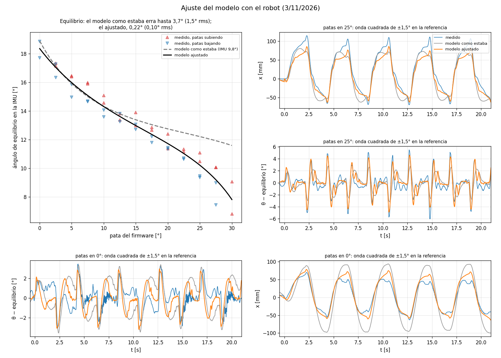

# Ajuste del modelo con el robot (3/11/2026)

Qué se corrigió del modelo con las pruebas del 3/11, de dónde sale cada cambio y qué tan seguro es.
Los valores nuevos están en la variante **`'ajustada'`** de
[`parametros_fisicos.m`](../parametros/parametros_fisicos.m) (al final, cada uno con el valor de
antes). La variante `'segunda_iteracion'` y todo lo que la usa quedaron como estaban.

## 1. Lo que se midió

Por WiFi, con el robot equilibrando en el piso, firmware del 3/11
([`sesion_placa.py`](../../firmware/herramientas/sesion_placa.py)):

| Prueba | Qué | Datos |
|---|---|---|
| `medir_equilibrio` | Ángulo de la IMU con el robot quieto, patas de 0 a 30° de a 2,5°, cuatro pasadas (dos subiendo y dos bajando): 48 mediciones de 12 s | [`equilibrio_patas_2026-11-03.csv`](../../firmware/docs/equilibrio_patas_2026-11-03.csv) |
| `identificar` | Onda cuadrada de ±1,5° en la referencia (2,08 s por nivel, 5 ciclos) con las patas en 25, 20, 10 y 0°: el robot va y viene ±60-80 mm y cabecea ±3-5° | [`onda_cuadrada_medida.csv`](onda_cuadrada_medida.csv) |
| `identificar` | Patas de 10 a 20° y de vuelta a 4, 16 y 30 °/s | `sesion_identificar_134323.csv` (sin versionar) |

La LiPo estaba en **11,9 V** (medido por el equipo).

## 2. Cómo se ajustó

**Estático** ([`ajustar_equilibrio.m`](ajustar_equilibrio.m)): quieto, el centro de masa de todo
queda sobre el eje de la rueda, así que la IMU marca `delta_imu + atan2(-cx, cz)` con `(cx, cz)`
el centro de masa respecto del eje. Se probaron las correcciones posibles, solas y combinadas,
contra el centro entre subiendo y bajando en cada altura:

| Corrección | IMU [°] | Caja x [mm] | Caja z [mm] | Cero de la pata [°] | Error rms / máx [°] |
|---|---:|---:|---:|---:|---|
| Como estaba (IMU 9,8) | 9,8 | 0 | 0 | 0 | 1,52 / 3,65 |
| Solo la IMU | 8,82 | 0 | 0 | 0 | 1,17 / 2,67 |
| IMU + caja adelante/atrás | 6,70 | −4,3 | 0 | 0 | 0,90 / 1,86 |
| IMU + cero de la pata | 8,27 | 0 | 0 | −1,86 | 1,06 / 2,37 |
| **IMU + caja adelante/atrás + cero de la pata** | **4,17** | **−19,3** | 0 | **+10,41** | **0,10 / 0,22** |
| IMU + caja (x, z) + cero de la pata | 0,18 | −41,3 | 42,8 | 10,38 | 0,09 / 0,18 (no físico) |

La curva medida es más empinada que la del modelo y se empina más cerca de 30°: eso solo lo
explica la pata más estirada de lo supuesto, que la acerca al punto muerto del cuatro barras.

**Dinámico**: la onda cuadrada se repitió en el simulador del escalón con el código C del firmware
(filtro de inclinación, odometría, LQR con rechaza banda y zona muerta, exactamente como estaba el
robot), [`banco_identificacion.c`](../../simulacion/escalon/banco_identificacion.c), y se buscó el
juego de parámetros que mejor sigue lo medido (grilla sobre el cero de la pata, el par del motor,
la zona muerta y la inercia). El mejor fue otra vez **la pata 10,4° más estirada**, con el motor
de 350 rpm y la zona muerta en 0,14; la inercia casi no cambia nada.

## 3. Qué cambió, punto por punto

| # | Parámetro | Antes | Ahora | De dónde sale | Seguridad |
|---|---|---|---|---|---|
| 1 | **Cero de la pata** (`pata_cero`): postura del modelo con la pata del firmware en 0 | 10° (supuesto) | **20,4°** | Curva de equilibrio y onda cuadrada (sobre todo con las patas en 0) | Media: **confirmar con una regla** (abajo) |
| 1b | Recorrido del servo en el modelo (`th`) | 320-350° (postura 10-40) | 309,5-339,7° (postura 20,4-50,4) | Consecuencia del 1 | Igual que el 1 |
| 2 | **Centro de masa de la caja** (`corr_caja`) | El del reparto estimado de los 542 g: 7,4 mm adelante de A | **19,3 mm más atrás** (11,9 mm detrás de A) | Curva de equilibrio | Media: no se sabe qué pieza; ¿la LiPo? |
| 3 | **Inclinación de la IMU** (`imu_delta_deg`) | 9,8° (sacado del modelo sin corregir) | **4,2°** | Curva de equilibrio, con 1 y 2 | Media (depende de 1 y 2) |
| 4 | **Motor de rueda** (`w_nl_motor_rpm`) | 300 rpm de salida (6000 en el rotor) | **350 rpm** (7000): Kt = Ke 14 % menor, par por voltio −14 %, contraelectromotriz −27 % | MED-005 (1,37 veces la velocidad por PWM del modelo), STEP «DC12V350RPM», onda cuadrada | Alta |
| 5 | Reductor (`N`) | 20 (nominal) | **20,43** | Encoder (FW-009) | Alta |
| 6 | Batería (`V_bat`) | 11,1 V (nominal) | **11,9 V**; con la caída del L298N de siempre (2,0 V) llegan 9,9 V al motor | Medido; la onda cuadrada pide 9,8 V | Alta |
| 7 | Zona muerta del motor (`zona_muerta_motor`, nuevo) | 0,17 de PWM (fijo en el banco) | **0,14** | Onda cuadrada (MED-005 en el aire: 0,17-0,19) | Media |
| 8 | Banda muerta del servo (`banda_servo_deg`, nuevo) | — | **0,27°** (3 µs del DS3240) | Ficha del DS3240 | Alta |

No cambió: la geometría de las barras, las masas medidas (barras, ruedas, motores, los 542 g de la
caja), la rueda, las inercias, el servo (par y velocidad), el contacto.

Con todo eso el modelo **reproduce la curva de equilibrio a 0,08° rms** (antes 1,5°) y la onda
cuadrada mejor en las cuatro alturas:

| Patas | Cabeceo rms, antes → ahora | x rms, antes → ahora |
|---:|---|---|
| 25° | 1,45° → 0,78° | 21,4 → 16,2 mm |
| 20° | 1,05° → 0,68° | 13,7 → 11,1 mm |
| 10° | 1,32° → 0,96° | 15,6 → 12,3 mm |
| 0° | 1,71° → 1,24° | 33,9 → 11,6 mm |

**Lo que el modelo no tiene:** la vibración de ~10-15 Hz que aparece con las patas en 0° (la
estructura, no es un cuerpo rígido), la histéresis de las patas (con las patas recién subidas el
equilibrio da ~0,9° más que recién bajadas: juego en la pata) y el golpe con que empezaron las tres
caídas en 30°.

### Para confirmar (cada una cierra un punto de la tabla)

1. **Regla, 2 minutos (punto 1):** altura del eje del servo (el tornillo del brazo) sobre el piso
   con el robot equilibrando. El modelo viejo da ~77 mm con las patas en 0° y ~184 mm en 30°; el
   ajustado, **~119 mm y ~218 mm**.
2. **Balanza (puntos 2 y 3):** el robot completo con la LiPo, y la LiPo sola con dónde va montada.
   Los 542 g de la caja se pesaron el 21/10, probablemente sin la LiPo.

## 4. El LQR recalculado

[`ganancias_ajustadas.m`](../../simulacion/segway_ajustado/ganancias_ajustadas.m): el mismo
criterio que las ganancias de hoy (Bryson con 8°, R ×64), con el modelo ajustado, en cada altura,
en unidades del firmware (`k = -K / 9,9 V`):

| Pata | kx | kv | kphi | kw | Amortiguamiento con las ganancias de hoy |
|---:|---:|---:|---:|---:|---:|
| 0 | 1,50 | 2,38 | 3,73 | 0,416 | 0,98 |
| 5 | 1,50 | 2,38 | 3,96 | 0,456 | 1,00 |
| 10 | 1,50 | 2,38 | 4,17 | 0,496 | 0,91 |
| 15 | 1,50 | 2,39 | 4,36 | 0,537 | 0,72 |
| 20 | 1,50 | 2,40 | 4,54 | 0,577 | 0,57 |
| 25 | 1,50 | 2,40 | 4,71 | 0,618 | 0,43 |
| 30 | 1,50 | 2,41 | 4,88 | 0,662 | **0,31** |

Hoy el firmware tiene 1,52 · 2,73 · 4,14 · 0,478 en todas las alturas (el LQR del modelo viejo
en la pata 15). Con las patas altas eso deja el lazo poco amortiguado: 0,31 en 30°, donde se cayó
tres veces el 3/11. En el simulador con la planta ajustada, la onda cuadrada de ±1,5° hace cabecear
al robot 6,2° (pata 0) a 11,1° (pata 30) con las ganancias de hoy, y **5,1-5,7° en todas las
alturas con las recalculadas**; una patada de 350 °/s lo inclina 8,5° a 14,8° contra 8,4° a 9,5°.
La propuesta es que el firmware tome kphi y kw de esta tabla según la pata (kx y kv casi no
cambian).

## 5. Las simulaciones del escalón con el modelo ajustado

[`simulacion/escalon`](../../simulacion/escalon/README.md), las cinco estrategias del 3/11 con
`-DPLANTA_AJUSTADA` (y con `GANANCIAS=ajustadas` para el LQR por altura):

| Estrategia | Modelo original | Ajustado, ganancias de hoy | Ajustado, LQR por altura |
|---|---|---|---|
| A. Agachado, 30° en el aire, 15° al tocar | Choca | Choca | Choca |
| B. Patas en 30° a 0,35 m/s | Choca | Choca | Choca |
| C. Salto (0 → 30° en el borde) | Choca | Choca | Choca |
| D. Patas en 30° a 0,55 m/s | Pasa, no frena en 25 cm | Se cae | Choca: se pasa al escalón siguiente |
| E. Igual que D, pisada larga | Queda parado a 30 cm | Se cae | Choca |

Con la geometría corregida ninguna estrategia funciona como se diseñó: la maniobra hay que
volver a ajustarla con este modelo (FW-016, rama `simulacion-caida`). Figuras:
[`resultados/ajustada/`](../../simulacion/escalon/resultados/ajustada/resumen_estrategias.png) y
[`resultados/ajustada_lqr/`](../../simulacion/escalon/resultados/ajustada_lqr/resumen_estrategias.png).

## 6. Las patas: ¿se pueden mover más despacio?

Sí: la velocidad es `velpata` (en vivo; el equipo usa 16 °/s). Pero el DS3240 no corrige errores
de menos de 3 µs (0,27°): por debajo de ~14 °/s avanza a saltitos de 0,27°. En la prueba, de 10 a
20° a 4, 16 y 30 °/s el robot no se cayó en ninguna; a 30 °/s los sacudones del acelerómetro
llegan hasta 4,6 m/s² (contra 2,2-2,8 a 4 y 16 °/s). Los saltos fuertes que se vieron en la medición
del equilibrio eran del script (escalones de 0,5° cada 0,25 s, cada uno a 16 °/s); ahora manda un
solo pedido por altura.

## 7. Dónde está cada cosa

- [`parametros_fisicos.m`](../parametros/parametros_fisicos.m): variante `'ajustada'`.
- [`ajustar_equilibrio.m`](ajustar_equilibrio.m), [`fig_ajuste.py`](fig_ajuste.py) → `fig_ajuste.png`.
- [`simulacion/segway_ajustado/`](../../simulacion/segway_ajustado/README.md): el **Simulink
  ajustado**, aparte del original (`simulacion/segway_completo`, sin cambios), y el LQR por altura.
- [`simulacion/escalon/`](../../simulacion/escalon/README.md): `exportar_planta_ajustada.m` →
  `planta_escalon_ajustada.h`, `banco_identificacion.c` (la réplica de la prueba) y los bancos con
  `-DPLANTA_AJUSTADA`.
