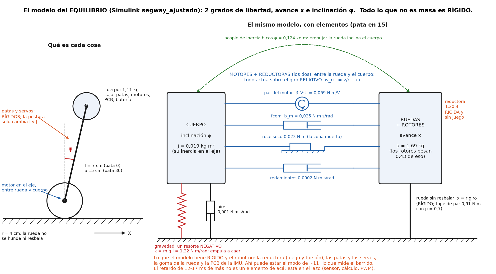
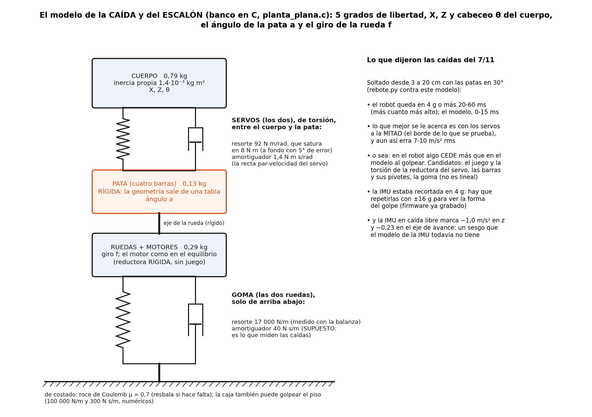
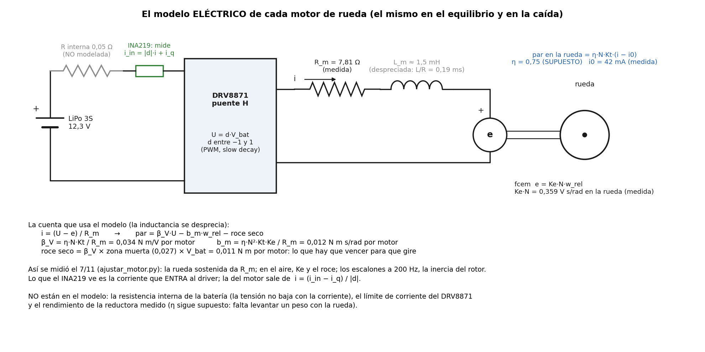

# El modelo del robot, con elementos: qué tiene, qué no y cómo seguir corrigiéndolo (9/11/2026)

Pedido de Joaquín: entender bien el modelo físico y el eléctrico para poder mejorarlo, y evaluar la idea de un
"controlador" que corrija los parámetros del modelo a medida que se hacen pruebas. Las figuras salen de
[`fig_modelo.py`](fig_modelo.py), con los números de la variante `'ajustada'` de
[`parametros_fisicos.m`](../parametros/parametros_fisicos.m) y de
[`planta_escalon_ajustada.h`](../../simulacion/escalon/planta_escalon_ajustada.h).

## 1. Son dos modelos, con el mismo motor

| | El del equilibrio | El de la caída y el escalón |
|---|---|---|
| Dónde | Simulink, [`simulacion/segway_ajustado/`](../../simulacion/segway_ajustado/) (`INICIAR_SEGWAY_AJUSTADO.m`) | C, [`simulacion/escalon/planta_plana.c`](../../simulacion/escalon/planta_plana.c) (`banco_escalon`) |
| Grados de libertad | 2: avance x e inclinación φ | 5: X, Z y cabeceo θ del cuerpo, ángulo de la pata a, giro de la rueda f |
| Para qué | diseñar y probar el LQR quieto o andando | bajar escalones, soltarlo y que caiga ([`rebote.py`](../../simulacion/escalon/rebote.py)) |
| La pata | rígida; la postura solo cambia l y la inercia (tablas) | la mueve el servo, que **cede** (resorte de torsión que satura) |
| La rueda contra el piso | rígida, sin resbalar | goma (resorte + amortiguador vertical) y roce de Coulomb de costado |
| El control | el del firmware en bloques: cada 5 ms, notch, zona muerta, un ciclo de retardo | el código C del firmware, con el filtro de 44 Hz de la IMU y 1 ms de cálculo |

## 2. El equilibrio (Simulink)

Dos inercias (el cuerpo y el conjunto ruedas + rotores) unidas por el motor, que actúa sobre el giro **relativo**
entre la rueda y el cuerpo, `w_rel = v/r − ω`. Por eso el mismo par empuja la rueda hacia adelante y el cuerpo
hacia atrás: es la única manija que tiene el control.

| Elemento | Valor (pata 15) | De dónde sale |
|---|---|---|
| Masa del cuerpo | 1,11 kg | 1208 g pesados el 7/11 menos las dos ruedas (los motores van en el cuerpo) |
| Inercia del cuerpo en el eje, j | 0,019 kg m² (0,010 en pata 0, 0,033 en 30) | CAD + piezas pesadas; el centro de masa ajustado a la curva de equilibrio |
| Masa equivalente de avance, a | 1,69 kg | el robot (1,21) + la inercia de las ruedas (0,05) + la de los **rotores (0,43)**: la reductora 1:20,4 hace que el rotor "pese" desde la rueda |
| Acople h cos φ | 0,124 kg m | m·l; si fuera cero, la rueda no podría inclinar el cuerpo |
| Gravedad, k = m g l | 1,22 N m/rad | un resorte **negativo**: cuanto más inclinado, más lo voltea (por eso es inestable) |
| Par del motor β_V | 0,069 N m/V (los dos) | R_m, Ke e i0 **medidos** con los INA219 el 7/11; η = 0,75 **supuesto** |
| Freno de la fcem b_m | 0,025 N m s/rad | ídem |
| Roce seco | 0,023 N m (los dos) | la zona muerta medida en el aire, 0,027 de PWM |
| Rodamientos, aire | 0,0002 y 0,001 N m s/rad | supuestos (chicos) |
| Tope de tracción | 0,91 N m | μ = 0,7 **supuesto** |

Lo que en este modelo es **rígido** y en el robot no: la reductora (tiene juego y se tuerce), las patas y los
servos, la goma de la rueda y la PCB donde va la IMU. Y no tiene el filtro de 44 Hz de la IMU.

## 3. La caída y el escalón (banco en C)

Una cadena de arriba abajo: cuerpo → servos (resorte de torsión + amortiguador) → pata (rígida, con la geometría
del cuatro barras en una tabla) → ruedas y motores → goma (resorte + amortiguador) → piso. El servo es un
control proporcional que llega a fondo con 5° de error: hasta ahí se comporta como un resorte de 92 N m/rad, y
después como un par constante de 8 N m (los dos). La goma se midió con una balanza (17 000 N/m las dos); su
amortiguamiento (40 N s/m) es **supuesto**: es lo que tenían que medir las caídas.

**Lo que dijeron las caídas del 7/11** (patas en 30°, desde 3 a 20 cm, 8 caídas):

- el robot queda en 4 g o más durante 20-60 ms (más cuanto más alto); el modelo, 0-15 ms;
- lo que más se le acerca es con los servos a la **mitad** de par, que es el borde de lo que se prueba, y aun así
  erra 7-10 m/s² rms: en el robot **algo cede más** que en el modelo (el juego y la torsión de la reductora del
  servo, las barras y sus pivotes, o la goma, que no es lineal);
- el acelerómetro estaba recortado en ±4 g (ya desde 3 cm) y el giróscopo en ±500 °/s (desde ~12 cm): el
  firmware ya está grabado con ±16 g y ±2000 °/s para repetirlas;
- en caída libre el acelerómetro marca (0,5; −0,23; −1,0) m/s² en vez de cero: un sesgo de 0,1 g en el eje
  vertical (por eso, quieto, mide 8,9 m/s² y no 9,8) y de −0,23 en el de avance. El modelo de la IMU no lo tiene;
  explica 1-1,5° del ángulo de equilibrio, que hoy absorbe `imu_delta_deg` (4,8°, provisorio).

## 4. El motor, eléctrico (el mismo en los dos)

Con la inductancia despreciada (L/R = 0,19 ms, contra un lazo de 5 ms) el motor queda en dos números:
`par = β_V·U − b_m·w_rel − roce seco`. Lo que falta: la resistencia interna de la batería (la tensión no baja al
pedir corriente), el límite de corriente del DRV8871 y el rendimiento de la reductora medido (levantar un peso
con la rueda).

## 5. Lo que el modelo no tiene, y cómo averiguar cuál falta

Hay dos tipos de error: un **parámetro** mal (el resorte está, pero su número no) y la **estructura** mal (falta
el resorte). Con parámetros no se arregla la estructura. Lo que hoy apunta a la estructura:

| Lo medido | Lo que no puede dar ningún parámetro del modelo actual | Candidatos | Cómo distinguirlos |
|---|---|---|---|
| Barrido del lazo: 12-17 ms de retardo de más (la fase cae con la frecuencia) | un retardo: el modelo rígido no lo tiene | el filtro de 44 Hz de la IMU (~5 ms, no está en Simulink), la lectura I2C, cuándo sale el PWM en el ciclo | bajar el filtro a 94 Hz y repetir el barrido (CTL-311, [plan](../../docs/gestion/2026-11-07-plan-retardo-modelo-lqr.md)) |
| Barrido: pico en ~11 Hz y antipico en ~12,5 Hz | un pico + antipico es una masa más con un resorte | la reductora del motor (el rotor tiene 8,5 veces la inercia de la rueda: un poco de juego o torsión ya hace un modo), las patas y el servo, la goma de costado, la PCB de la IMU | golpecitos con el robot sostenido, grabando a 200 Hz: si la frecuencia cambia con la pata son las patas; si cambia con la rueda en el aire o en el piso, la goma; si la ve la IMU y no el encoder, la PCB |
| Caídas: el golpe dura más que en el modelo | servos más blandos que "a la mitad" no deberían hacer falta | juego y torsión del servo, pivotes, goma no lineal | las caídas con ±16 g, con las patas en 30° y en 15° (si cambia con la pata, es el servo o las barras) |
| La IMU en caída libre no marca cero | — (es un sesgo, sí es un parámetro) | sesgo del acelerómetro | ya medido: agregarlo al modelo de la IMU |

### La pata que cede y el centro de masa (9/11)

**La pata que cede.** En el péndulo de Simulink la pata es rígida; en el banco en C el servo ya es un resorte
de torsión (92 N m/rad, **supuesto**: el servo a fondo con 5° de error) con su amortiguador. Cuenta gruesa con
esos números: el cuatro barras convierte el giro del servo en subir y bajar la rueda (~0,18-0,21 m por radián),
así que el servo, visto desde arriba, es un resorte de ~2100-2700 N/m; en serie con la goma (17 000 N/m) y con
~0,85-1,1 kg encima (el cuerpo, más la inercia de los servos), **el cuerpo rebota sobre las patas a ~7-8 Hz**:
la zona de la vibración de 8 Hz que hubo que sacar con el notch de 7,7 Hz. Puede ser casualidad (la rigidez es
supuesta), pero hay que medirla. Ponerla en el péndulo no es solo un resorte: es un grado de libertad más (la
altura del cuerpo sobre la pata), que se mezcla con la inclinación por la geometría del cuatro barras (con la
pata en 30° la rueda además se corre ~0,1 m por radián hacia adelante o atrás; en 0-15°, casi nada).

**El centro de masa nunca se midió directo.** Hoy sale de las piezas (CAD y lo pesado; el reparto de los 542 g
de la caja es estimado), de los 246 g que faltaban puestos en el centro de la cabina, y de `corr_caja`, que se
ajusta para que el modelo dé la curva de equilibrio medida con la IMU: el 3/11 (19,3 mm atrás), el 5/11 (24,7 mm
atrás y 8,2 mm abajo, con la carga). El 7/11, con las PCB, no se tocó: solo se reajustó la IMU (4,8°), y el error
pasó de 0,10° a 0,69° rms, señal de que algo no cierra. El problema de fondo: **la curva de equilibrio da la
dirección del centro de masa, no su altura**, y la inclinación de la IMU, el cero de la pata y la altura se
compensan entre sí (dejándolos libres, el 3/11 daba la caja 43 mm más arriba con la IMU en −0,9°, casi igual de
bien). Hay que medir cada uno por separado y usar la curva para verificar:

| Qué | Cómo | Lo que dice hoy el modelo (patas 0 / 15 / 30) |
|---|---|---|
| Altura del centro de masa **y** inercia del cuerpo | **Dejarlo caer** desarmado (los motores quedan libres) desde cerca del equilibrio hasta ~30°, con `grabar` (idea de Joaquín, 9/11). La gravedad sola da un cociente (lo que tira sobre lo que cuesta girarlo), y no separa altura de inercia; lo que las separa es la rueda: con las ruedas libres, mientras el cuerpo cae la rueda rueda para el otro lado, y cuánto por grado depende de m·l (con a ya medida). Además, caídas con las ruedas trabadas (un libro adelante y otro atrás), que dan otro cociente. Se ajusta simulando cada caída con el roce medido (en los primeros 3-5° el roce de la reductora es tan grande como lo que empuja la rueda). Alternativa: el robot acostado sobre un lápiz paralelo al eje, hasta que quede en equilibrio | todo el robot: 66 / 103 / 137 mm del eje (**106 / 143 / 177 mm del piso** equilibrando). En la pata 15 cae de 3° a 30° en ~0,18 s con las ruedas libres (λ ≈ 12,6 1/s) y ~0,29 s trabadas (λ ≈ 7,9 1/s) |
| **Medido el 10-11/11, patas en 30°, 1327 g** ([`ajustar_caidas.py`](ajustar_caidas.py), [figura](fig_caidas.png)) | 22 caídas sin motores con las ruedas trabadas y libres, y la prueba de inclinación con 286 g atrás y adelante (140 mm entre los dos). Las caídas trabadas dan λ = 6,74 1/s (péndulo equivalente de 216 mm); el peso corre el equilibrio +4,9° y −4,5° | **cuerpo (1,227 kg) a l = 140 mm del eje** (todo el robot: 130 mm del eje, 170 mm del piso); **inercia propia 0,0124 kg m²** (el modelo: 150 mm y 0,0072, con 1208 g). La comprobación: las tres tandas con peso dan la velocidad de caída medida con 1-1,4 % de error. Con las ruedas libres, en los primeros ~7° la reductora no patina y el robot cae entero pivotando en el piso. El peso arriba (243 g a 265 mm) no sirvió: quedó cerca de los 216 mm |
| Cero de la pata (`pata_cero`, 20,4°, ajustado y nunca confirmado) | Regla: altura del eje del servo sobre el piso con el robot equilibrando | 116 / 168 / 217 mm |
| Inclinación de la IMU (`imu_delta_deg`) | El robot con las aristas de la caja a plomo (nivel del celular) y anotar lo que marca la IMU | 4,8° (provisorio) |
| Rigidez del servo | Robot parado, desarmado y sostenido apenas de costado: poner 0,5-1 kg arriba y medir cuánto baja el eje del servo; y golpecitos grabando a 200 Hz para la frecuencia | ~2,1 mm con 0,5 kg en la pata 15 (y la banda muerta del servo, 0,27°, ya son ~0,9 mm) |

## 6. La idea: un "controlador" que corrija el modelo con cada prueba

**Existe y se usa mucho.** Se llama **identificación de sistemas**, y en particular **estimación de parámetros de
caja gris**: la estructura sale de la física (estas figuras) y los números se ajustan para que la simulación,
con las mismas entradas que tuvo el robot, dé lo mismo que se midió. En la industria se habla de calibrar el
**gemelo digital** o de **actualizar el modelo** (en estructuras, *model updating*). Hay dos versiones:

- **Por lotes (offline)**: se juntan los ensayos y un optimizador busca los parámetros que mejor siguen a
  **todos** a la vez. Es lo que ya se hizo por partes: [`ajustar_motor.py`](ajustar_motor.py) (el motor),
  [`ajustar_equilibrio.m`](ajustar_equilibrio.m) (centro de masa e IMU), [`ajustar_onda.py`](ajustar_onda.py) (el
  lazo), [`rebote.py`](../../simulacion/escalon/rebote.py) (goma y servos), [`identificar_lazo.py`](identificar_lazo.py)
  (la respuesta en frecuencia). En MATLAB está hecho: **Simulink Design Optimization → Parameter Estimator**
  (`sdo.estimate`) ajusta parámetros de bloques de un modelo de Simulink contra señales medidas; y el **System
  Identification Toolbox** (`greyest`, `nlgreyest`). Las dos están instaladas.
- **En línea (online)**: el robot estima mientras anda, con mínimos cuadrados recursivos o un filtro de Kalman
  extendido que trata los parámetros como estados. Si además rediseña el control con lo estimado, es **control
  adaptativo** (regulador autoajustable). Sirve para lo que cambia despacio (la batería, el roce, una carga), no
  para encontrar lo que le falta al modelo, y adaptar dentro del lazo puede desestabilizarlo.

Para este robot conviene la de **por lotes**, con una regla: el optimizador mira todos los ensayos juntos (si
persigue el último, empeora los anteriores) y se valida con ensayos que no usó para ajustar.

**Y la intuición es correcta: primero la estructura, después los parámetros.** Las señales de que lo que falta es
estructura:

1. el mejor valor queda en el **borde** de lo permitido (los servos a la mitad en las caídas);
2. ensayos distintos piden **valores distintos** del mismo parámetro;
3. el error que queda tiene forma (una oscilación de 11 Hz, una fase que crece con la frecuencia), no es ruido;
4. el valor que da es físicamente imposible;
5. lo medido tiene algo que ninguna combinación de parámetros produce (un par pico-antipico pide una masa y un
   resorte más; una fase que cae proporcional a la frecuencia pide un retardo).

Por eso el camino es: proponer elementos candidatos (sección 5), agregarlos de a uno, ajustar, y quedarse con el
que explica **varios** ensayos con valores razonables y mejora los de validación, cuidando no agregar parámetros
que nada mide.

## 7. Cómo seguir

1. Golpecitos para ubicar el modo de 11 Hz (con la pata en 0 y en 30, ruedas en el piso y en el aire).
2. Las caídas con ±16 g, patas en 30° y en 15°.
3. El filtro de la IMU a 94 Hz y repetir el barrido (CTL-311).
4. Con lo que salga, agregar al modelo el retardo y el elemento que falte, y armar el ajuste conjunto: un
   catálogo de ensayos (archivo, qué se hizo, qué parámetros informa) y un costo sobre todos, con el banco en C
   (rápido: 56 simulaciones en 3 s) o con Parameter Estimator sobre el Simulink.
