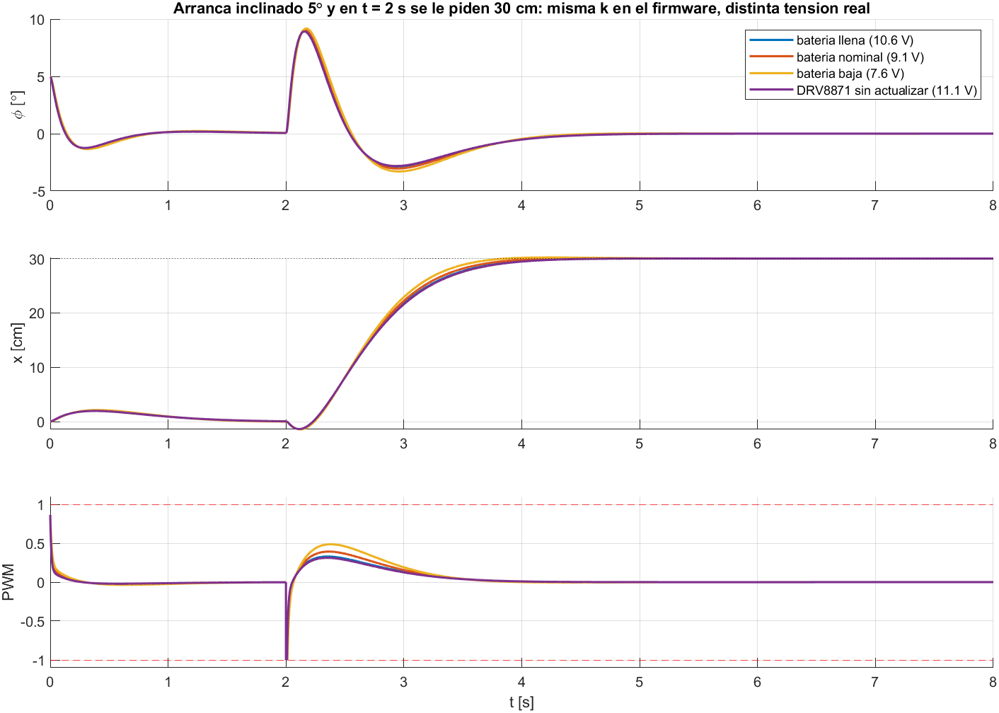

# Ganancias del LQR para el firmware

Generado por [`ganancias_para_el_firmware.m`](../ganancias_para_el_firmware.m) el 2026-10-29 10:33, MATLAB 23.2.0.2485118 (R2023b) Update 6.

Ley del firmware: `u = kx*x + kv*v + kphi*phi + komega*omega`, con u en fraccion de PWM (-1 a 1), todo positivo hacia adelante y phi = inclinacion de la IMU menos `ref`.

K del modelo: [-55.50 -53.12 -90.17 -11.44] V por (m, m/s, rad, rad/s), postura 25 grados.

| Ganancia | 21/10 (11,1 V) | Hoy, sin caida (11,1 V) | **Hoy, L298N (9.1 V)** |
|---|---|---|---|
| kx [1/m] | 5.000 | 5.000 | **6.099** |
| kv [1/(m/s)] | 4.760 | 4.785 | **5.837** |
| kphi [1/rad] | 8.170 | 8.123 | **9.909** |
| komega [1/(rad/s)] | 1.040 | 1.030 | **1.257** |

Cambio del modelo desde el 21/10: +0.0 %, +0.5 %, -0.6 % y -0.9 %. La caida de 2.0 V del L298N sube las cuatro un 22 %.

Lazo muestreado (5 ms, un paso de retardo, velocidad filtrada a 20 Hz): estable si la tension real dividida la supuesta esta entre **0.23 y 1.44**.

| Escenario en Simulink | V real | g | Radio espectral | Se recupera hasta | 30 cm: llega en | Error final |
|---|---|---|---|---|---|---|
| bateria llena | 10.6 V | 1.16 | 0.9858 | 40 grados | 1.78 s | 0.00 mm |
| bateria nominal | 9.1 V | 1.00 | 0.9860 | 35 grados | 1.67 s | 0.00 mm |
| bateria baja | 7.6 V | 0.84 | 0.9865 | 29 grados | 1.53 s | 0.00 mm |
| DRV8871 sin actualizar | 11.1 V | 1.22 | 0.9857 | 41 grados | 1.81 s | 0.00 mm |

El firmware corta a 30 grados (`TILT_LIMIT_DEG`): lo que pase de ahi es margen.

Alcance: planta no lineal con motor, bateria y agarre (pendulo_invertido_lqr.slx), control continuo con el estado exacto. El muestreo, el retardo y el filtro entran solo en el radio espectral (lineal). No estan la zona muerta del motor, el filtro complementario ni la cuantizacion del encoder: eso lo prueba el banco del codigo C del firmware.
