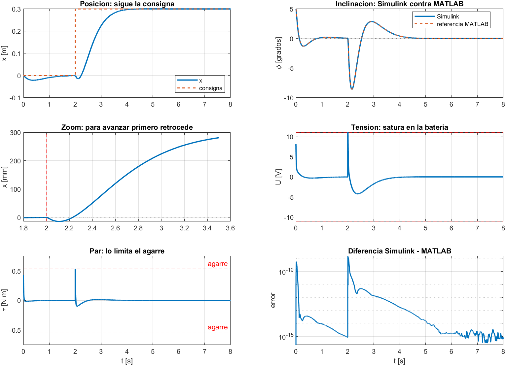

# Pendulo invertido con motor y LQR en Simulink

- MATLAB 23.2.0.2485118 (R2023b) Update 6. Variante `segunda_iteracion`, postura 25 grados, rotor: true.
- Modelo `pendulo_invertido_lqr.slx`, generado por `construir_pendulo_simulink.m`, solo bloques nativos.
- Motor: GA25-370 12V 1:20 (300 rpm en vacio) con encoder de cuadratura, 11 PPR en el rotor.

| Magnitud | Valor |
|---|---:|
| Polo inestable a lazo abierto | 7.38 1/s (duplica cada 94 ms) |
| K (V por m, m/s, rad, rad/s) | [55.5, 54.8, -93.5, -11.7] |
| Polos a lazo cerrado | [-94.83 -7.16 -2.67-1.13i -2.67+1.13i] |
| Par de bloqueo del motor | 0.587 N m (17.8 N en el piso) |
| Par que el piso transmite | 0.539 N m (16.3 N) |
| Velocidad maxima | 1.01 m/s |
| Se corre del lugar estando quieto | 21.4 mm |
| Consigna de posicion | 0.30 m |
| Retroceso antes de avanzar | 13.9 mm |
| Tiempo en llegar al 98 % | 1.84 s |
| Tension pico | 11.10 V de 11.1 |
| Error Simulink vs MATLAB (phi) | 1.96e-11 rad |
| Rodadura valida | true |

